## PHẦN A: XÁC ĐỊNH VẤN ĐỀ

Theo Tổ chức Y tế Thế giới, đến năm 2050 có gần 2,5 tỷ người sống với một mức độ suy giảm thính lực, trong đó ít nhất 700 triệu người cần dịch vụ phục hồi chức năng [1]. Tại Việt Nam, tỷ lệ khuyết tật ở người từ 2 tuổi trở lên năm 2023 là 6,11% [2]. Ngân hàng Thế giới ước tính Việt Nam có khoảng 116.000 trẻ em Điếc, và phần lớn các em chỉ dựa vào đọc khẩu hình hoặc máy trợ thính [3].

Ngôn ngữ ký hiệu là cầu nối tự nhiên của cộng đồng Điếc, nhưng người nghe hiếm khi biết ngôn ngữ này. Vì vậy, các việc hằng ngày như đi khám bệnh, đến ngân hàng hay làm thủ tục hành chính thường phải có phiên dịch hoặc người thân đi cùng. Dự án QIPEDC đã xây dựng kho khoảng 4.000 ký hiệu và 150 bài giảng video cho bậc tiểu học [3]. Tuy nhiên, đây là nguồn tài liệu để tra cứu và học, chưa giúp hai bên trao đổi trực tiếp với nhau.

Trong khi đó, các công cụ hiện có đều có giới hạn. Phiên dịch viên chính xác nhất nhưng không phải lúc nào cũng có và chi phí cao. Găng tay cảm biến cần phần cứng riêng và khó thu được vị trí tay so với khuôn mặt. Các ứng dụng nhận diện chữ cái buộc người dùng phải đánh vần từng chữ. Với ngôn ngữ ký hiệu tiếng Việt, các nghiên cứu ở cấp từ còn ít, và hầu như chưa có công trình đi từ mô hình đến một sản phẩm chạy được bằng webcam thông thường.

Từ thực tế đó, nhóm đặt ra bài toán: **xây dựng hệ thống nhận diện ngôn ngữ ký hiệu tiếng Việt ở cấp từ, chỉ cần một webcam và máy tính thường, hiển thị từ nhận được thành chữ để người nghe hiểu người Điếc.** Sản phẩm hướng tới các trao đổi ngắn trong đời sống và không nhằm thay thế phiên dịch viên trong các tình huống quan trọng.

Ý nghĩa của đề tài:

- **Kinh tế:** giảm phụ thuộc vào phiên dịch trong các trao đổi ngắn. Sản phẩm chạy trên máy tính có sẵn nên chi phí triển khai thấp, và có thể đóng gói cho quầy dịch vụ, bệnh viện, ngân hàng hay trường chuyên biệt.
- **Xã hội:** mở thêm một kênh giao tiếp giữa người Điếc và người nghe, đồng thời hỗ trợ người thân và giáo viên học ký hiệu.
- **Môi trường:** là phần mềm chạy trên thiết bị sẵn có, xử lý ngay trên máy nên không cần thêm phần cứng hay máy chủ.
- **Quyền riêng tư:** sau bước trích khung xương, mô hình chỉ làm việc với toạ độ khớp, không cần gửi hay lưu hình ảnh khuôn mặt.
- **Khoa học:** cung cấp phép so sánh có hệ thống giữa nhiều kiến trúc trên cùng dữ liệu tiếng Việt, kèm đánh giá trên video khác nguồn.

## PHẦN B: NGHIÊN CỨU ĐỀ XUẤT GIẢI PHÁP

### I. Mục tiêu, phương pháp nghiên cứu

#### 1. Mục tiêu nghiên cứu

##### 1.1. Xây dựng và so sánh các mô hình phân loại ký hiệu

- Phân loại ký hiệu cấp từ (gloss) từ chuỗi khung xương 76 điểm trích bằng MediaPipe.
- So sánh có hệ thống bảy họ mô hình trên cùng dữ liệu và cùng cấu hình huấn luyện: mạng thời gian MS-TCN, các mạng đồ thị ST-GCN, CTR-GCN, AAGCN, Transformer, và hai hướng cải tiến của nhóm là MultiRate-Attn-STGCN và AnchorGCN.

##### 1.2. Xây dựng sản phẩm thử nghiệm

- Ứng dụng máy tính dùng webcam, tự tách từng ký hiệu trong luồng video và hiển thị từ nhận được cùng độ tin cậy.
- Mô hình đủ nhẹ để chạy trên CPU, không cần GPU khi sử dụng.

##### 1.3. Đánh giá khả năng ứng dụng thực tế

Đề tài trả lời bốn câu hỏi nghiên cứu:

- **CH1.** Mô hình đồ thị có vượt được mô hình chỉ dùng thông tin thời gian không, và chênh lệch có đáng so với chi phí tính toán?
- **CH2.** Các điểm chân có giúp phân loại không, hay nên bỏ để giảm nhiễu?
- **CH3.** Vì sao một số cặp ký hiệu hay bị nhầm, và thông tin tay so với mặt, mô hình đa tốc độ hay tổ hợp mô hình có giảm được các lỗi đó không?
- **CH4.** Mô hình giữ được bao nhiêu năng lực khi chuyển sang video từ nguồn khác?

#### 2. Phương pháp nghiên cứu

##### 2.1. Phương pháp nghiên cứu lí thuyết

- Tìm hiểu cấu tạo của ký hiệu trong ngôn ngữ ký hiệu và các hướng nhận diện: dựa trên ảnh, dựa trên tư thế và đa phương thức [4][5][6].
- Nghiên cứu các mô hình đồ thị cho chuỗi khung xương [7][8][12][20], mạng thời gian [9], Transformer trên tư thế [21] và mô hình đa tốc độ [22].
- Tìm hiểu bộ dữ liệu VSL400 [18][19], nguồn video QIPEDC [17] và các nghiên cứu cho ngôn ngữ ký hiệu tiếng Việt [13][15][16].

##### 2.2. Phương pháp thực nghiệm

- Trích khung xương cho toàn bộ video, chuẩn hoá và huấn luyện từng mô hình trên GPU đám mây.
- Thí nghiệm cắt bỏ: mỗi mô hình chạy với hai bộ điểm (J = 68 bỏ chân, J = 76 giữ chân). Các biến thể cải tiến chỉ thay một yếu tố mỗi lần.
- Chấm lại mọi mô hình trên tập kiểm tra và trên video khác nguồn bằng cùng một quy trình.

##### 2.3. Phương pháp phân tích và đánh giá kết quả

- Dùng nhiều nhóm chỉ số: độ chính xác (Top-1, Top-5, Macro-F1), khả năng tổng quát, độ tin cậy, tốc độ.
- Ước lượng khoảng tin cậy 95% bằng bootstrap để biết chênh lệch nào có ý nghĩa.
- Phân tích ma trận nhầm lẫn, rồi xem lại video của các cặp hay nhầm để giải thích nguyên nhân.

### II. Kiến thức nền

#### 1. Kiến thức về ngôn ngữ ký hiệu

Ngôn ngữ ký hiệu là một ngôn ngữ hoàn chỉnh, có từ vựng và ngữ pháp riêng, không phải là cách diễn đạt tiếng nói bằng tay [4]. Mỗi ký hiệu ở cấp từ được tạo nên từ nhiều thành phần diễn ra cùng lúc:

| Thành phần | Mô tả | Ví dụ ảnh hưởng đến nhận diện |
|---|---|---|
| Hình dạng bàn tay | Các ngón duỗi, gập, chụm hay xoè | Hai ký hiệu cùng vị trí nhưng khác hình dạng tay |
| Vị trí | Nơi bàn tay đặt: trước ngực, cạnh má, trước mũi… | Tay đặt ở má hay ở thái dương làm thay đổi nghĩa |
| Chuyển động | Hướng, biên độ và nhịp chuyển động của tay | Cùng tư thế nhưng chuyển động nhanh hay chậm |
| Hướng lòng bàn tay | Lòng bàn tay ngửa, úp, hướng vào hay hướng ra | Thay đổi nhỏ, khó thấy trên khung xương |
| Yếu tố không dùng tay | Nét mặt, khẩu hình, tư thế đầu và thân | Gần như không có trong bộ điểm của đề tài |

*Bảng 1. Các thành phần tạo nên một ký hiệu*

Vì nghĩa của ký hiệu phụ thuộc vào cả năm thành phần, một hệ thống chỉ nhìn bàn tay hoặc chỉ nhìn một khung hình sẽ dễ nhầm. Đề tài vì vậy mô tả mỗi ký hiệu bằng toàn bộ thân trên và hai bàn tay theo thời gian.

#### 2. Kiến thức tin học: video số và ước lượng tư thế

##### 2.1. Video số

Video là một dãy ảnh tĩnh, gọi là khung hình, phát liên tiếp. Dữ liệu của đề tài có 25 khung mỗi giây, mỗi khung là ảnh vuông 224×224 điểm ảnh. Một ký hiệu dài trung bình 2,61 giây [19], tức khoảng 65 khung. Hình 1 cho thấy một ký hiệu như vậy: người ký đưa tay lên, giữ ở vị trí đặc trưng, rồi hạ tay về tư thế nghỉ.

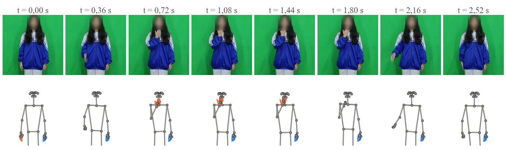

*Hình 1. Ký hiệu "Anh" trong VSL400: ảnh gốc theo thời gian (hàng trên) và khung xương tương ứng (hàng dưới). Ảnh từ bộ dữ liệu VSL400 [19], vùng mặt đã được khử nhận dạng*

Từ Hình 1 có thể thấy hai điều quan trọng. Thứ nhất, thông tin của ký hiệu nằm trong **sự thay đổi theo thời gian**: chỉ nhìn khung đầu hoặc khung cuối thì mọi ký hiệu đều giống nhau, vì người ký đang ở tư thế nghỉ. Thứ hai, khung xương giữ lại được tư thế và chuyển động mà bỏ đi phông nền, quần áo và khuôn mặt.

##### 2.2. Ước lượng tư thế bằng MediaPipe

MediaPipe là thư viện mã nguồn mở của Google, ước lượng vị trí các khớp cơ thể từ ảnh màu thông thường. Mô-đun Pose tìm 33 điểm trên cơ thể và mặt [11], mô-đun Hands tìm 21 điểm trên mỗi bàn tay [10]. Đề tài thêm điểm cổ (trung điểm hai vai), tạo thành bộ **76 điểm**, mỗi điểm có ba toạ độ *(x, y, z)*: *x* và *y* là vị trí trong ảnh, chuẩn hoá về khoảng 0–1, còn *z* là độ sâu tương đối.

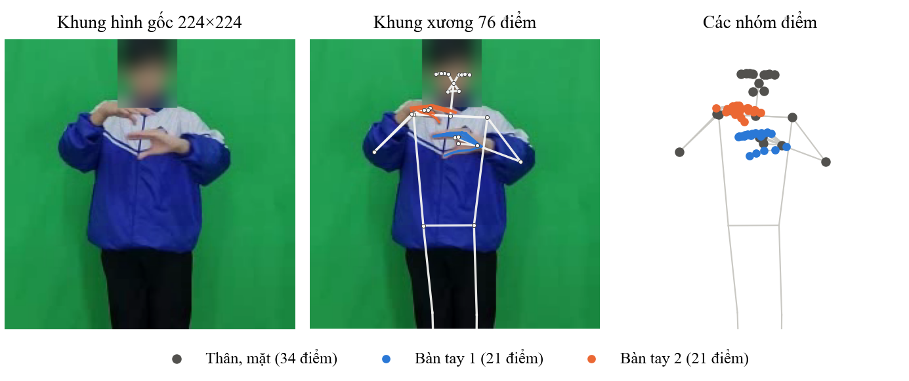

*Hình 2. Một khung hình của ký hiệu "Bánh chưng": ảnh gốc, khung xương chồng lên ảnh, và ba nhóm điểm. Ảnh từ bộ dữ liệu VSL400 [19]*

MediaPipe chạy được thời gian thực trên máy tính thường, nhưng không hoàn hảo. Khi bàn tay di chuyển nhanh, bị che, hoặc nằm chồng lên khuôn mặt, bộ tìm bàn tay có thể không thấy tay. Nhóm đã đo trên toàn bộ tập test: **trong các khung có cổ tay giơ cao hơn vai, bàn tay không được nhận ra ở 29% số khung.** Đây là một nguyên nhân quan trọng của các lỗi nhầm được phân tích ở Phần D.

#### 3. Kiến thức toán học

##### 3.1. Vector, ma trận và tensor

Mỗi điểm khớp là một vector toạ độ. Một khung hình là ma trận 76 × 3, và một clip *T* khung là một tensor ba chiều *T* × 76 × 3. Mô hình nhận thêm một kênh thứ tư là cờ hợp lệ (bằng 1 nếu điểm được nhận ra, bằng 0 nếu mất), nên đầu vào có kích thước *T* × *J* × 4.

##### 3.2. Phép tịnh tiến và co giãn để chuẩn hoá

Cùng một ký hiệu, người đứng gần camera trông to hơn, người đứng lệch sang phải thì toạ độ lớn hơn. Để mô hình không bị ảnh hưởng bởi những khác biệt này, toạ độ được **tịnh tiến** về gốc là trung điểm hai vai, rồi **chia** cho độ rộng vai. Sau phép biến đổi, mọi người ký đều có vai rộng 1 đơn vị và trung điểm vai ở gốc (0, 0). Công thức cụ thể ở mục C.II.2.

##### 3.3. Nội suy tuyến tính

Các clip dài ngắn khác nhau, nhưng mô hình cần đầu vào có số khung cố định *T* = 64. Nội suy tuyến tính ước lượng giá trị tại một thời điểm nằm giữa hai khung đã biết *ti* và *ti+1*: *x(t) = (1 − α)·xi + α·xi+1*, với *α* là vị trí tương đối của *t* giữa hai khung. Cách này giữ được hình dạng chuyển động khi kéo giãn hoặc nén clip.

##### 3.4. Xác suất và thống kê

- **Softmax** biến các điểm số đầu ra của mô hình thành xác suất cho từng gloss, có tổng bằng 1. Xác suất lớn nhất được dùng làm **độ tin cậy** của dự đoán.
- **Trung bình và trung vị:** trung vị ít bị ảnh hưởng bởi giá trị ngoại lai hơn trung bình, nên được dùng khi đo độ rộng vai và thời gian chạy.
- **Bootstrap:** lấy mẫu có hoàn lại từ tập kiểm tra 1.000 lần và tính lại chỉ số mỗi lần. Khoảng chứa 95% các giá trị là **khoảng tin cậy 95%**. Nếu khoảng tin cậy của hai mô hình chồng lên nhau nhiều, chưa thể kết luận mô hình nào tốt hơn.

#### 4. Kiến thức học máy và học sâu

##### 4.1. Nơ-ron nhân tạo và mạng nơ-ron

Một nơ-ron nhân tạo nhận các giá trị đầu vào *x*, nhân với trọng số *w*, cộng độ lệch *b* rồi đưa qua hàm kích hoạt: *y = f(w·x + b)*. Hàm kích hoạt phổ biến là ReLU, *f(z) = max(0, z)*. Ghép nhiều lớp nơ-ron nối tiếp nhau tạo thành mạng nơ-ron sâu. Các lớp đầu học đặc trưng đơn giản (ví dụ vị trí một khớp), các lớp sau kết hợp chúng thành đặc trưng phức tạp (ví dụ một kiểu chuyển động của bàn tay).

##### 4.2. Huấn luyện mạng nơ-ron

Huấn luyện là quá trình điều chỉnh trọng số để mô hình dự đoán đúng hơn:

1. Mô hình dự đoán xác suất cho một nhóm clip (một **batch**).
2. **Hàm mất mát** đo mức sai. Đề tài dùng cross-entropy: mất mát càng lớn khi xác suất của nhãn đúng càng nhỏ (công thức (3), mục C.III).
3. **Lan truyền ngược** tính đạo hàm của mất mát theo từng trọng số.
4. **Bộ tối ưu** (SGD hoặc AdamW) dịch trọng số một bước nhỏ, gọi là tốc độ học, theo hướng làm giảm mất mát.

Một lượt đi qua toàn bộ dữ liệu huấn luyện gọi là một **epoch**. Đề tài huấn luyện mỗi mô hình 70 epoch.

##### 4.3. Học khớp và các kỹ thuật chống học khớp

Mô hình có thể "học thuộc" dữ liệu huấn luyện mà không học được quy luật chung, gọi là **học khớp** (overfitting). Dấu hiệu là điểm trên tập huấn luyện rất cao nhưng điểm trên tập kiểm tra thấp hơn nhiều. Vì vậy dữ liệu được chia thành tập huấn luyện và tập kiểm tra gồm các clip khác nhau. Đề tài dùng các kỹ thuật:

- **Tăng cường dữ liệu:** tạo thêm biến thể của clip bằng cách cắt, co giãn, xoay, thêm nhiễu.
- **Label smoothing:** không ép mô hình tin 100% vào nhãn đúng, giúp độ tin cậy hợp lý hơn.
- **EMA:** dùng trung bình trượt của trọng số qua các bước, cho mô hình ổn định hơn.
- **Weight decay:** phạt trọng số quá lớn.

#### 5. Mạng nơ-ron tích chập và mạng thời gian

Phép tích chập trượt một bộ lọc nhỏ dọc theo dữ liệu và tính tổng có trọng số tại mỗi vị trí. Với chuỗi khung xương, **tích chập thời gian** trượt dọc trục thời gian nên phát hiện được các mẫu chuyển động ngắn, ví dụ "tay đi lên rồi dừng". **MS-TCN** dùng nhiều tầng tích chập thời gian giãn [9]: bộ lọc nhìn các khung cách nhau xa dần, nên vùng nhìn mở rộng nhanh mà ít tham số. MS-TCN không biết khớp nào nối với khớp nào, nên được chọn làm mốc so sánh.

#### 6. Mạng nơ-ron trên đồ thị

Đồ thị gồm các đỉnh và các cạnh nối giữa chúng. Khung xương là một đồ thị tự nhiên: khớp là đỉnh, xương là cạnh (xem Hình 6 ở Phần C). Tích chập đồ thị cập nhật mỗi khớp bằng thông tin của các khớp lân cận. Theo ST-GCN [7], với ba phân vùng lân cận:

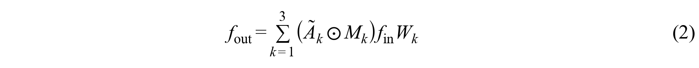

Trong đó *Ãk* là ma trận kề đã chuẩn hoá của phân vùng *k*, *Mk* là trọng số cạnh học được và *Wk* là tham số của phép chiếu.

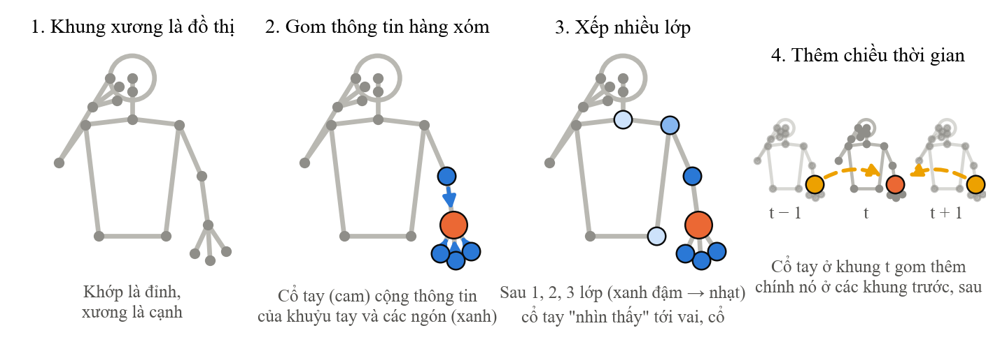

*Hình 3. Nguyên lý của mạng nơ-ron trên đồ thị, minh hoạ trên khung xương người*

Hình 3 giải thích công thức trên qua bốn bước:

1. **Khung xương là đồ thị:** mỗi khớp là một đỉnh, mỗi đoạn xương là một cạnh.
2. **Gom thông tin hàng xóm:** ở mỗi lớp, một khớp (ví dụ cổ tay) cập nhật giá trị của mình bằng tổng có trọng số của chính nó và các khớp nối trực tiếp với nó (khuỷu tay, các ngón). Trọng số này được học từ dữ liệu.
3. **Xếp nhiều lớp:** sau mỗi lớp, thông tin lan thêm một bước trên đồ thị. Sau vài lớp, cổ tay đã "biết" vị trí của vai và cổ, tức là biết tay đang ở đâu so với thân.
4. **Thêm chiều thời gian:** sau bước gom theo không gian, mỗi khớp tiếp tục gom thông tin của chính nó ở các khung trước và sau (tích chập thời gian, mục 5), nên mô hình nắm được cả tư thế lẫn chuyển động.

Các mạng đồ thị khác nhau chủ yếu ở **cách chọn các cạnh** để gom thông tin (Hình 4):

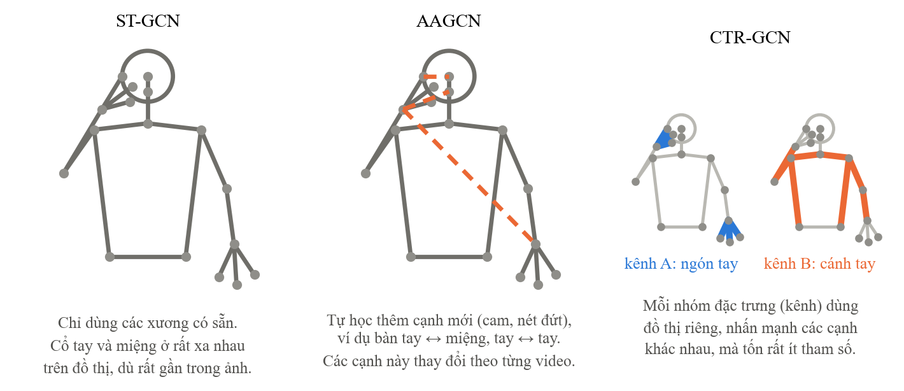

*Hình 4. Ba cách xây dựng đồ thị của ST-GCN, AAGCN và CTR-GCN*

- **ST-GCN** dùng đồ thị cố định theo cấu trúc cơ thể [7]. Với ký hiệu, đây là điểm yếu: bàn tay và khuôn mặt có quan hệ về nghĩa nhưng nằm cách xa nhau trên đồ thị xương. Khi tay đưa lên miệng, cổ tay và miệng gần nhau trong ảnh, nhưng trên đồ thị phải đi qua khuỷu tay, vai, cổ mới tới miệng.
- **AAGCN** học thêm các cạnh mới từ dữ liệu, ví dụ nối thẳng bàn tay với miệng hay hai bàn tay với nhau. Một phần các cạnh này còn được tính lại cho từng video, nên mô hình tự chọn quan hệ phù hợp với từng ký hiệu. AAGCN có thêm các mô-đun attention theo khớp, khung và kênh [12][20].
- **CTR-GCN** học một đồ thị dùng chung, rồi tinh chỉnh riêng cho từng kênh đặc trưng [8]. Kênh mô tả hình dạng bàn tay có thể nhấn mạnh các cạnh giữa các ngón, còn kênh mô tả vị trí cánh tay nhấn mạnh các cạnh vai – khuỷu – cổ tay. Phần tinh chỉnh này tốn rất ít tham số, nên CTR-GCN vừa linh hoạt vừa nhỏ gọn.

#### 7. Cơ chế attention, Transformer và mô hình đa tốc độ

**Attention** cho phép mô hình tự quyết định nên chú ý vào phần nào của dữ liệu: mỗi phần tử tính mức liên quan với các phần tử khác rồi lấy tổng có trọng số. **Transformer** xây dựng hoàn toàn từ attention, nên nắm được quan hệ giữa hai khung cách xa nhau [21], nhưng thường cần nhiều dữ liệu. **Mô hình đa tốc độ** lấy ý tưởng từ SlowFast [22]: xử lý cùng một clip ở nhiều độ phân giải thời gian, nhánh thưa nắm tư thế tổng thể, nhánh dày nắm chuyển động nhanh.

#### 8. Các chỉ số đánh giá

Gọi *M* là số clip kiểm tra, *N* là số gloss, *yi* là nhãn đúng và *Tk(xi)* là tập *k* gloss có xác suất cao nhất. Top-1 và Top-5 là tỷ lệ clip có nhãn đúng nằm trong 1 hoặc 5 dự đoán đầu:

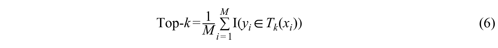

Precision *Pc* cho biết khi mô hình nói là gloss *c* thì đúng bao nhiêu phần. Recall *Rc* cho biết trong các clip thật sự là *c*, mô hình nhận ra bao nhiêu phần:

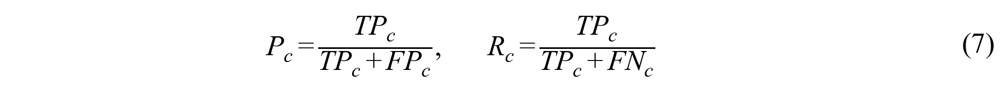

**Macro-F1** là trung bình F1 của các gloss với trọng số bằng nhau, nên gloss ít mẫu ảnh hưởng ngang với gloss nhiều mẫu. Đây là chỉ số chính để chọn mô hình:

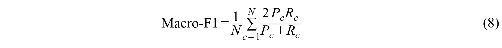

**Sai số hiệu chuẩn kỳ vọng (ECE)** đo độ lệch giữa độ tin cậy mà mô hình báo và độ chính xác thực tế [23]:

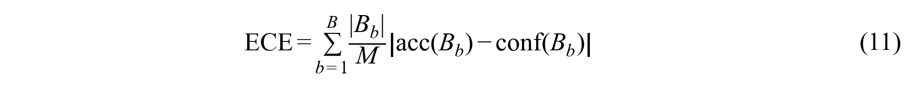

**Độ phủ và độ chính xác có chọn lọc** dùng khi hệ thống chỉ trả lời lúc độ tin cậy đạt ngưỡng *τ*:

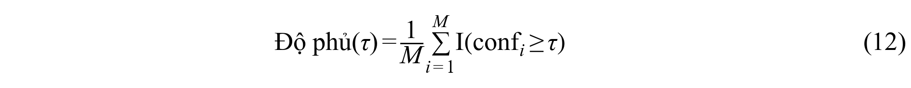

#### 9. Các nghiên cứu cho ngôn ngữ ký hiệu tiếng Việt

| Công trình | Dữ liệu | Hướng tiếp cận | Hạn chế so với mục tiêu đề tài |
|---|---|---|---|
| Ha và cộng sự [15] | 33 ký tự và chữ số | GCN đa luồng trên điểm bàn tay | Chưa ở cấp từ, không dùng thân và mặt |
| Dang và Bessmertny [13] | 4.364 video, ba miền | GRU-LSTM trên vector MediaPipe | Tập trung vào sinh dữ liệu, chưa so sánh GCN |
| Dinh và cộng sự [16] | 1.000 gloss, 30 người ký, đa góc nhìn | So sánh nhiều mô hình | Cần nhiều camera |
| Nguyen Quoc và cộng sự [18][19] | VSL400: 400 gloss, 28 người ký | Bộ dữ liệu cấp từ | Là bài công bố dữ liệu, chưa đi đến triển khai |

*Bảng 2. Các nghiên cứu liên quan cho ngôn ngữ ký hiệu tiếng Việt*

### III. Đề xuất và lựa chọn giải pháp

#### 1. Phiên dịch viên ngôn ngữ ký hiệu

- **Ưu điểm:** chính xác nhất, hiểu cả ngữ cảnh và biểu cảm.
- **Hạn chế:** số lượng ít, chi phí cao, không phải lúc nào cũng có mặt.

#### 2. Găng tay cảm biến

- **Ưu điểm:** đo chính xác độ gập ngón tay, không phụ thuộc ánh sáng.
- **Hạn chế:** cần phần cứng riêng, bất tiện khi đeo, khó thu vị trí tay so với khuôn mặt và chuyển động thân.

#### 3. Nhận diện từ video RGB hoặc đa phương thức

- **Ưu điểm:** giàu thông tin, đạt kết quả cao trong các cuộc thi [6].
- **Hạn chế:** mô hình nặng, thường cần GPU hoặc camera độ sâu, và phải xử lý hình ảnh người dùng.

#### 4. Giải pháp lựa chọn: khung xương kết hợp mạng đồ thị, chạy bằng webcam

Nhóm chọn hướng trích khung xương bằng MediaPipe, sau đó phân loại bằng mạng nơ-ron trên đồ thị. Giải pháp này chỉ cần một webcam, chạy được trên CPU và không lưu hình ảnh người dùng.

| Tiêu chí | Phiên dịch viên | Từ điển, bài giảng video | Găng tay cảm biến | Nhận diện chữ cái | Giải pháp của đề tài |
|---|---|---|---|---|---|
| Trao đổi trực tiếp | Có | Không | Có | Hạn chế, phải đánh vần | Có, theo từng từ |
| Thiết bị | Không | Máy tính, điện thoại | Phần cứng riêng | Camera | Camera thông thường |
| Chi phí mỗi lần dùng | Cao | Thấp | Trung bình | Thấp | Thấp |
| Độ chính xác ngữ nghĩa | Cao nhất | Do người học tự tra | Khó thu vị trí tay so với mặt | Giới hạn ở chữ cái | Phụ thuộc mô hình, giới hạn trong bộ từ vựng |
| Sẵn có mọi lúc | Không | Có | Có | Có | Có |

*Bảng 3. So sánh các giải pháp (đánh giá định tính của nhóm)*

## PHẦN C: TÍNH TOÁN VÀ THIẾT KẾ

### I. Thiết kế sơ đồ khối

#### 1. Sơ đồ khối

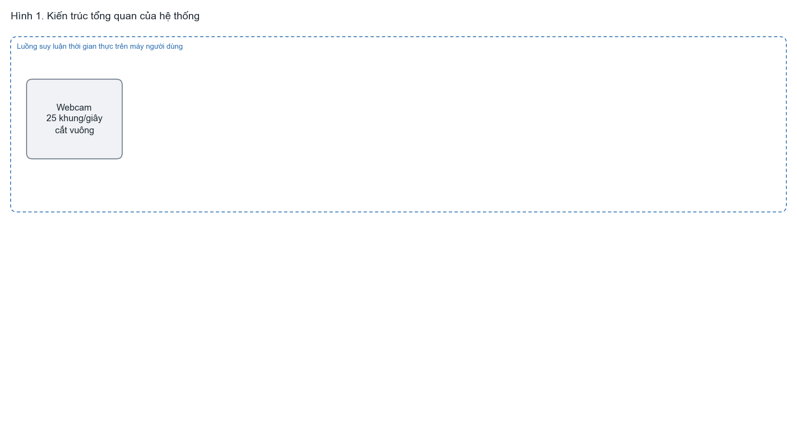

*Hình 5. Kiến trúc tổng quan của hệ thống*

#### 2. Chức năng các khối

| Khối | Chức năng | Công nghệ |
|---|---|---|
| Thu nhận hình ảnh | Lấy khung hình từ webcam, cắt vuông để khớp định dạng 224×224 của dữ liệu huấn luyện | OpenCV |
| Trích khung xương | Ước lượng 33 điểm cơ thể và 21 điểm mỗi bàn tay, cộng điểm cổ, tổng cộng 76 điểm | MediaPipe |
| Tách ký hiệu | Xác định thời điểm bắt đầu và kết thúc một ký hiệu, loại khung lỗi | PoseStateMLP và hàng đợi cử chỉ |
| Chuẩn hoá | Đưa clip về hệ toạ độ theo vai, nội suy về số khung cố định | NumPy |
| Phân loại | Dự đoán gloss, trả về 5 ứng viên có xác suất cao nhất | PyTorch |
| Giao diện | Hiển thị chữ, độ tin cậy và yêu cầu ký lại khi cần | Ứng dụng máy tính |

*Bảng 4. Chức năng các khối của hệ thống*

**Nguyên lý làm việc.** Ở mỗi khung hình, hệ thống trích khung xương và ước lượng xác suất người dùng đang ký. Khi xác suất vượt ngưỡng, các khung hợp lệ được đưa vào hàng đợi. Khi người dùng trở về tư thế nghỉ, clip được đóng lại, chuẩn hoá và đưa vào mô hình phân loại. Từ nhận được hiển thị ngay trên màn hình, rồi hệ thống chờ ký hiệu tiếp theo.

### II. Dữ liệu và tiền xử lý

#### 1. Bộ dữ liệu VSL400

| Thuộc tính | Mô tả |
|---|---|
| Quy mô | 74.259 clip đã gán nhãn, 400 gloss [19] |
| Người ký | 28 người, gồm cả người Điếc dùng ngôn ngữ ký hiệu bản ngữ [18][19] |
| Ghi hình | Ba camera RGB đồng bộ: chính diện, trái, phải [19] |
| Độ dài | Trung bình 2,61 giây mỗi clip, tổng khoảng 53,99 giờ [19] |
| Quyền riêng tư | Vùng mặt đã được khử nhận dạng [19] |
| Điều kiện dùng | Giấy phép CC BY 4.0, cần đồng ý Thoả thuận sử dụng dữ liệu [19] |

*Bảng 5. Thông tin bộ dữ liệu VSL400*

Vì sản phẩm chỉ dùng một webcam đặt trước mặt, đề tài dùng góc quay chính diện. Mỗi video được chuyển về khung vuông 224×224 ở 25 khung/giây, rồi trích thành chuỗi keypoint (T, 76, 3), gồm 34 điểm thân (33 điểm Pose và điểm cổ) và 42 điểm tay.

Đề tài chỉ giữ các gloss có ít nhất 20 clip huấn luyện. Sau khi lọc còn **422 nhãn**, với 20.698 clip train và 5.163 clip test. Có 124 clip test thuộc 50 gloss bị loại; các clip này được dùng để kiểm tra phản ứng của mô hình với từ chưa học.

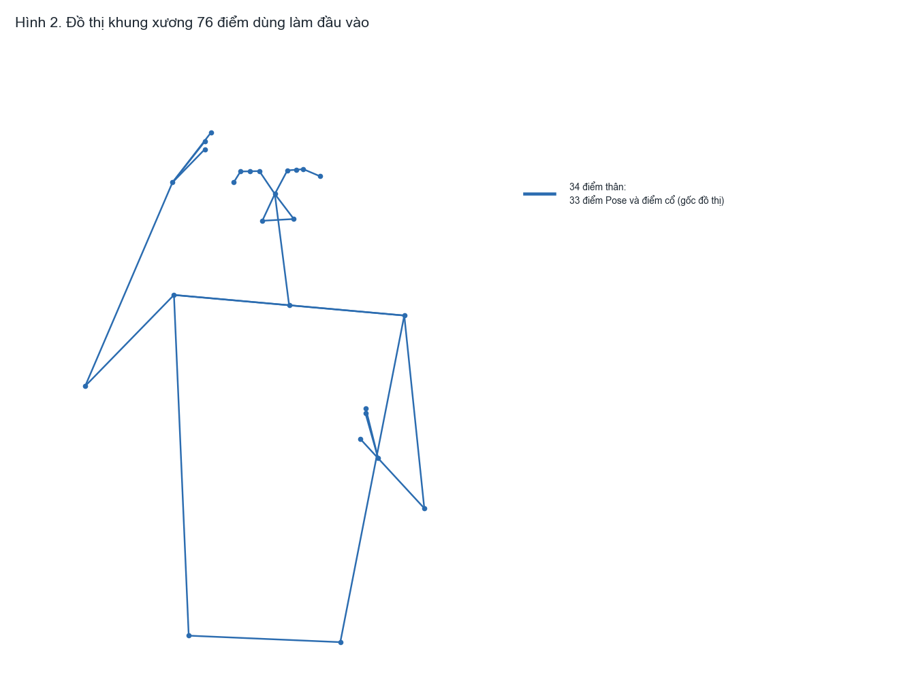

*Hình 6. Đồ thị khung xương 76 điểm, vẽ từ một khung thật trong VSL400*

#### 2. Chuẩn hoá và tăng cường dữ liệu

**Chuẩn hoá không gian** loại bỏ khác biệt do vị trí đứng và khoảng cách đến camera. Với *ct* là trung điểm hai vai ở khung *t* và *s* là trung vị độ rộng vai trong clip:

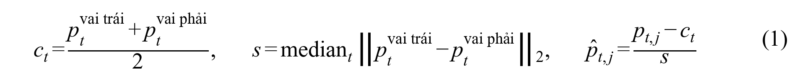

Mỗi điểm có thêm cờ hợp lệ *vt,j ∈ {0, 1}*, tạo tensor đầu vào 4 kênh. Nhờ đó mô hình phân biệt được điểm thật nằm ở gốc toạ độ với điểm mà bộ trích xuất không nhận được.

**Chuẩn hoá thời gian:** mỗi clip được nội suy về *T = 64* khung (riêng mô hình đa tốc độ dùng thêm 32 và 96 khung).

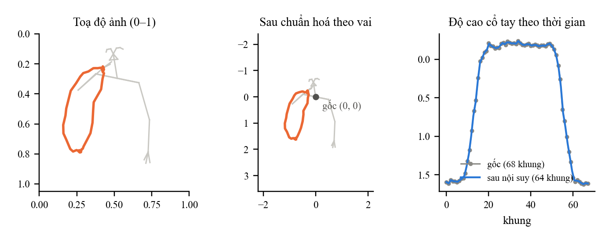

*Hình 7. Quỹ đạo cổ tay của một clip "Con heo": trong toạ độ ảnh (trái), sau khi chuẩn hoá theo vai (giữa), và độ cao cổ tay trước và sau khi nội suy từ 68 về 64 khung (phải)*

Hình 7 cho thấy chuẩn hoá giữ nguyên hình dạng chuyển động, chỉ đổi gốc và đơn vị đo. Sau chuẩn hoá, vị trí tay được đo bằng "bao nhiêu lần độ rộng vai so với giữa hai vai", nên giống nhau giữa người cao và người thấp. Đường nội suy 64 khung (xanh) bám sát dữ liệu gốc 68 khung (xám).

**Tăng cường dữ liệu:** cắt thời gian ngẫu nhiên 85–95%, co giãn, xoay trong mặt phẳng và thêm nhiễu Gauss. Đề tài **không lật trái phải**, vì tay thuận là một phần của ký hiệu.

### III. Thiết kế mô hình

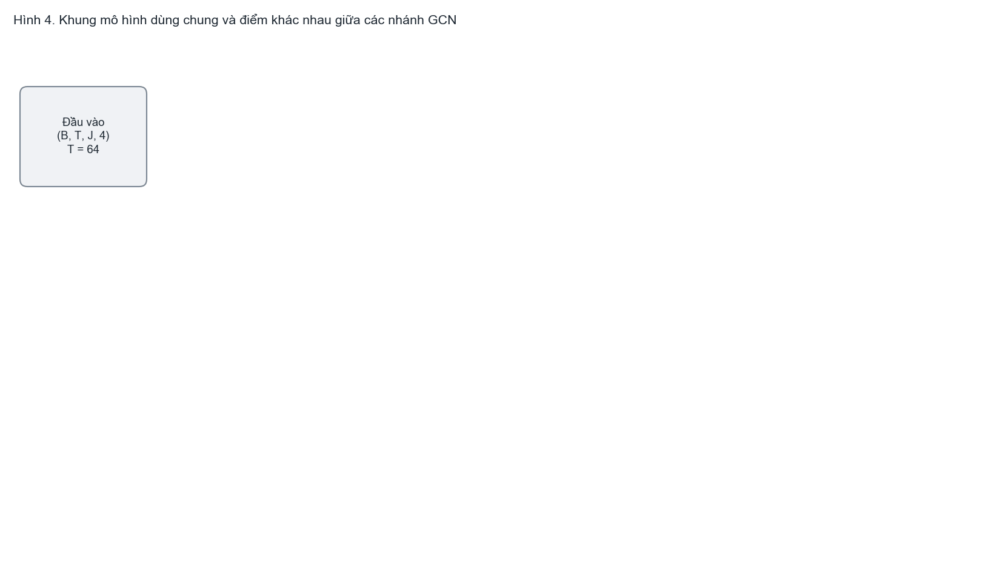

*Hình 8. Khung mô hình dùng chung cho các mạng đồ thị*

| Nhóm | Mô hình | Vai trò trong nghiên cứu |
|---|---|---|
| Mốc so sánh | MS-TCN [9] | Không dùng đồ thị. Mô hình đồ thị phải vượt được mốc này |
| Đồ thị | ST-GCN [7] | Đồ thị cố định theo cơ thể, là mốc của nhóm đồ thị |
| Đồ thị | CTR-GCN [8] | Học topo dùng chung và tinh chỉnh theo từng kênh, ít tham số |
| Đồ thị | AAGCN [12] | Học topo từ dữ liệu, có attention |
| Khác họ | Transformer [21] | Có kiểu sai khác với GCN, dùng cho tổ hợp |
| Cải tiến | MultiRate-Attn-STGCN | Ba nhánh 32, 64, 96 khung, gộp bằng attention |
| Cải tiến | CTR-GCN-BT | CTR-GCN cân bằng lại: chuyển bớt năng lực từ phần không gian sang phần thời gian |
| Cải tiến | AnchorGCN-A, AnchorGCN-AS, AnchorGCN-T32 | Mô tả điểm tay so với tám mốc ở tai, mắt, miệng, đầu, cổ, vai |

*Bảng 6. Các mô hình được so sánh*

Ba biến thể AnchorGCN được thử theo từng bước. **AnchorGCN-A** chỉ thêm đặc trưng "tay so với mốc" ở đầu vào của CTR-GCN. **AnchorGCN-AS** thêm các khối quan hệ giữa tay và mốc, rồi gộp các token bàn tay bằng attention. **AnchorGCN-T32** đưa các token đó qua hai tầng Transformer.

Hàm mất mát là cross-entropy với label smoothing *ε = 0,1*:

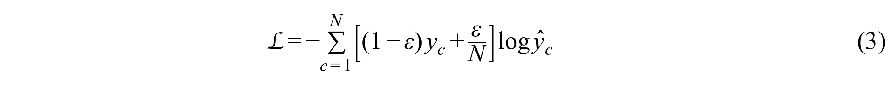

Tổ hợp mô hình lấy trung bình xác suất của tập mô hình *ℳ*:

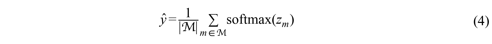

### IV. Thiết lập huấn luyện

Mọi mô hình dùng chung một cấu hình, nên chênh lệch đo được phản ánh kiến trúc chứ không phải cách huấn luyện.

| Tham số | Giá trị |
|---|---|
| Số khung, số epoch | 64 khung, 70 epoch, 5 epoch warmup |
| Bộ tối ưu | SGD, lr 0,1, momentum 0,9, weight decay 4×10⁻⁴. Riêng Transformer dùng AdamW, lr 10⁻³ |
| Batch hiệu dụng | 128, trên 2 GPU T4, huấn luyện phân tán DDP |
| Kỹ thuật ổn định | EMA 0,999, gradient clipping 1,0, AMP |
| Tiêu chí chọn mô hình | Macro-F1 cao nhất trên tập đánh giá |

*Bảng 7. Cấu hình huấn luyện dùng chung*

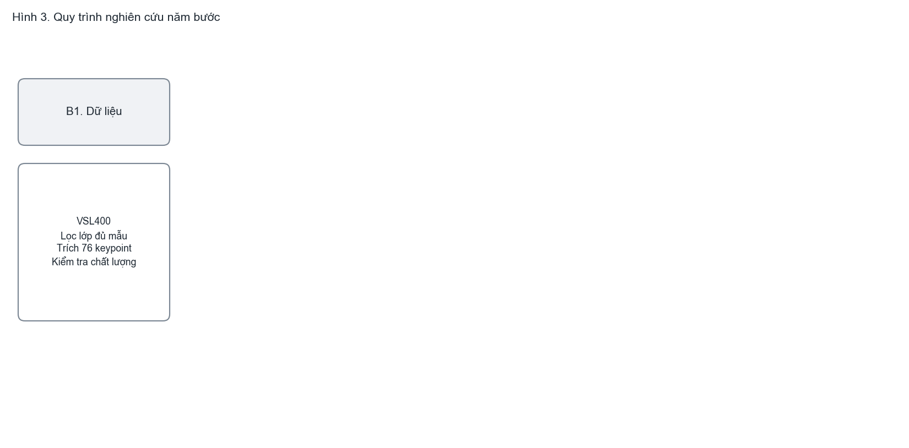

*Hình 9. Quy trình nghiên cứu năm bước*

### V. Tách ký hiệu thời gian thực

*Hình 10. Tách ký hiệu từ luồng webcam*

Dữ liệu huấn luyện là các clip đã cắt sẵn, còn webcam là luồng liên tục, nên cần một bộ phát hiện ranh giới ký hiệu:

- **PoseStateMLP:** mạng MLP nhỏ nhận cửa sổ 3 khung liên tiếp của 26 điểm thân, phân biệt tư thế nghỉ và tư thế đang ký.
- **Hàng đợi cử chỉ:** chuyển trạng thái theo ngưỡng *P(action) = 0,3*. Khi ký hiệu kết thúc, clip được đệm 5 khung nghỉ ở mỗi đầu để giống cách quay dữ liệu huấn luyện.
- **Kiểm soát chất lượng:** khung mất cặp vai hoặc mất quá một bàn tay bị loại. Clip bị yêu cầu ký lại nếu

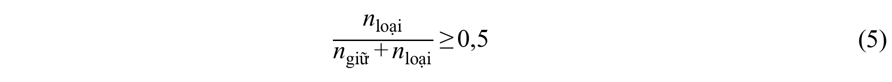

### VI. Thiết kế đánh giá

| Mức | Dữ liệu | Câu hỏi cần trả lời |
|---|---|---|
| Cùng miền | VSL400 test: 5.163 clip, 422 gloss | Mô hình phân biệt tốt đến đâu trong điều kiện giống huấn luyện? |
| Ngoài từ vựng | 124 clip test của 50 gloss bị loại | Mô hình có trả lời tự tin cho từ chưa học không? |
| Khác miền | Video QIPEDC [17]: 252 clip, 147 gloss chung với VSL400 | Mô hình có tổng quát khi đổi người ký, phông nền và cách quay? |

*Bảng 8. Các mức kiểm tra*

## PHẦN D: THỰC NGHIỆM, KẾT QUẢ VÀ ĐÁNH GIÁ

### I. Triển khai thực nghiệm

#### 1. Hạ tầng huấn luyện

Toàn bộ quá trình huấn luyện chạy trên GPU đám mây Kaggle, mỗi phiên có 2 GPU Tesla T4. Vì mỗi phiên bị giới hạn thời gian chạy và mỗi tài khoản có hạn mức GPU theo tuần, nhóm chia các thí nghiệm cho **5 tài khoản** chạy song song. Mô hình lưu checkpoint sau mỗi epoch, nên lần chạy bị ngắt được huấn luyện tiếp từ checkpoint ở phiên sau, kể cả trên tài khoản khác. Ví dụ, CTR-GCN J76 được huấn luyện qua 4 phiên trên 2 tài khoản. Tổng cộng nhóm đã chạy 79 phiên, dùng khoảng **320 giờ** GPU (2 × T4), và thu được **14 mô hình** đưa vào so sánh.

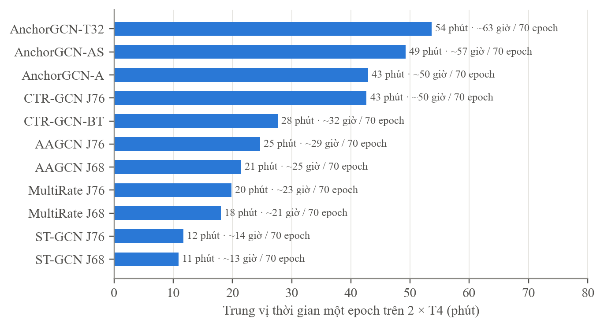

*Hình 11. Thời gian huấn luyện một epoch của từng mô hình trên 2 × T4*

**Nhận xét Hình 11.** Thời gian huấn luyện chênh nhau gần 5 lần giữa các mô hình. ST-GCN chỉ mất khoảng 11–12 phút mỗi epoch, còn CTR-GCN và các biến thể AnchorGCN mất 43–54 phút, tức 50–63 giờ cho 70 epoch. Đó là lý do việc chia nhỏ quá trình huấn luyện qua nhiều phiên và nhiều tài khoản là cần thiết.

#### 2. Quá trình huấn luyện

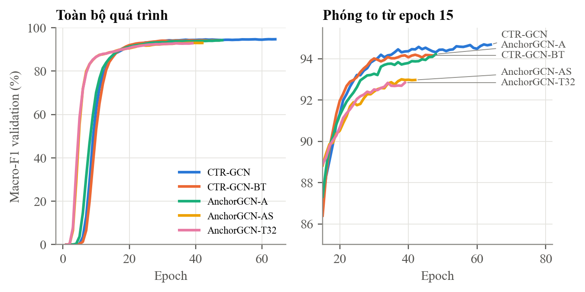

*Hình 12. Macro-F1 trên tập đánh giá theo từng epoch*

**Nhận xét Hình 12.** Trong khoảng 5–8 epoch đầu, Macro-F1 gần bằng 0. Đây không phải lỗi: điểm được đo trên bản trung bình trượt (EMA) của trọng số với hệ số 0,999, nên bản này thay đổi chậm hơn mô hình đang học. Sau đó điểm tăng rất nhanh, vượt 90% quanh epoch 20, rồi gần như đi ngang từ epoch 40. Khung phóng to cho thấy CTR-GCN và CTR-GCN-BT dẫn đầu, AnchorGCN-A bám sát, còn AnchorGCN-AS và AnchorGCN-T32 thấp hơn khoảng 1,5 điểm ở cùng số epoch.

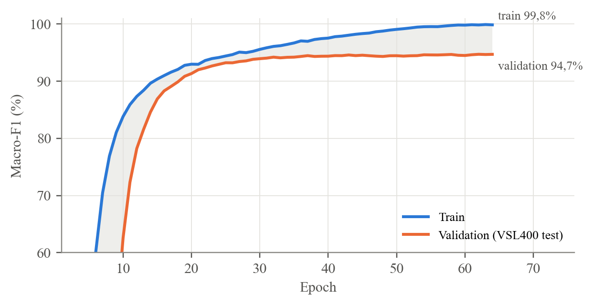

*Hình 13. Macro-F1 trên tập huấn luyện và tập đánh giá của CTR-GCN J76*

**Nhận xét Hình 13.** Ở cuối quá trình, mô hình gần như thuộc lòng tập huấn luyện (Macro-F1 99,8%) nhưng đạt 94,7% trên tập đánh giá. Khoảng cách khoảng 5 điểm cho thấy mô hình đã học khớp. Tuy vậy, điểm trên tập đánh giá không giảm theo thời gian, nên mức học khớp này chưa gây hại. Muốn tăng tiếp, cần thêm dữ liệu hoặc tăng cường dữ liệu mạnh hơn, chứ không phải huấn luyện lâu hơn.

#### 3. Kiểm tra tính đúng của số liệu

Checkpoint tốt nhất của cả 14 mô hình được tải về và chấm lại trên máy cá nhân bằng đúng mã nguồn đã dùng để huấn luyện. Kết quả chấm lại khớp với điểm lưu trong checkpoint, lệch không quá 0,05 điểm.

**Lưu ý.** Do giới hạn thời gian GPU, tập test VSL400 được dùng luôn để chọn checkpoint. Vì vậy các số liệu cùng miền dưới đây là **cận trên** của năng lực thật. Dữ liệu QIPEDC không tham gia vào việc chọn mô hình, nên là thước đo khách quan hơn.

### II. Kết quả nghiên cứu, đánh giá

#### 1. Độ chính xác cùng miền

| Mô hình | J | Tham số | Top-1 (%) | Top-5 (%) | Macro-F1 (%) | CI 95% | Macro-P (%) | Macro-R (%) |
|---|---:|---:|---:|---:|---:|---|---:|---:|
| MS-TCN (mốc) | 68 | 0,69 M | 92,66 | 98,22 | 93,07 | 92,16–93,53 | 93,58 | 93,15 |
| MS-TCN (mốc) | 76 | 0,71 M | 92,70 | 98,39 | 93,20 | 92,27–93,62 | 93,73 | 93,21 |
| ST-GCN | 68 | 3,27 M | 94,09 | 98,61 | 94,45 | 93,62–94,86 | 94,85 | 94,50 |
| ST-GCN | 76 | 3,30 M | 94,29 | 98,61 | **94,72** | 93,92–95,10 | 95,04 | 94,76 |
| CTR-GCN | 76 | 1,67 M | **94,33** | 98,53 | 94,68 | 93,87–95,05 | 95,04 | 94,73 |
| AAGCN | 68 | 3,92 M | 93,18 | 98,31 | 93,62 | 92,74–94,05 | 94,14 | 93,62 |
| AAGCN | 76 | 3,95 M | 93,12 | 98,33 | 93,50 | 92,59–93,88 | 93,97 | 93,56 |
| Transformer | 76 | 5,18 M | 90,78 | 98,02 | 91,33 | 90,25–91,77 | 91,86 | 91,38 |
| MultiRate-Attn-STGCN | 68 | 5,12 M | 93,76 | 98,30 | 94,12 | 93,22–94,52 | 94,40 | 94,29 |
| MultiRate-Attn-STGCN | 76 | 5,21 M | 93,49 | 98,26 | 93,78 | 92,89–94,19 | 94,17 | 93,93 |
| CTR-GCN-BT | 76 | 2,26 M | 93,84 | **98,62** | 94,17 | 93,31–94,56 | 94,62 | 94,23 |
| AnchorGCN-A | 76 | 1,68 M | 93,80 | 98,57 | 94,20 | 93,34–94,62 | 94,63 | 94,22 |
| AnchorGCN-AS | 76 | 2,51 M | 92,58 | 97,56 | 92,97 | 91,99–93,43 | 93,50 | 92,99 |
| AnchorGCN-T32 | 76 | 3,57 M | 92,35 | 97,62 | 92,86 | 91,92–93,21 | 93,44 | 92,83 |

*Bảng 9. Kết quả trên VSL400 test, 5.163 clip, 422 gloss. Khoảng tin cậy 95% tính bằng bootstrap 1.000 lần*

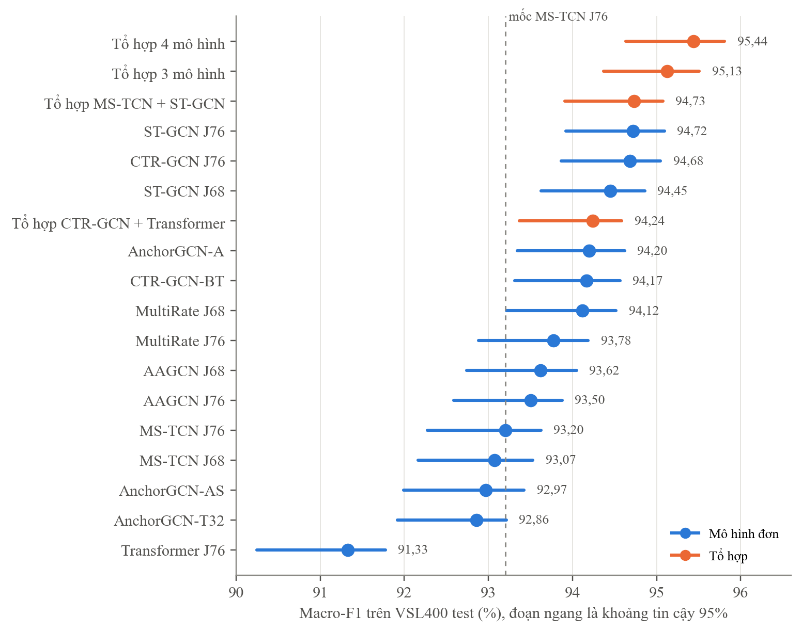

*Hình 14. Macro-F1 trên VSL400 của mọi mô hình và tổ hợp, kèm khoảng tin cậy 95%*

**Nhận xét Bảng 9 và Hình 14.**

- Mô hình đơn tốt nhất đạt **Top-1 94,3%** (CTR-GCN J76) và **Macro-F1 94,7%** (ST-GCN J76; CTR-GCN J76 kém 0,04 điểm). Với 422 lớp, nếu đoán ngẫu nhiên thì chỉ đúng khoảng 0,24%.
- **Top-5 đạt khoảng 98,5%** ở mọi mô hình chính. Nếu giao diện đưa ra 5 từ gợi ý, gần như lúc nào cũng có từ đúng trong đó.
- Precision và Recall trung bình gần bằng nhau, chênh dưới 0,6 điểm: mô hình không thiên về đoán dư hay đoán thiếu một nhóm gloss nào.
- Các khoảng tin cậy rộng khoảng ±0,6 điểm. Vì vậy, chênh lệch nhỏ hơn mức đó, như giữa ST-GCN, CTR-GCN, AnchorGCN-A và CTR-GCN-BT, chưa đủ để kết luận mô hình nào hơn.

**Trả lời CH1: mô hình đồ thị so với mốc.** ST-GCN và CTR-GCN J76 hơn MS-TCN khoảng 1,5 điểm Macro-F1, và khoảng tin cậy hai bên không chồng lấn. Tính theo clip, ST-GCN đúng 4.868 clip, còn MS-TCN đúng 4.786 clip. Như vậy cấu trúc đồ thị của cơ thể giúp ích thật. AAGCN chỉ hơn mốc 0,3 điểm, nằm trong sai số, nên attention bổ sung chưa có lợi ở quy mô dữ liệu này. Transformer thấp nhất (91,3%), phù hợp với nhận định rằng Transformer cần nhiều dữ liệu hơn [21].

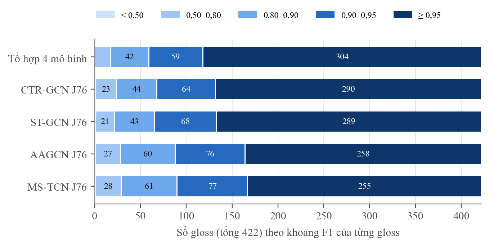

*Hình 15. Số gloss theo từng khoảng F1 (mỗi gloss tính F1 riêng)*

**Nhận xét Hình 15.** Điểm trung bình che giấu sự chênh lệch giữa các từ. Với CTR-GCN J76, 290/422 gloss đạt F1 ≥ 0,95, nhưng vẫn còn 24 gloss dưới 0,80. Từ MS-TCN sang CTR-GCN rồi sang tổ hợp, phần tô đậm (F1 ≥ 0,95) tăng dần từ 255 lên 290 rồi 304 gloss, chủ yếu nhờ kéo các gloss ở mức 0,80–0,95 lên. Các gloss yếu nhất của CTR-GCN là Con heo (F1 0,48), Dơ (0,53), Thứ ba và Thứ tư (cùng 0,59) và Khóc (0,62). Phần 3 dưới đây giải thích vì sao.

#### 2. Vai trò của các điểm chân (CH2)

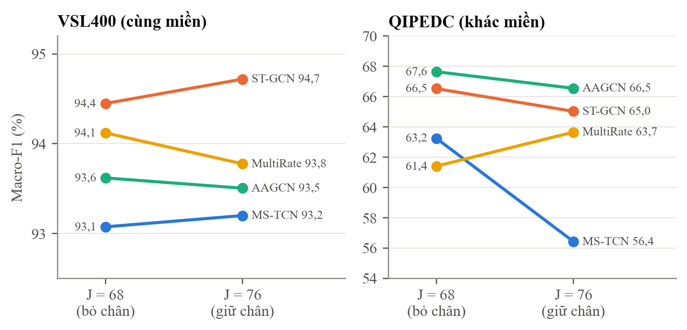

*Hình 16. Macro-F1 khi bỏ chân (J = 68) và khi giữ chân (J = 76)*

**Nhận xét Hình 16.** Trên VSL400 (khung trái), các đường gần như nằm ngang: chênh lệch chỉ từ −0,34 đến +0,27 điểm, nhỏ hơn độ rộng khoảng tin cậy. Như vậy **điểm chân không giúp phân loại một cách có ý nghĩa**. Điều này hợp lý: như Bảng 1 cho thấy, các thành phần của ký hiệu đều nằm ở tay, mặt và thân trên. Trên QIPEDC (khung phải), 3/4 họ mô hình giảm khi giữ chân, rõ nhất là MS-TCN (từ 63,2 xuống 56,4). Một cách giải thích hợp lý là chân thường bị khuất hoặc nằm ngoài khung hình ở video khác nguồn, nên các điểm chân trở thành nhiễu. **Kết luận:** sản phẩm dùng webcam nên bỏ điểm chân.

#### 3. Các cặp ký hiệu dễ nhầm (CH3)

##### 3.1. Tỷ lệ nhầm của các cặp

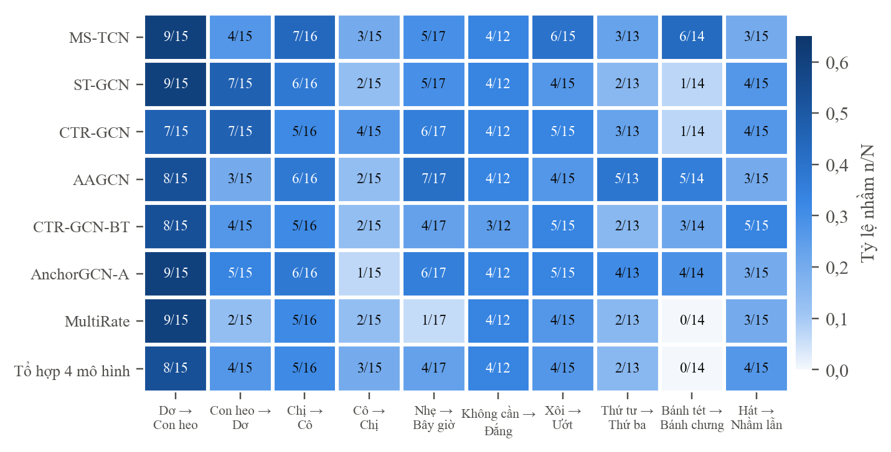

*Hình 17. Số clip bị nhầm n/N theo từng chiều nhầm (màu càng đậm, tỷ lệ nhầm càng cao)*

Hình 17 cho thấy một số cặp bị nhầm với mọi mô hình. Để hiểu nguyên nhân, nhóm xem lại video của từng cặp. Các hình 18–23 đặt hai ký hiệu cạnh nhau: mỗi hàng là một ký hiệu, các khung được lấy đều trong đoạn có tay chuyển động, kèm khung xương mà mô hình nhận được (tay thứ nhất màu xanh, tay thứ hai màu cam). Hình 24 chồng quỹ đạo cổ tay của hai ký hiệu trong mỗi cặp lên cùng một hệ toạ độ theo vai.

##### 3.2. Ví dụ và giải thích từng cặp

**Cặp 1: Dơ và Con heo** (CTR-GCN nhầm 7/15 clip theo mỗi chiều)

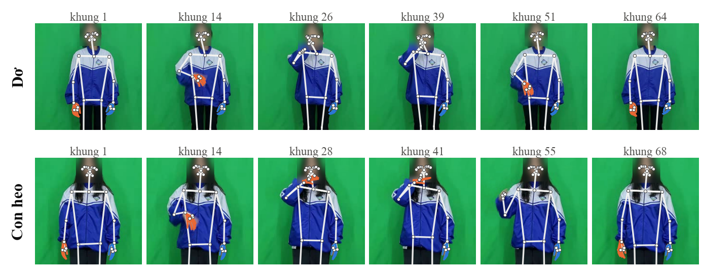

*Hình 18. Ký hiệu "Dơ" (trên) và "Con heo" (dưới). Ảnh từ bộ dữ liệu VSL400 [19]*

Hai ký hiệu có gần như cùng một chuỗi động tác: tay phải đi lên từ dưới, dừng trước mũi và miệng (khung 26–41), giữ ở đó rồi hạ xuống; tay trái buông yên suốt ký hiệu. Quỹ đạo cổ tay của hai từ gần như trùng khít (Hình 24, ô thứ nhất). Điểm khác nằm ở **hình dạng và hướng bàn tay khi đặt trước mặt**: ở "Dơ" bàn tay áp sát lên mũi, ở "Con heo" bàn tay nằm ngang trước mũi. Đây đúng là phần khung xương mô tả kém nhất. Khi bàn tay áp lên mặt, MediaPipe thường không nhận ra bàn tay: ở khung 26 và 39 của "Dơ", các điểm bàn tay biến mất, chỉ còn cẳng tay. Thông tin phân biệt hai từ vì thế bị mất ngay ở thời điểm quan trọng nhất.

**Cặp 2: Chị và Cô** (CTR-GCN nhầm Chị → Cô 5/16, Cô → Chị 4/15)

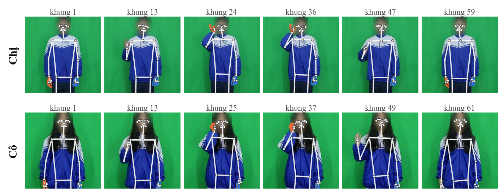

*Hình 19. Ký hiệu "Chị" (trên) và "Cô" (dưới). Ảnh từ bộ dữ liệu VSL400 [19]*

Cả hai đều đưa tay phải lên cạnh mặt, giữ một lúc rồi hạ xuống. Quỹ đạo cổ tay lên – giữ – xuống của hai từ chồng lên nhau (Hình 24, ô thứ hai). Khác biệt chỉ là **vị trí chạm trên mặt**: ở ví dụ này, "Chị" đặt tay cao gần thái dương, còn "Cô" đặt tay thấp hơn ở má. Khoảng cách này chỉ vài centimet, nhỏ hơn mức khác nhau tự nhiên giữa các người ký. Thêm vào đó, bàn tay ở cạnh mặt mất điểm trong 21–27% số khung tay giơ cao (Bảng 10). Biến thể AnchorGCN-A, vốn đo trực tiếp vị trí tay so với các mốc trên mặt, đã giảm chiều Cô → Chị xuống còn 1/15.

**Cặp 3: Nhẹ và Bây giờ** (CTR-GCN nhầm Nhẹ → Bây giờ 6/17)

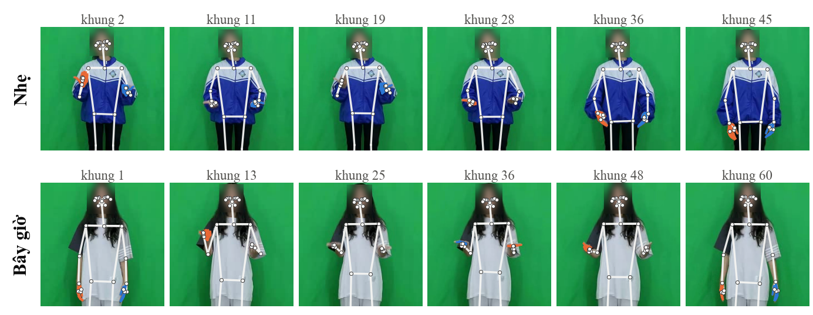

*Hình 20. Ký hiệu "Nhẹ" (trên) và "Bây giờ" (dưới). Ảnh từ bộ dữ liệu VSL400 [19]*

Khác với hai cặp trên, ở đây hai tay **không đưa lên mặt**: cả hai ký hiệu dùng hai tay cùng lúc, đặt ngang bụng phía trước người, và chỉ chuyển động với biên độ nhỏ. Trên Hình 24 (ô thứ ba), quỹ đạo hai cổ tay của cả hai từ đều chỉ dao động trong một vùng hẹp hai bên bụng. Điểm khác chủ yếu nằm ở **hướng và nhịp của chuyển động**: ở "Bây giờ" hai bàn tay đưa vào giữa rồi tách ra (khung 25–48), còn ở "Nhẹ" hai bàn tay chỉ nâng hạ nhẹ ở hai bên. Mô hình chỉ nhìn ở một tốc độ dễ bỏ qua khác biệt nhỏ về nhịp này. **MultiRate-Attn-STGCN**, mô hình nhìn clip ở ba tốc độ, giảm lỗi này từ 6/17 xuống còn 1/17.

**Cặp 4: Không cần và Đắng** (mọi mô hình nhầm 3–4/12)

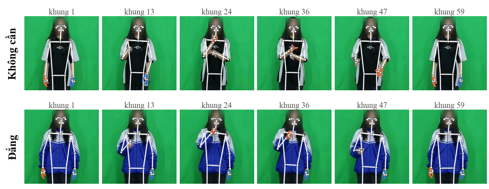

*Hình 21. Ký hiệu "Không cần" (trên) và "Đắng" (dưới). Ảnh từ bộ dữ liệu VSL400 [19]*

Cả hai ký hiệu đều bắt đầu bằng cùng một động tác: tay phải đưa lên chạm cằm và miệng (khung 24–36), rồi hạ xuống. Ở Hình 24 (ô thứ tư), đoạn đi lên của tay phải ở hai từ trùng nhau gần như hoàn toàn. "Không cần" có thêm động tác tay trái đặt trước ngực, nhưng phần quan trọng nhất ở miệng lại là nơi **khẩu hình và nét mặt** đóng vai trò lớn. Bộ 76 điểm không có điểm chi tiết trên môi, và vùng mặt trong VSL400 đã bị làm mờ [19]. Thêm vào đó, ở "Không cần" bàn tay không được nhận ra trong 53% số khung tay giơ cao. Vì vậy không mô hình nào trong đề tài tách được cặp này.

**Cặp 5: Xôi và Ướt** (CTR-GCN nhầm Xôi → Ướt 5/15)

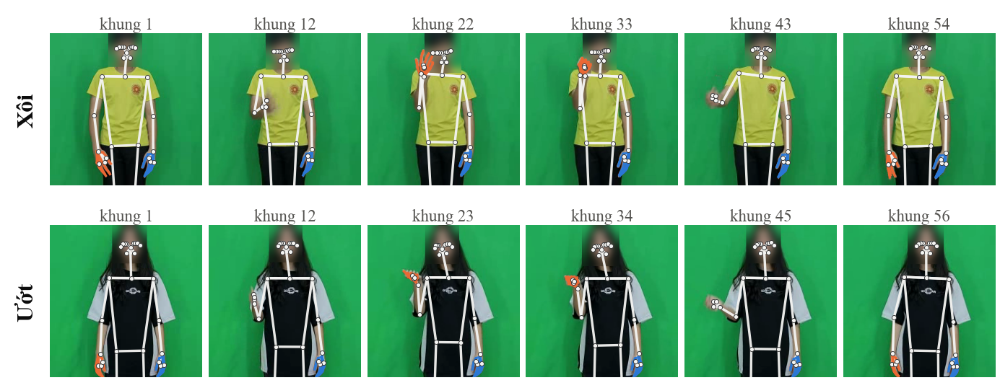

*Hình 22. Ký hiệu "Xôi" (trên) và "Ướt" (dưới). Ảnh từ bộ dữ liệu VSL400 [19]*

Hai ký hiệu có cùng dạng chuyển động: tay phải đưa lên ngang vai, các ngón xoè ra (khung 22–34), rồi hạ xuống theo một vòng. Hai quỹ đạo vòng trên Hình 24 (ô thứ năm) gần như trùng nhau. Ở ví dụ này, "Xôi" đặt tay sát má còn "Ướt" đặt tay lệch ra ngoài ngang vai. Nhưng khi tay sát má, MediaPipe mất bàn tay trong **69% số khung** tay giơ cao của "Xôi", tỷ lệ cao nhất trong các từ được kiểm tra. Mô hình chỉ còn thấy cổ tay đi lên rồi đi xuống, giống hệt "Ướt".

**Cặp 6: Bánh tét và Bánh chưng** (MS-TCN nhầm Bánh tét → Bánh chưng 6/14, MultiRate 0/14)

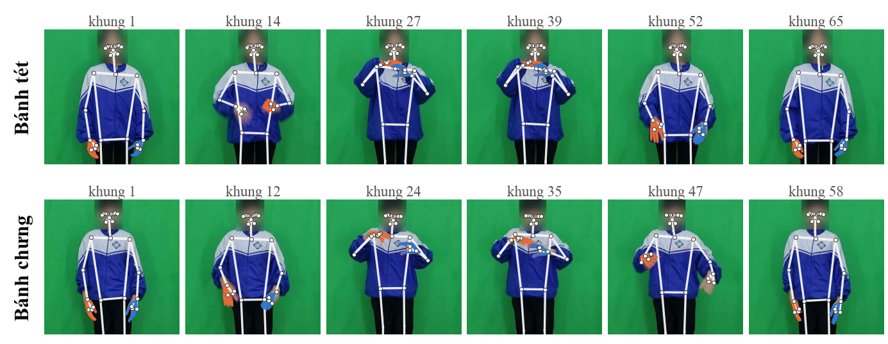

*Hình 23. Ký hiệu "Bánh tét" (trên) và "Bánh chưng" (dưới). Ảnh từ bộ dữ liệu VSL400 [19]*

Đây là cặp có nghĩa gần nhau và cách ký cũng gần nhau. Cả hai đều dùng hai bàn tay đưa lên trước ngực, đặt gần nhau để mô tả hình dạng chiếc bánh (khung 24–39). Trên Hình 24 (ô cuối), quỹ đạo hai cổ tay của hai từ đối xứng và gần như trùng nhau. Điểm khác chỉ nằm ở **cách hai bàn tay đặt với nhau và chuyển động nhỏ của các ngón**. MS-TCN, mô hình không dùng cấu trúc cơ thể, nhầm 6/14 clip. ST-GCN và CTR-GCN, vốn mô hình hoá quan hệ giữa các khớp của hai bàn tay, chỉ nhầm 1/14, và MultiRate không nhầm clip nào.

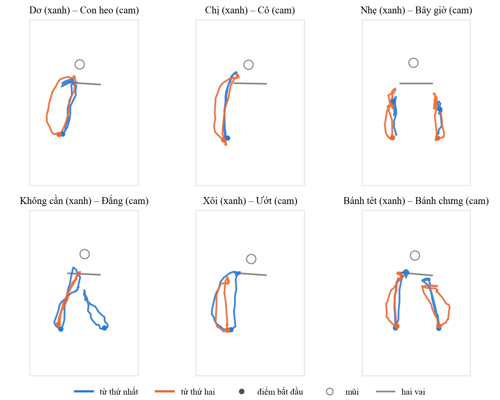

*Hình 24. Quỹ đạo cổ tay chuyển động của từng cặp, vẽ trong toạ độ theo vai: từ thứ nhất màu xanh, từ thứ hai màu cam, chấm tròn là điểm bắt đầu*

| Cặp | Điểm giống nhau | Điểm khác nhau | Mất bàn tay khi tay giơ cao |
|---|---|---|---|
| Dơ – Con heo | Tay phải lên trước mũi, giữ, rồi hạ | Hình dạng, hướng bàn tay trên mũi | 17% – 9% |
| Chị – Cô | Tay phải lên cạnh mặt, giữ, rồi hạ | Vị trí chạm: thái dương hay má | 27% – 21% |
| Nhẹ – Bây giờ | Hai tay ngang bụng, biên độ nhỏ | Hướng và nhịp chuyển động | Tay không lên mặt |
| Không cần – Đắng | Tay phải lên cằm và miệng | Khẩu hình, động tác tay trái | 53% – 16% |
| Xôi – Ướt | Tay phải lên ngang vai, ngón xoè, vòng xuống | Tay sát má hay lệch ra ngoài | 69% – tay hiếm khi cao hơn vai |
| Bánh tét – Bánh chưng | Hai tay trước ngực tạo hình chiếc bánh | Cách đặt hai bàn tay, động tác ngón | 22% – 27% |

*Bảng 10. Tóm tắt các cặp dễ nhầm. Cột cuối là tỷ lệ khung mà MediaPipe không nhận ra bàn tay, trong các khung có cổ tay cao hơn vai, tính trên toàn bộ clip test của từng từ*

##### 3.3. Nhận xét chung về các cặp dễ nhầm

- **Nguyên nhân chung:** trong mọi cặp, hai ký hiệu có **vị trí và quỹ đạo tay gần như giống nhau**, và chỉ khác nhau ở những chi tiết nhỏ: hình dạng bàn tay, điểm chạm trên mặt, nhịp chuyển động hoặc khẩu hình. Đó đúng là những thành phần mà khung xương mô tả kém (Bảng 1).
- **MediaPipe mất bàn tay khi tay ở gần mặt:** trên toàn tập test, bàn tay không được nhận ra ở 29% số khung có tay giơ cao hơn vai. Với nhiều từ, tỷ lệ này còn cao hơn (Xôi 69%, Không cần 53%). Mô hình mất thông tin ngay ở thời điểm phân biệt quan trọng nhất.
- **Mô hình đa tốc độ giải quyết được các cặp khác nhau về nhịp chuyển động.** MultiRate có tổng số nhầm thấp nhất (41 trên 14 chiều theo dõi, so với 55 của ST-GCN và CTR-GCN). Nó giảm Nhẹ → Bây giờ xuống 1/17 và đưa Bánh tét → Bánh chưng về 0.
- **Thông tin tay so với mặt có tác dụng một phần.** AnchorGCN-A giảm Cô → Chị xuống 1/15, nhưng chưa tách được Dơ và Con heo, vì khác biệt của cặp này nằm ở hình dạng bàn tay chứ không ở vị trí.
- **Các cặp khác nhau ở nét mặt và khẩu hình** (Dơ – Con heo, Không cần – Đắng) cần thêm điểm chi tiết trên khuôn mặt. Đây là hướng phát triển tiếp theo của đề tài.

#### 4. Những trường hợp mô hình nhận diện đúng

Phân tích lỗi ở trên chỉ chiếm một phần nhỏ kết quả. Với CTR-GCN J76, **185/422 từ (44%) được nhận đúng toàn bộ** trên tập test (F1 = 1), và 290 từ đạt F1 ≥ 0,95. Mục này xem mô hình nhận đúng như thế nào, và những ký hiệu nào được nhận tốt.

##### 4.1. Ví dụ nhận diện đúng

Mỗi hàng trong Hình 25 và Hình 26 là một clip trong tập test: bốn khung hình trong đoạn có tay chuyển động kèm khung xương mà mô hình nhận được, và bên phải là ba từ có xác suất cao nhất do CTR-GCN J76 dự đoán. Độ tin cậy cao nhất chỉ khoảng 94–98% chứ không lên 100%, vì label smoothing (*ε = 0,1*) cố ý giữ mô hình không quá tự tin.

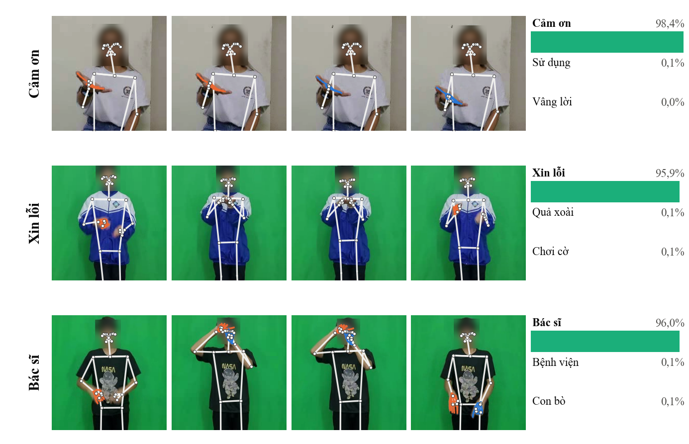

*Hình 25. Ký hiệu "Cảm ơn", "Xin lỗi", "Bác sĩ" được nhận đúng. Ảnh từ bộ dữ liệu VSL400 [19], vùng mặt đã được làm mờ*

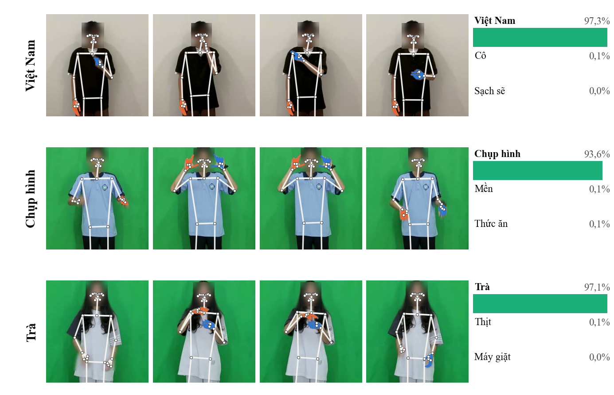

*Hình 26. Ký hiệu "Việt Nam", "Chụp hình", "Trà" được nhận đúng. Ảnh từ bộ dữ liệu VSL400 [19], vùng mặt đã được làm mờ*

**Nhận xét Hình 25 và Hình 26.** Cả sáu từ đều thuộc nhóm F1 = 1: mọi clip test của chúng đều được nhận đúng, và không clip nào của từ khác bị đoán nhầm thành chúng. Xác suất của từ đúng vượt trội hẳn (94–98%), trong khi từ đứng thứ hai chỉ khoảng 0,1%. Mô hình không "phân vân" giữa các lựa chọn. Quan sát các khung hình cho thấy mỗi từ có ít nhất một nét riêng rất rõ:

- **Cảm ơn:** bàn tay xoè ngửa, đưa ra phía trước ở tầm bụng, không chạm vào mặt nên các điểm bàn tay được nhận đầy đủ trong mọi khung.
- **Xin lỗi:** hai bàn tay chụm vào nhau trước ngực. Vị trí hai tay gặp nhau ở giữa người là một dấu hiệu mà khung xương thể hiện rất rõ.
- **Bác sĩ:** cả hai tay cùng đưa lên trán. Dù tay ở gần mặt, việc dùng đồng thời hai tay ở vị trí cao làm ký hiệu này khác hẳn các từ chỉ dùng một tay.
- **Việt Nam:** một tay đi từ cằm sang vai bên kia rồi xuống ngực. Quỹ đạo dài và cắt ngang thân hiếm gặp ở các từ khác.
- **Chụp hình:** hai tay giơ cao ngang đầu, đối xứng, các ngón tạo khung.
- **Trà:** hai tay đặt trước ngực, một tay làm động tác phía trên tay kia.

##### 4.2. Đặc điểm của các từ được nhận tốt

Để kiểm tra các quan sát trên bằng số liệu, nhóm so sánh 185 từ đạt F1 = 1 với 30 từ có F1 thấp nhất trên toàn bộ clip test:

| Đặc điểm | 185 từ F1 = 1 | 30 từ F1 thấp nhất |
|---|---:|---:|
| Tỷ lệ khung dùng cả hai tay, trong các khung có tay chuyển động | 62% | 36% |
| Tỷ lệ mất bàn tay khi tay giơ cao hơn vai | 21% | 31% |
| Độ dài quỹ đạo cổ tay (trung vị, tính bằng số lần độ rộng vai) | 4,9 | 4,5 |

*Bảng 11. So sánh đặc điểm của nhóm từ được nhận tốt nhất và nhóm từ kém nhất (CTR-GCN J76)*

**Nhận xét Bảng 11.** Khác biệt lớn nhất là **số tay sử dụng**: các từ được nhận tốt dùng cả hai tay trong 62% số khung, gần gấp đôi nhóm kém (36%). Khi cả hai tay cùng tham gia, vị trí tương đối giữa hai tay mang thêm nhiều thông tin, và đồ thị khung xương mô tả tốt quan hệ này. Thứ hai, ở các từ được nhận tốt, bàn tay **ít bị mất điểm** hơn (21% so với 31%), vì tay ít nằm chồng lên mặt. Ngược lại, độ dài quỹ đạo gần như không khác nhau, nên điều quyết định không phải tay đi xa hay gần mà là tay đi **đến đâu** và **bao nhiêu tay** tham gia. Kết quả này thống nhất với phân tích lỗi ở mục 3: mô hình mạnh ở vị trí và quan hệ giữa các bộ phận lớn, còn yếu ở hình dạng ngón tay và chi tiết trên mặt.

##### 4.3. Mô hình vẫn đúng ở phần lớn clip của các cặp khó

Các cặp ở mục 3 bị nhầm nhiều, nhưng mô hình vẫn nhận đúng phần lớn clip: Dơ 8/15, Con heo 7/15, Chị 11/16, Cô 11/15, Nhẹ 11/17, Bây giờ 12/15, Bánh tét 13/14, Bánh chưng 12/14, Xôi 9/15, Ướt 15/17.

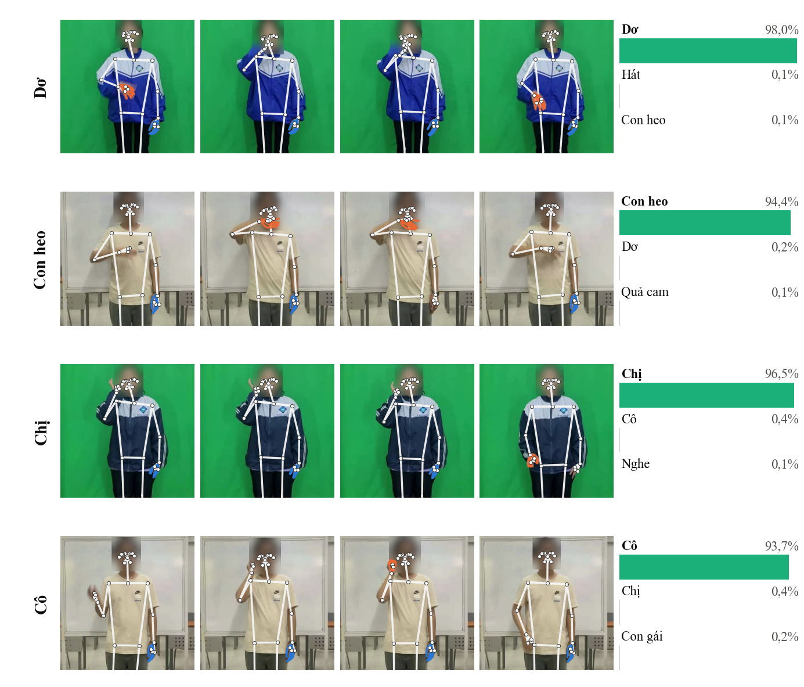

*Hình 27. Các clip "Dơ", "Con heo", "Chị", "Cô" được nhận đúng. Ảnh từ bộ dữ liệu VSL400 [19], vùng mặt đã được làm mờ*

**Nhận xét Hình 27.** Ở những clip được nhận đúng, mô hình tách được cặp từ với độ tin cậy cao: clip "Dơ" được đoán đúng với 98,0%, "Con heo" chỉ chiếm 0,1%; clip "Chị" đúng với 96,5%, "Cô" chỉ 0,4%. Từ còn lại trong cặp vẫn xuất hiện trong ba dự đoán đầu, cho thấy mô hình "biết" hai từ này giống nhau. Ở clip "Con heo" và "Cô" (hàng 2 và 4), bàn tay được nhận ra rõ khi đặt trên mặt. Còn ở clip "Dơ" (hàng 1), bàn tay mất điểm khi áp lên mũi nhưng mô hình vẫn đoán đúng, nhờ các đặc điểm khác của chuyển động như nhịp đưa tay lên và hạ xuống. Như vậy, việc mất điểm bàn tay làm tăng nguy cơ nhầm chứ không phải lúc nào cũng dẫn đến nhầm.

#### 5. Tổ hợp mô hình

| Tổ hợp (mô hình J76) | Tham số | Top-1 (%) | Top-5 (%) | Macro-F1 (%) | CI 95% |
|---|---:|---:|---:|---:|---|
| MS-TCN + ST-GCN | 4,00 M | 94,36 | 98,68 | 94,73 | 93,91–95,08 |
| CTR-GCN + Transformer | 6,85 M | 93,84 | 98,66 | 94,24 | 93,37–94,59 |
| CTR-GCN + ST-GCN + Transformer | 10,15 M | 94,79 | 98,74 | 95,13 | 94,37–95,51 |
| ST-GCN + CTR-GCN + CTR-GCN-BT + MultiRate | 12,44 M | **95,08** | **98,78** | **95,44** | 94,64–95,81 |

*Bảng 12. Kết quả tổ hợp trên VSL400. Tổ hợp 4 mô hình được chọn bằng cách dò mọi tổ hợp 2–4 mô hình trên chính tập test, nên số của nó lạc quan hơn các dòng còn lại*

**Nhận xét Bảng 12.** Tổ hợp nâng Macro-F1 lên 95,4%, hơn mô hình đơn tốt nhất khoảng 0,7 điểm, và tăng số gloss đạt F1 = 1 từ 185 lên 215. Tổ hợp có lợi nhất khi các thành viên sai theo những kiểu khác nhau, như ở tổ hợp 4 mô hình gồm cả MultiRate. Ghép CTR-GCN với Transformer lại kém CTR-GCN đứng riêng, vì Transformer yếu hơn hẳn. Tổ hợp không sửa được các cặp mà mọi thành viên cùng nhầm, như Dơ – Con heo (Hình 17).

#### 6. Khả năng tổng quát khác miền (CH4)

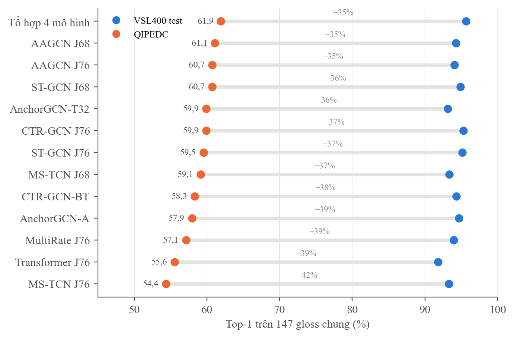

*Hình 28. Top-1 trên cùng 147 gloss chung: VSL400 (xanh) và QIPEDC (cam). Số nhỏ là mức suy giảm tương đối*

| Mô hình | QIPEDC Top-1 (%) | QIPEDC Top-5 (%) | QIPEDC Macro-F1 (%) | Suy giảm Top-1 | Dự đoán ra ngoài 147 gloss |
|---|---:|---:|---:|---:|---:|
| MS-TCN J76 | 54,37 | 71,43 | 56,43 | 41,7% | 25,0% |
| ST-GCN J76 | 59,52 | 71,83 | 65,03 | 37,5% | 24,6% |
| CTR-GCN J76 | 59,92 | 71,83 | 64,04 | 37,1% | **23,4%** |
| AAGCN J68 | 61,11 | **74,21** | **67,64** | **35,2%** | 24,6% |
| AAGCN J76 | 60,71 | 71,43 | 66,55 | 35,5% | 23,8% |
| MultiRate J76 | 57,14 | 71,03 | 63,65 | 39,2% | 29,4% |
| CTR-GCN-BT | 58,33 | 71,43 | 61,18 | 38,2% | 24,6% |
| AnchorGCN-A | 57,94 | 70,24 | 63,60 | 38,8% | 25,8% |
| Tổ hợp 4 mô hình | **61,90** | 72,62 | 66,98 | 35,3% | 23,8% |

*Bảng 13. Kết quả trên 252 clip QIPEDC thuộc 147 gloss chung. Dự đoán ra ngoài 147 gloss được tính là sai*

**Nhận xét Hình 28 và Bảng 13.**

- Đây là phát hiện quan trọng nhất của đợt thực nghiệm. **Khi đổi nguồn video, mọi mô hình mất khoảng 35–42% Top-1**: từ khoảng 94% xuống 54–62%. Độ chính xác cao trên VSL400 chưa bảo đảm sản phẩm dùng tốt với người ký mới.
- Khoảng một phần tư số clip QIPEDC bị đoán thành một từ nằm ngoài 147 gloss chung. Như vậy mô hình nhầm sang từ khác hẳn, chứ không chỉ nhầm giữa các từ gần nhau.
- **Thứ hạng thay đổi khi đổi miền.** AAGCN, vốn đứng sau CTR-GCN trên VSL400, lại tổng quát tốt nhất trong các mô hình đơn. CTR-GCN-BT ngang CTR-GCN trên VSL400 nhưng thấp hơn gần 3 điểm Macro-F1 trên QIPEDC. Vì vậy chọn mô hình cho sản phẩm phải dựa vào cả kết quả khác miền.
- QIPEDC chỉ có 1–3 clip mỗi gloss, nên khoảng tin cậy rộng (ví dụ CTR-GCN J76: Macro-F1 64,0%, CI 57,9–68,2%). Chênh lệch dưới 5 điểm giữa các mô hình ở mức này chưa có ý nghĩa thống kê.

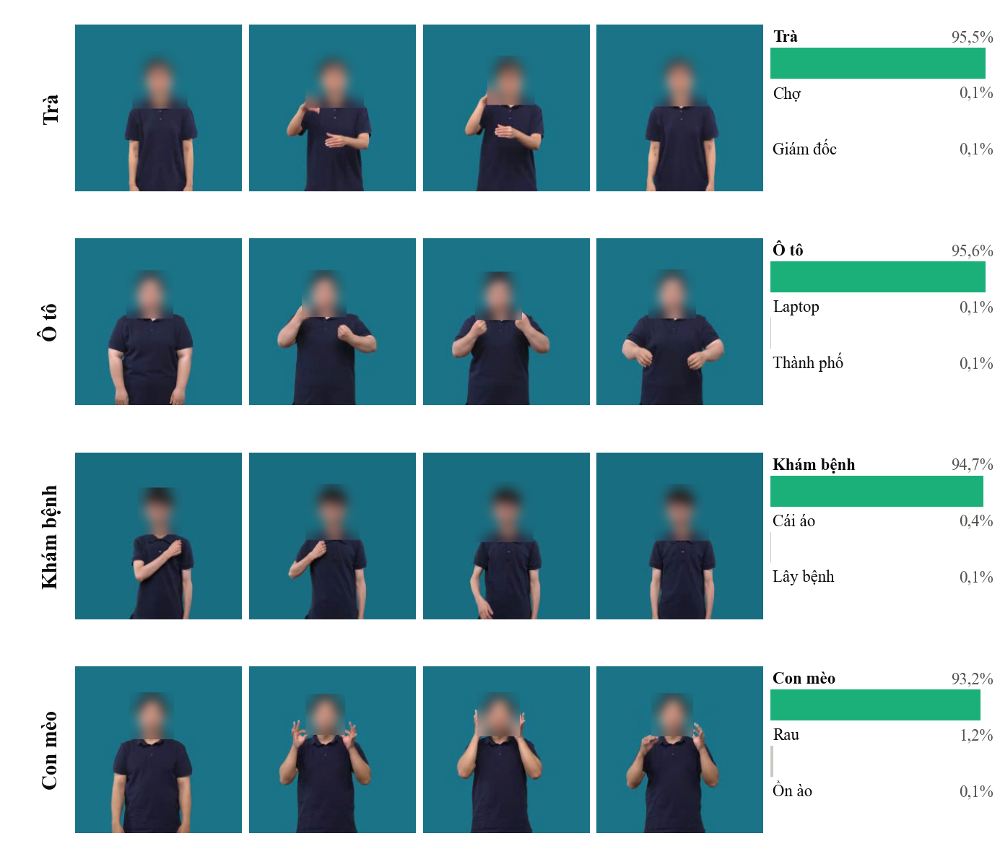

*Hình 29. Video QIPEDC khác nguồn được nhận đúng: "Trà", "Ô tô", "Khám bệnh", "Con mèo". Ảnh từ video QIPEDC [17], vùng mặt đã được làm mờ*

**Nhận xét Hình 29.** Dù độ chính xác chung giảm khi đổi nguồn, mô hình vẫn nhận đúng **151/252 clip QIPEDC** (59,9%), nhiều clip với độ tin cậy trên 93%. Những video này khác VSL400 ở mọi mặt: phông nền xanh dương thay vì xanh lá, người ký khác, áo tối màu, khung hình rộng hơn và người ký đứng xa hơn. Việc vẫn nhận đúng cho thấy cách chuẩn hoá theo vai đã loại bỏ được phần lớn khác biệt về vị trí và kích thước người ký. Các từ được nhận đúng ở đây cũng có những nét rõ như ở mục 4: "Ô tô" và "Con mèo" dùng hai tay đối xứng, "Khám bệnh" có vị trí đặc trưng trước ngực.

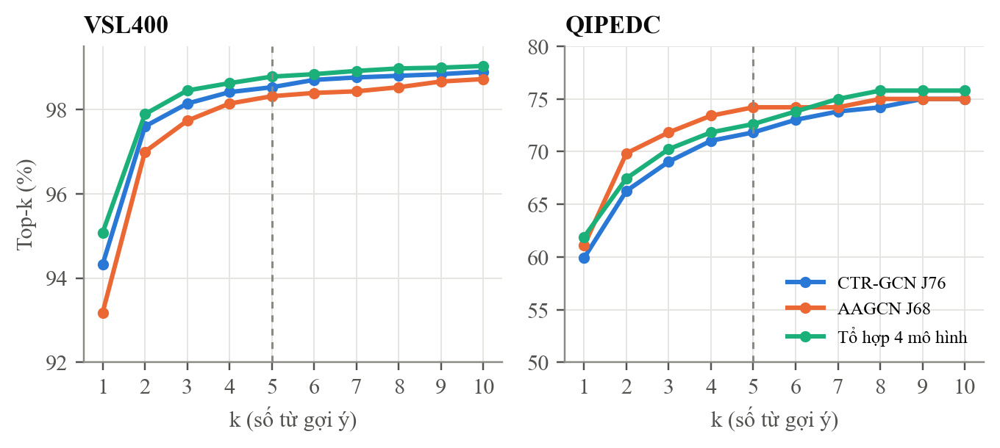

*Hình 30. Tỷ lệ có từ đúng trong k từ gợi ý đầu tiên*

**Nhận xét Hình 30.** Trên VSL400, đường Top-k gần như đi ngang từ k = 3 vì đã đạt khoảng 98%. Trên QIPEDC, đường tăng rõ đến k = 5: khi cho người dùng chọn trong 5 từ gợi ý, tỷ lệ có từ đúng tăng từ khoảng 60% lên 72–74%. Từ k = 6 trở đi, mỗi từ gợi ý thêm chỉ tăng chưa đến 1 điểm. Điều này ủng hộ thiết kế giao diện hiển thị **5 từ ứng viên** khi mô hình không chắc chắn.

#### 7. Độ tin cậy và ngưỡng từ chối

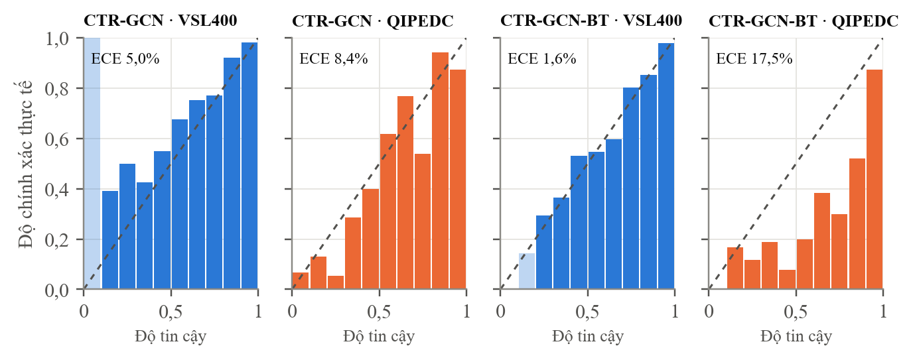

*Hình 31. Biểu đồ độ tin cậy: cột là độ chính xác thực tế trong từng khoảng độ tin cậy, đường chéo là hiệu chuẩn lý tưởng. Cột nhạt là khoảng có dưới 10 clip*

**Nhận xét Hình 31.** Một mô hình hiệu chuẩn tốt có các cột bám sát đường chéo: khi nó báo 80% thì đúng khoảng 80%. Trên VSL400, CTR-GCN-BT hiệu chuẩn rất tốt (ECE 1,6%). Nhưng trên QIPEDC, các cột của nó nằm thấp hơn đường chéo nhiều (ECE 17,5%): mô hình **tự tin quá mức với video lạ**. Ví dụ, khi báo độ tin cậy khoảng 85%, nó chỉ đúng khoảng một nửa số lần. CTR-GCN lệch ít hơn nhiều (ECE 8,4% trên QIPEDC), nên độ tin cậy mà giao diện hiển thị đáng tin hơn.

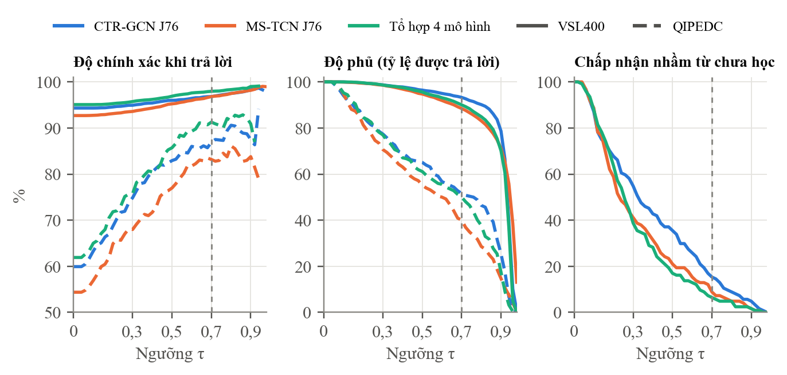

*Hình 32. Ảnh hưởng của ngưỡng τ: độ chính xác khi trả lời, tỷ lệ được trả lời và tỷ lệ chấp nhận nhầm từ chưa học*

| Mô hình | Phủ VSL400 | Đúng VSL400 | Phủ QIPEDC | Đúng QIPEDC | Chấp nhận nhầm từ chưa học |
|---|---:|---:|---:|---:|---:|
| MS-TCN J76 | 88,5% | 96,8% | 40,1% | 83,2% | 8,9% |
| ST-GCN J76 | 87,6% | 97,5% | 48,4% | 85,2% | 18,5% |
| CTR-GCN J76 | 93,3% | 96,8% | 51,6% | 86,9% | 15,3% |
| AAGCN J68 | 91,6% | 97,0% | 61,9% | 80,1% | 21,0% |
| CTR-GCN-BT | 93,8% | 96,6% | 66,3% | 79,0% | 25,0% |
| MultiRate J76 | 87,8% | 97,5% | 40,1% | 90,1% | 8,9% |
| Tổ hợp 4 mô hình | 90,0% | **98,0%** | 50,0% | **91,3%** | **6,5%** |

*Bảng 14. Kết quả với ngưỡng τ = 0,7: hệ thống chỉ trả lời khi độ tin cậy ≥ 0,7, còn lại đề nghị ký lại*

**Nhận xét Hình 32 và Bảng 14.**

- **Ngưỡng từ chối là cách đơn giản để tăng độ tin cậy.** Khi τ tăng, độ chính xác khi trả lời tăng (khung trái), đổi lại tỷ lệ được trả lời giảm (khung giữa). Với CTR-GCN và τ = 0,7, độ chính xác trên QIPEDC tăng từ 59,9% lên 86,9%, đổi lại hệ thống chỉ trả lời 51,6% số lần.
- **Từ chưa học là rủi ro thực tế** (khung phải). Không có ngưỡng, mô hình luôn trả lời một từ nào đó cho ký hiệu chưa học. Ở τ = 0,7, mô hình đơn vẫn chấp nhận nhầm 9–25% số clip chưa học, còn tổ hợp 4 mô hình giảm xuống 6,5%.
- Nhóm chọn **τ = 0,7** làm ngưỡng cho sản phẩm.

#### 8. Hiệu năng triển khai

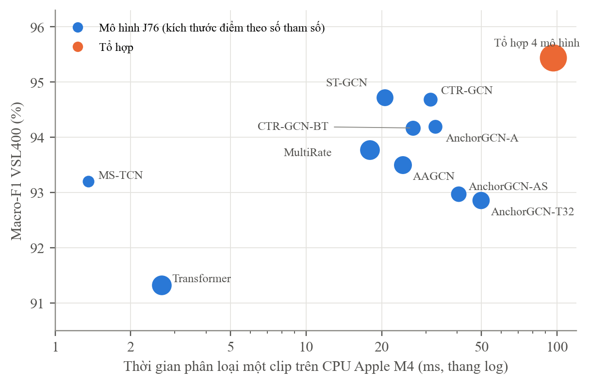

*Hình 33. Macro-F1 so với thời gian phân loại một clip trên CPU (kích thước điểm tỷ lệ với số tham số)*

| Mô hình (J76) | Tham số | Dung lượng tệp | Thời gian CPU / clip |
|---|---:|---:|---:|
| MS-TCN | 0,71 M | 2,7 MB | 1,4 ms |
| Transformer | 5,18 M | 19,8 MB | 2,7 ms |
| MultiRate-Attn-STGCN | 5,21 M | 20,2 MB | 17,9 ms |
| ST-GCN | 3,30 M | 12,7 MB | 20,6 ms |
| AAGCN | 3,95 M | 15,8 MB | 24,2 ms |
| CTR-GCN | 1,67 M | 6,7 MB | 31,2 ms |
| AnchorGCN-T32 | 3,57 M | 14,0 MB | 49,6 ms |
| Tổ hợp 4 mô hình | 12,44 M | 48,4 MB | 96,4 ms |

*Bảng 15. Kích thước và tốc độ, đo trên CPU Apple M4 (4 luồng, PyTorch 2.14, mỗi lần một clip, trung vị 30 lần chạy, chưa gồm MediaPipe)*

**Nhận xét Hình 33 và Bảng 15.**

- Mọi mô hình đơn phân loại một clip dưới 50 ms, và tổ hợp 4 mô hình dưới 0,1 giây. Một ký hiệu kéo dài trung bình 2,61 giây [19], nên thời gian phân loại gần như không cảm nhận được. **Sản phẩm không cần GPU.**
- Hình 33 cho thấy sự đánh đổi. MS-TCN rất nhanh nhưng kém chính xác hơn. Các mô hình đồ thị chính xác hơn khoảng 1,5 điểm nhưng chậm hơn 15–22 lần, dù vẫn chỉ vài chục mili giây. Tổ hợp chính xác nhất nhưng chậm nhất và nặng nhất.
- Số tham số ít không đồng nghĩa với chạy nhanh. CTR-GCN chỉ có 1,67 triệu tham số nhưng chậm hơn ST-GCN, vì nó tính một topo riêng cho từng kênh.

#### 9. Hiệu quả của các mô hình đề xuất ở trường hợp mục tiêu

Ở Bảng 9, không mô hình đề xuất nào vượt ST-GCN và CTR-GCN về Macro-F1 trên toàn bộ 422 từ: MultiRate J76 đạt 93,78%, CTR-GCN-BT 94,17%, AnchorGCN-A 94,20%. Tuy vậy, mỗi đề xuất được thiết kế cho một loại lỗi cụ thể, nên cần đánh giá ở đúng các trường hợp đó. Nhóm dùng lại kết quả dự đoán của lần chấm ở mục D.I.3 và xét bốn góc: (1) các clip thuộc 14 chiều nhầm của Bảng 10; (2) khả năng sửa lỗi của mô hình mốc khi ghép tổ hợp; (3) độ tin cậy trên video khác nguồn; (4) các tập con rộng theo tốc độ ký và vị trí tay, để kiểm tra giả thuyết ở mức tổng quát hơn. So sánh hai mô hình trên cùng tập clip dùng kiểm định McNemar chính xác; khoảng tin cậy của chênh lệch dùng bootstrap ghép cặp 2.000 lần.

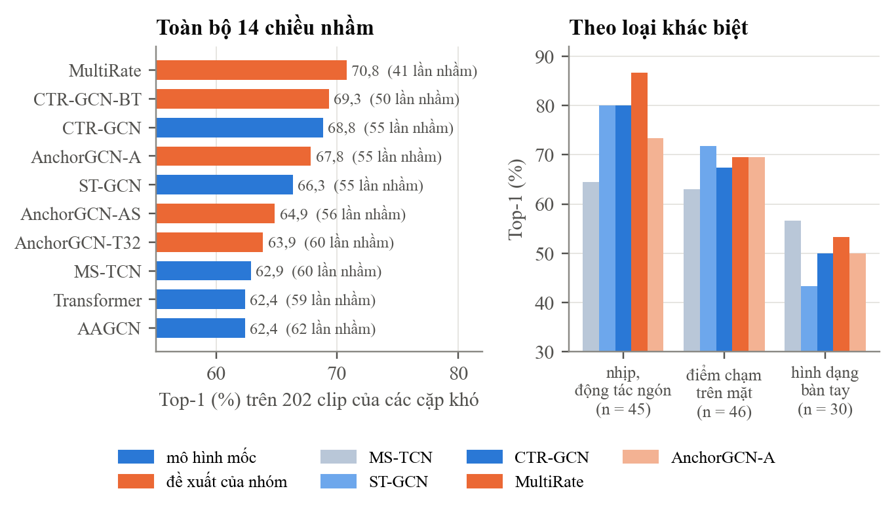

*Hình 34. Top-1 trên 202 clip thuộc 14 chiều nhầm của Bảng 10 (trái) và theo loại khác biệt giữa hai từ (phải). Số trong ngoặc là số clip bị đoán thành đúng từ còn lại của cặp*

**Nhận xét Hình 34.**

- **MultiRate đúng nhiều nhất trên các cặp khó:** Top-1 70,8%, và số lần nhầm sang từ còn lại của cặp giảm từ 55 (ST-GCN, CTR-GCN) xuống 41, tức giảm 25%. So với MS-TCN, cải thiện có ý nghĩa thống kê: 24 clip chỉ MultiRate đúng, 8 clip chỉ MS-TCN đúng (p = 0,007). So với ST-GCN, kết quả nghiêng về MultiRate (17 so với 8 clip) nhưng chưa đủ ý nghĩa (p = 0,11) vì số clip còn ít.
- **Rõ nhất ở nhóm khác nhau về nhịp và động tác ngón** (Nhẹ, Bánh tét, Bánh chưng): MultiRate đạt 86,7%, ST-GCN và CTR-GCN 80,0%, MS-TCN 64,4%. Đây đúng là loại lỗi mà ba nhánh 32, 64, 96 khung được thiết kế để giải quyết.
- **CTR-GCN-BT đứng thứ hai** (69,3%, 50 lần nhầm), hơn CTR-GCN mà nó cải biên (68,8%, 55 lần nhầm).
- **AnchorGCN-A cải thiện ở nhóm điểm chạm trên mặt** (Chị, Cô, Xôi): 69,6% so với 67,4% của CTR-GCN, mô hình gốc của nó; chiều Cô → Chị giảm từ 4/15 xuống 1/15. Tuy vậy ST-GCN vẫn cao hơn ở nhóm này (71,7%), và tổng số lần nhầm không giảm.
- Ở nhóm khác nhau về hình dạng bàn tay (Dơ, Con heo), mọi mô hình chỉ đúng khoảng 50%. Đây là thông tin mà khung xương hiện tại chưa mô tả đủ, không đề xuất nào nhắm vào.

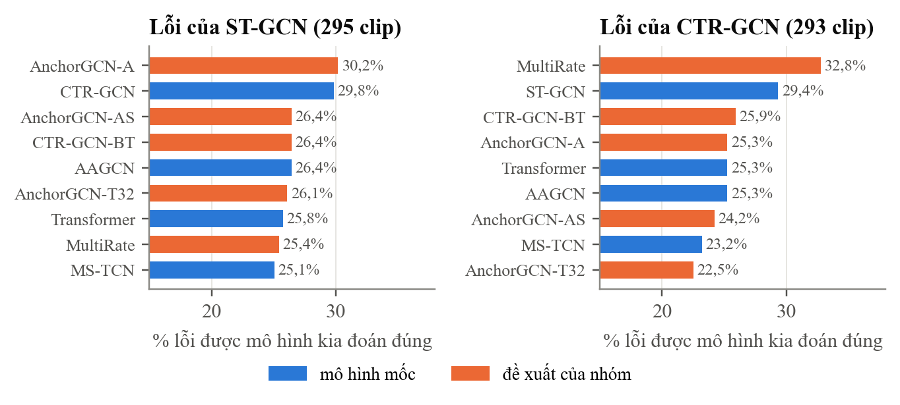

*Hình 35. Tỷ lệ clip mà ST-GCN (trái) hoặc CTR-GCN (phải) đoán sai nhưng mô hình khác đoán đúng*

**Nhận xét Hình 35.**

- Một mô hình có ích cho tổ hợp khi nó đúng ở chỗ mô hình mốc sai. Trong 293 clip CTR-GCN đoán sai, **MultiRate đoán đúng 96 clip (32,8%)**, nhiều nhất trong mọi mô hình, kể cả ST-GCN (29,4%). Trong 295 clip ST-GCN đoán sai, **AnchorGCN-A đoán đúng 89 clip (30,2%)**, cũng nhiều nhất.
- Như vậy các đề xuất sai theo kiểu khác với mô hình mốc. Điều này giải thích vì sao tổ hợp tốt nhất ở Bảng 12 gồm cả MultiRate và CTR-GCN-BT, và đạt Macro-F1 95,4%, cao hơn mọi mô hình đơn.

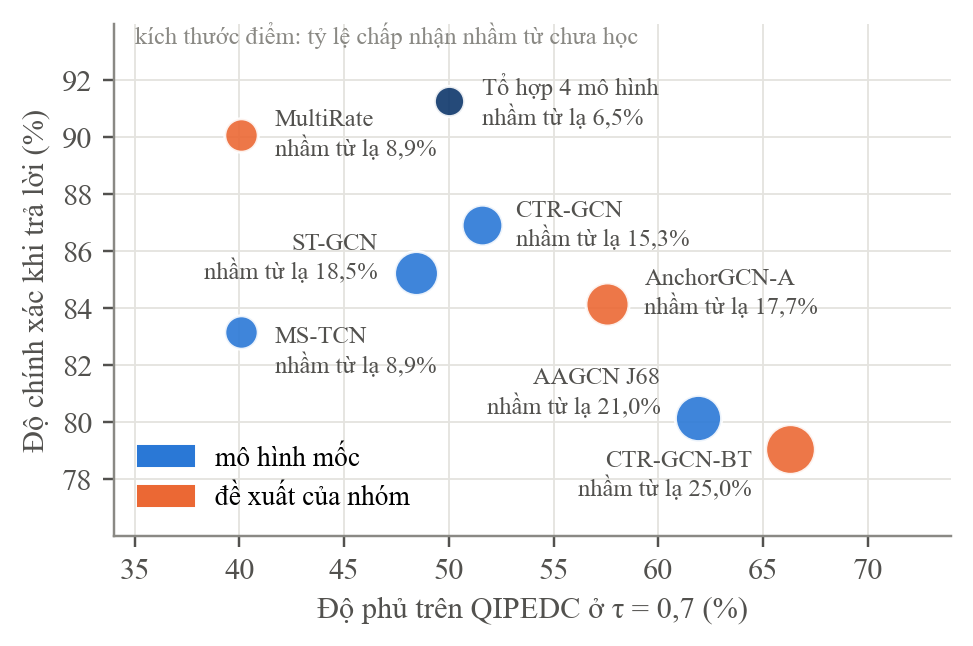

*Hình 36. Độ phủ và độ chính xác khi trả lời trên QIPEDC với ngưỡng τ = 0,7. Kích thước điểm tỷ lệ với tỷ lệ chấp nhận nhầm từ chưa học*

**Nhận xét Hình 36.**

- **MultiRate là mô hình đơn đáng tin nhất trên video lạ.** Khi trả lời, nó đúng 90,1% (CTR-GCN 86,9%, ST-GCN 85,2%) và chỉ chấp nhận nhầm 8,9% clip từ chưa học (CTR-GCN 15,3%, ST-GCN 18,5%). ECE trên QIPEDC của nó là 7,0%, thấp nhất trong các mô hình đơn (Bảng 18). Đổi lại, nó trả lời ít hơn (40,1% số clip).
- **CTR-GCN-BT ở đầu bên kia:** trả lời nhiều nhất (66,3%) nhưng đúng ít hơn (79,0%). Trên VSL400, nó có Top-5 cao nhất (98,62%) và ECE thấp nhất (1,6%).
- **AnchorGCN-A nằm giữa** ở τ = 0,7; với τ = 0,9, nó đúng 90,7% khi trả lời trên QIPEDC, cao nhất trong các mô hình đơn (Bảng 18).

| Tập con VSL400 test | Số clip | MultiRate − ST-GCN | CTR-GCN-BT − CTR-GCN | AnchorGCN-A − CTR-GCN |
|---|---:|---|---|---|
| Ký rất nhanh (r < 0,85) | 523 | 0,00 [−1,53; 1,53] | −1,53 [−3,06; −0,19] | −1,15 [−2,87; 0,38] |
| Tốc độ bình thường (0,92 ≤ r ≤ 1,08) | 2.602 | −0,61 [−1,35; 0,08] | −0,42 [−1,12; 0,31] | −0,38 [−1,08; 0,31] |
| Ký rất chậm (r > 1,17) | 514 | −0,78 [−2,72; 1,17] | −0,19 [−1,36; 0,97] | −0,19 [−1,75; 1,36] |
| Tay gần mặt (25% clip cao nhất) | 1.292 | −0,70 [−1,63; 0,31] | −0,08 [−0,93; 0,70] | −0,39 [−1,32; 0,54] |
| Tay xa mặt (50% clip thấp nhất) | 2.569 | −0,70 [−1,48; 0,08] | −0,93 [−1,67; −0,19] | −0,27 [−1,01; 0,43] |

*Bảng 16. Chênh lệch Top-1 (điểm %) giữa mô hình đề xuất và mô hình gốc trên các tập con rộng, kèm khoảng tin cậy 95%. r là độ dài clip chia cho trung vị độ dài của cùng từ trên tập train; "tay gần mặt" là tỷ lệ khung có điểm tay cách tâm miệng dưới 0,75 lần độ rộng vai*

**Nhận xét Bảng 16.** Ở mức tập con rộng, các đề xuất **không** vượt mô hình gốc: chênh lệch đều quanh 0 và khoảng tin cậy chứa 0, trừ CTR-GCN-BT thấp hơn khoảng 1–1,5 điểm ở hai tập con. Như vậy MultiRate không giúp đều cho mọi clip ký nhanh hay chậm, mà giúp ở những cặp từ mà nhịp chính là điểm phân biệt. Tương tự, AnchorGCN-A không tốt hơn với mọi clip có tay gần mặt, mà chỉ ở các từ phân biệt nhau bằng điểm chạm. Nhóm ghi nhận điều này để không khái quát quá mức kết quả ở Hình 34.

Hình 37 và Hình 38 là các clip cụ thể trong tập test mà mô hình đề xuất đoán đúng còn **cả ST-GCN và CTR-GCN đều đoán sai**. Khung hình lấy từ video gốc, vùng mặt đã được làm mờ; bên phải là từ mà mỗi mô hình đoán ra kèm độ tin cậy.

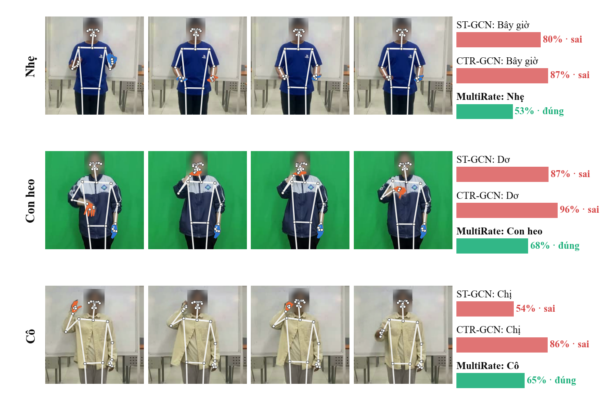

*Hình 37. Ba clip mà MultiRate đoán đúng còn ST-GCN và CTR-GCN đoán sai. Ảnh từ VSL400 [19], vùng mặt đã được làm mờ*

**Nhận xét Hình 37.**

- **"Nhẹ"**: người ký chỉ chuyển động hai tay rất nhỏ ở ngang bụng. Hai mô hình gốc đoán thành "Bây giờ" với độ tin cậy 80% và 87%, MultiRate đoán đúng "Nhẹ". Đây là cặp khác nhau chủ yếu ở nhịp chuyển động (mục 3.2).
- **"Con heo"**: hai mô hình gốc đoán "Dơ" và rất tự tin (87% và 96%), MultiRate đoán đúng với 68%.
- **"Cô"**: tay chạm ở má, hai mô hình gốc đoán "Chị", MultiRate đoán đúng với 65%.
- Ở cả ba clip, câu trả lời đúng có độ tin cậy dưới τ = 0,7, nên trong sản phẩm hệ thống sẽ hiện 5 từ gợi ý thay vì tự thêm vào câu. Ngược lại, CTR-GCN sai với độ tin cậy 86–96% và sẽ bị chấp nhận nhầm. Đây là ví dụ cụ thể cho kết luận ở Hình 36.

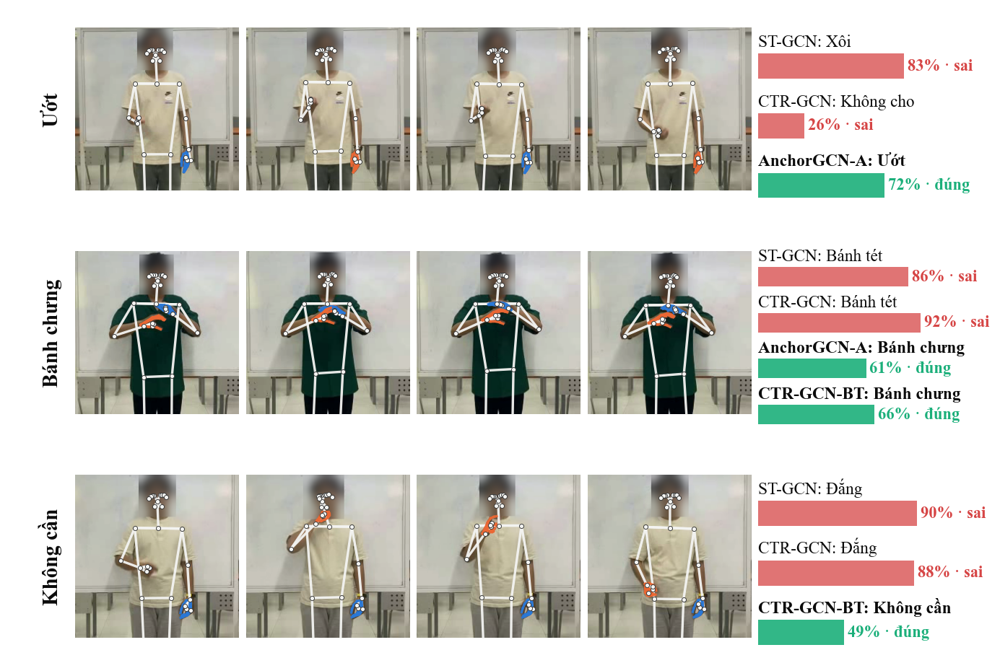

*Hình 38. Ba clip mà AnchorGCN-A hoặc CTR-GCN-BT đoán đúng còn ST-GCN và CTR-GCN đoán sai. Ảnh từ VSL400 [19], vùng mặt đã được làm mờ*

**Nhận xét Hình 38.**

- **"Ướt"**: ST-GCN đoán "Xôi" với 83%, đúng là cặp khác nhau ở điểm chạm của Bảng 10. AnchorGCN-A, mô hình đo vị trí tay so với các mốc trên mặt, đoán đúng với 72%, vượt ngưỡng τ = 0,7.
- **"Bánh chưng"**: hai mô hình gốc đều đoán "Bánh tét" (86% và 92%); cả AnchorGCN-A và CTR-GCN-BT đoán đúng.
- **"Không cần"**: hai mô hình gốc đoán "Đắng" với khoảng 90%; chỉ CTR-GCN-BT đoán đúng, nhưng độ tin cậy thấp (49%).

**Mức độ đại diện của các ví dụ.** Đây là các ví dụ được chọn để minh hoạ, không phải trường hợp điển hình. Trên toàn bộ tập test có 207 clip mà cả ST-GCN và CTR-GCN cùng sai. MultiRate đoán đúng 36 clip trong số đó, nhưng cũng sai 90 clip mà cả hai mô hình gốc đều đúng, phù hợp với Macro-F1 chung thấp hơn. Điểm đáng chú ý là **14/36 lần đúng (39%) của MultiRate rơi vào 20 từ của các cặp khó**, trong khi các từ này chỉ chiếm 285/5.163 clip (5,5%), tức tập trung gấp khoảng 7 lần. Tỷ lệ tương ứng của CTR-GCN-BT là 11/26 (42%) và của AnchorGCN-A là 8/29 (28%). Như vậy phần mô hình đề xuất làm tốt hơn tập trung đúng vào các trường hợp mà chúng nhắm tới.

**Kết luận mục 9.** Các mô hình đề xuất không thay thế mô hình mốc mà **bổ sung** cho nó. MultiRate giảm 25% số lần nhầm ở các cặp khó, rõ nhất ở các cặp khác nhịp, và là mô hình đơn đáng tin nhất trên video lạ. AnchorGCN-A và CTR-GCN-BT sửa được các lỗi khác với mô hình mốc. Nhờ vậy, tổ hợp có các đề xuất đạt Macro-F1 cao nhất (95,4%).

### III. Ưu điểm

- **Độ chính xác cao trong cùng miền:** Top-1 94,3%, Top-5 98,5% và Macro-F1 94,7% trên 422 từ. Tổ hợp mô hình đạt Macro-F1 95,4%.
- **Nhẹ và nhanh:** mô hình chính chỉ có 1,7 triệu tham số và 6,7 MB, phân loại một ký hiệu trong khoảng 30 ms trên CPU, không cần GPU.
- **Chỉ cần một webcam:** không cần găng tay, cảm biến độ sâu hay máy chủ.
- **Bảo vệ quyền riêng tư:** chỉ xử lý toạ độ khớp, không cần lưu hay gửi hình ảnh người dùng.
- **Kết luận có cơ sở:** mọi mô hình được so sánh trên cùng dữ liệu và cùng cấu hình, có khoảng tin cậy, có kiểm tra trên video khác nguồn, và các lỗi được giải thích bằng chính video gốc.
- **Có cơ chế an toàn:** ngưỡng từ chối và 5 từ gợi ý giúp hệ thống biết khi nào nên hỏi lại thay vì đoán sai.
- **Đề xuất có tác dụng ở đúng chỗ nhắm tới:** MultiRate giảm 25% số lần nhầm ở các cặp khó và đúng 90,1% khi trả lời trên video lạ; các đề xuất sửa được tới 30–33% lỗi của mô hình mốc, nên nâng tổ hợp lên Macro-F1 95,4%.

### IV. Hạn chế

- **Giảm mạnh khi đổi nguồn video:** Top-1 giảm từ khoảng 94% xuống 54–62% trên QIPEDC. Đây là hạn chế lớn nhất trước khi đưa vào sử dụng rộng rãi.
- **Số liệu cùng miền là cận trên:** tập test được dùng để chọn checkpoint, chưa có tập kiểm tra tách theo người ký.
- **Một số cặp ký hiệu chưa phân biệt được**, như Dơ – Con heo và Không cần – Đắng, do thiếu thông tin khuôn mặt và do bàn tay bị mất điểm khi ở gần mặt.
- **Bộ từ vựng có giới hạn:** 422 từ, và mô hình vẫn có thể chấp nhận nhầm từ chưa học.

## PHẦN E: KẾT LUẬN

Sau thời gian nghiên cứu và thực nghiệm, nhóm đã xây dựng được quy trình hoàn chỉnh từ video đến từ ngữ cho ngôn ngữ ký hiệu tiếng Việt, đồng thời huấn luyện và đánh giá 14 mô hình trên 422 từ của bộ VSL400. Mô hình tốt nhất đạt Top-1 94,3% với 1,7 triệu tham số, và chạy được trên CPU trong khoảng 30 ms. Các thực nghiệm trả lời được bốn câu hỏi nghiên cứu:

1. Mô hình đồ thị vượt mốc MS-TCN khoảng 1,5 điểm Macro-F1 với khoảng tin cậy không chồng lấn (CH1).
2. Điểm chân không giúp ích và còn làm giảm khả năng tổng quát, nên sản phẩm bỏ điểm chân (CH2).
3. Các cặp dễ nhầm có vị trí và quỹ đạo tay gần như trùng nhau, chỉ khác ở hình dạng tay, điểm chạm, nhịp hoặc khẩu hình. Mô hình đa tốc độ giảm rõ lỗi do khác nhịp, còn các cặp khác nhau ở nét mặt cần thêm thông tin khuôn mặt (CH3).
4. Khi đổi nguồn video, độ chính xác giảm 35–42%, nhưng ngưỡng từ chối và 5 từ gợi ý giúp hệ thống vẫn hữu ích (CH4).

### 1. Tính mới

- Dùng cả thân và hai bàn tay ở cấp từ cho ngôn ngữ ký hiệu tiếng Việt, khác với các nghiên cứu chỉ dùng điểm bàn tay cho chữ cái [15].
- So sánh có hệ thống bảy họ mô hình trên cùng quy trình, có khoảng tin cậy và có đánh giá khác miền, một hướng còn ít công trình cho tiếng Việt.
- Đo được định lượng mức suy giảm khi đổi nguồn video, tác động của điểm chân và tỷ lệ mất bàn tay khi tay ở gần mặt, làm cơ sở cho các nghiên cứu sau.

### 2. Tính sáng tạo

- Đề xuất **AnchorGCN**, mô tả trực tiếp vị trí bàn tay so với tám mốc trên mặt, cổ và vai.
- Đề xuất **MultiRate-Attn-STGCN**, xử lý ký hiệu ở ba tốc độ và gộp bằng attention. Mô hình này giảm 25% số lần nhầm ở các cặp khó (41 so với 55 của ST-GCN và CTR-GCN), đạt 86,7% ở các cặp khác nhịp so với 80,0%, và là mô hình đơn đáng tin nhất trên video lạ.
- Thiết kế cờ hợp lệ cho từng điểm để xử lý điểm bị mất một cách tường minh.
- Giải thích lỗi của mô hình bằng cách đối chiếu ma trận nhầm lẫn với video và quỹ đạo tay thật.
- Tổ chức huấn luyện phân tán trên nhiều tài khoản GPU miễn phí, có cơ chế huấn luyện tiếp từ checkpoint.

### 3. Khả năng áp dụng của sản phẩm

Sản phẩm chạy trên máy tính có webcam, không cần thiết bị chuyên dụng. Vì vậy có thể dùng ở quầy dịch vụ công, bệnh viện, ngân hàng hoặc trường chuyên biệt, cho các trao đổi ngắn. Sản phẩm cũng hỗ trợ người nghe và giáo viên học ký hiệu nhờ phản hồi trực tiếp. Nhóm chọn **CTR-GCN J76** làm mô hình mặc định vì chính xác, nhỏ gọn và hiệu chuẩn tốt, kèm ngưỡng **τ = 0,7** và 5 từ gợi ý. Khi máy đủ mạnh, sản phẩm chuyển sang tổ hợp 4 mô hình để giảm chấp nhận nhầm. Với các tình huống quan trọng như y tế hay pháp lý, phiên dịch viên vẫn là lựa chọn đúng.

### 4. Hướng nghiên cứu phát triển

- Tách tập kiểm tra theo người ký để có số liệu cùng miền khách quan.
- Giảm mức suy giảm khác miền bằng tăng cường dữ liệu mô phỏng điều kiện webcam và tiền huấn luyện tự giám sát trên dữ liệu tư thế [14].
- Bổ sung điểm chi tiết trên khuôn mặt và môi cho các cặp khác nhau ở khẩu hình, và dùng bộ tìm bàn tay tốt hơn khi tay ở gần mặt.
- Tiếp tục phát triển AnchorGCN để tách các cặp khác nhau ở điểm chạm trên mặt.
- Thử nghiệm sản phẩm với người Điếc, có người Điếc tham gia từ khâu chọn từ vựng đến khâu đánh giá [4].
- Mở rộng bộ từ vựng và hướng tới dịch câu liên tục.

Nhóm hy vọng đề tài góp phần tạo thêm một kênh giao tiếp giữa người Điếc và người nghe, và cung cấp dữ liệu, phương pháp cho các nghiên cứu về ngôn ngữ ký hiệu tiếng Việt.

## TÀI LIỆU THAM KHẢO

[1] World Health Organization. *WHO: 1 in 4 people projected to have hearing problems by 2050*. 2021. <https://www.who.int/news/item/02-03-2021-who-1-in-4-people-projected-to-have-hearing-problems-by-2050>

[2] Cục Thống kê, Bộ Tài chính. *Thông cáo báo chí về kết quả Điều tra người khuyết tật năm 2023*. 2024. <https://www.nso.gov.vn/tin-tuc-thong-ke/2024/11/thong-cao-bao-chi-ve-ket-qua-dieu-tra-nguoi-khuyet-tat-nam-2023/>

[3] World Bank. *How Vietnam Opened New Doors for Deaf Children*. 2022. <https://www.worldbank.org/en/news/feature/2022/11/17/how-vietnam-opened-new-doors-for-deaf-children>

[4] D. Bragg et al. "Sign Language Recognition, Generation, and Translation: An Interdisciplinary Perspective." *ACM SIGACCESS Conference on Computers and Accessibility (ASSETS)*, 2019. <https://arxiv.org/abs/1908.08597>

[5] D. Li, C. Rodriguez Opazo, X. Yu, H. Li. "Word-level Deep Sign Language Recognition from Video: A New Large-scale Dataset and Methods Comparison." *IEEE Winter Conference on Applications of Computer Vision (WACV)*, 2020. <https://arxiv.org/abs/1910.11006>

[6] S. Jiang, B. Sun, L. Wang, Y. Bai, K. Li, Y. Fu. "Skeleton Aware Multi-modal Sign Language Recognition." CVPR 2021 Challenge on Large Scale Signer Independent Isolated Sign Language Recognition, 2021. <https://arxiv.org/abs/2103.08833>

[7] S. Yan, Y. Xiong, D. Lin. "Spatial Temporal Graph Convolutional Networks for Skeleton-Based Action Recognition." *AAAI Conference on Artificial Intelligence*, 2018, pp. 7444–7452. <https://arxiv.org/abs/1801.07455>

[8] Y. Chen, Z. Zhang, C. Yuan, B. Li, Y. Deng, W. Hu. "Channel-Wise Topology Refinement Graph Convolution for Skeleton-Based Action Recognition." *IEEE/CVF International Conference on Computer Vision (ICCV)*, 2021, pp. 13359–13368. <https://openaccess.thecvf.com/content/ICCV2021/html/Chen_Channel-Wise_Topology_Refinement_Graph_Convolution_for_Skeleton-Based_Action_Recognition_ICCV_2021_paper.html>

[9] Y. Abu Farha, J. Gall. "MS-TCN: Multi-Stage Temporal Convolutional Network for Action Segmentation." *IEEE/CVF Conference on Computer Vision and Pattern Recognition (CVPR)*, 2019, pp. 3575–3584. <https://arxiv.org/abs/1903.01945>

[10] F. Zhang et al. "MediaPipe Hands: On-device Real-time Hand Tracking." 2020. <https://arxiv.org/abs/2006.10214>

[11] V. Bazarevsky, I. Grishchenko, K. Raveendran, T. Zhu, F. Zhang, M. Grundmann. "BlazePose: On-device Real-time Body Pose Tracking." CVPR Workshop on Computer Vision for Augmented and Virtual Reality, 2020. <https://arxiv.org/abs/2006.10204>

[12] L. Shi, Y. Zhang, J. Cheng, H. Lu. "Skeleton-Based Action Recognition with Multi-Stream Adaptive Graph Convolutional Networks." *IEEE Transactions on Image Processing*, 2020. DOI: 10.1109/TIP.2020.3028207. <https://arxiv.org/abs/1912.06971>

[13] T. Dang, I. A. Bessmertny. "ViSL One-shot: generating Vietnamese sign language data set." *Scientific and Technical Journal of Information Technologies, Mechanics and Optics*, 2024. <https://openbooks.itmo.ru/read_ntv/22753/22753.pdf>

[14] P. Selvaraj et al. "OpenHands: Making Sign Language Recognition Accessible with Pose-based Pretrained Models across Languages." *Annual Meeting of the Association for Computational Linguistics (ACL)*, 2022. <https://arxiv.org/abs/2110.05877>

[15] M.-H. Ha, D.-C. Nguyen, T.-K. Dinh, T. Tien-Tam, D. T. Thanh, O. T.-C. Chen. "Deep Learning Based Graph Convolutional Network Using Hand Skeletal Points For Vietnamese Sign Language Classification." *Iranian Journal of Electrical and Electronic Engineering*, 22(1), 2026, pp. 106–117. DOI: 10.22068/IJEEE.22.1.3717. <https://ijeee.iust.ac.ir/article-1-3717-en.html>

[16] N. S. Dinh et al. "Sign Language Recognition: A Large-Scale Multi-View Dataset and Comprehensive Evaluation." *IEEE/CVF Winter Conference on Applications of Computer Vision (WACV)*, 2025, pp. 7876–7886. <https://openaccess.thecvf.com/content/WACV2025/html/Dinh_Sign_Language_Recognition_A_Large-Scale_Multi-View_Dataset_and_Comprehensive_Evaluation_WACV_2025_paper.html>

[17] Lakeserl. *SignConnect: Vietnamese Sign Language Dataset* (video từ QIPEDC), Hugging Face. <https://huggingface.co/datasets/Lakeserl/SignConnect>

[18] T. Nguyen Quoc et al. "VSL400: A Multi-view Dataset for Vietnamese Word-Level Sign Language Recognition." Preprint, Authorea. DOI: 10.22541/au.177075292.21810740/v1. <https://www.authorea.com/doi/full/10.22541/au.177075292.21810740/v1>

[19] T. Nguyen Quoc, K. Pham Dang, V. Truong Duy, V. Truong Hoang, S. Bilik, M. Sindelar, J. Stefansky, A. Łysiak, R. Martinek, P. Bilik. *A Multi-view Dataset for Vietnamese Word-Level Sign Language Recognition* (v1) [Data set]. Zenodo, 2026. DOI: 10.5281/zenodo.17943574. <https://zenodo.org/records/17943574>

[20] L. Shi, Y. Zhang, J. Cheng, H. Lu. "Two-Stream Adaptive Graph Convolutional Networks for Skeleton-Based Action Recognition." *IEEE/CVF Conference on Computer Vision and Pattern Recognition (CVPR)*, 2019, pp. 12026–12035. <https://arxiv.org/abs/1805.07694>

[21] M. Boháček, M. Hrúz. "Sign Pose-Based Transformer for Word-Level Sign Language Recognition." *IEEE/CVF Winter Conference on Applications of Computer Vision Workshops (WACVW)*, 2022, pp. 182–191. DOI: 10.1109/WACVW54805.2022.00024. <https://openaccess.thecvf.com/content/WACV2022W/HADCV/html/Bohacek_Sign_Pose-Based_Transformer_for_Word-Level_Sign_Language_Recognition_WACVW_2022_paper.html>

[22] C. Feichtenhofer, H. Fan, J. Malik, K. He. "SlowFast Networks for Video Recognition." *IEEE/CVF International Conference on Computer Vision (ICCV)*, 2019, pp. 6202–6211. <https://arxiv.org/abs/1812.03982>

[23] C. Guo, G. Pleiss, Y. Sun, K. Q. Weinberger. "On Calibration of Modern Neural Networks." *International Conference on Machine Learning (ICML)*, PMLR 70, 2017, pp. 1321–1330. <https://proceedings.mlr.press/v70/guo17a.html>

## PHỤ LỤC

### A. Một số hình ảnh minh hoạ

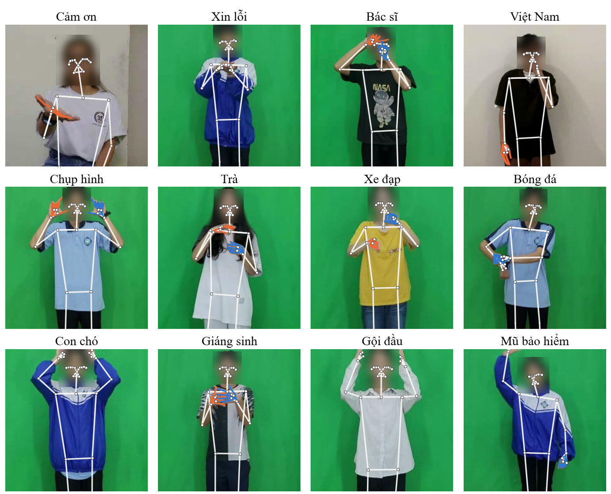

*Hình 39. Mười hai ký hiệu trong VSL400 được mô hình nhận đúng toàn bộ, mỗi ký hiệu lấy khung có tay giơ cao nhất. Ảnh từ bộ dữ liệu VSL400 [19], vùng mặt đã được làm mờ*

Hình 39 cho thấy sự đa dạng của bộ dữ liệu: người ký khác nhau về giới tính, vóc dáng, trang phục, và một số clip được quay trong phòng thay vì trước phông xanh. Các ký hiệu dùng nhiều vị trí khác nhau: trước ngực ("Xin lỗi", "Giáng sinh"), trên đầu ("Con chó", "Gội đầu", "Mũ bảo hiểm"), ngang mặt ("Chụp hình", "Bác sĩ").

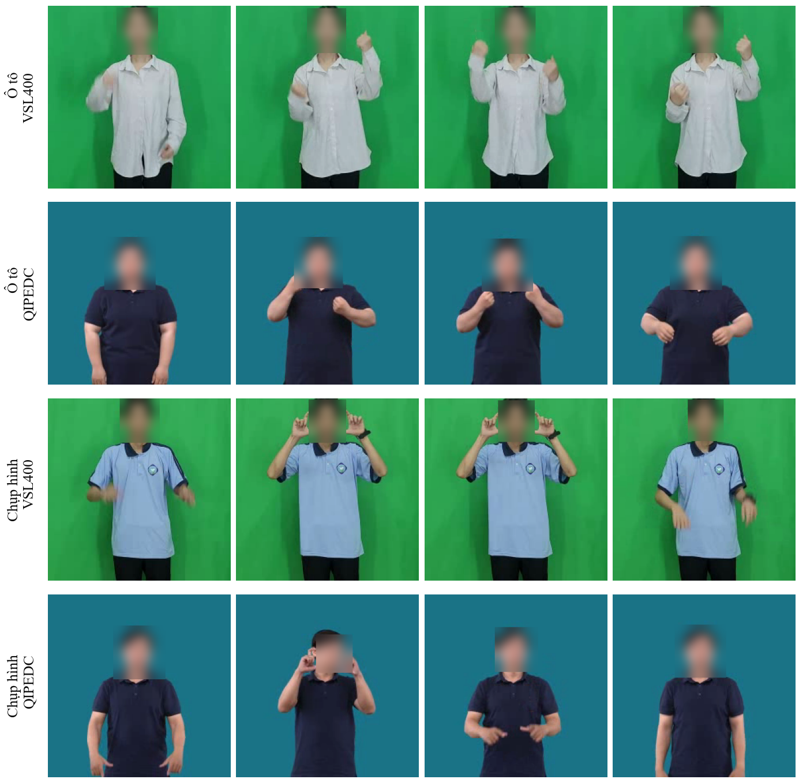

*Hình 40. Cùng một từ ở hai nguồn: VSL400 (hàng trên của mỗi từ) và QIPEDC (hàng dưới). Ảnh từ VSL400 [19] và QIPEDC [17], vùng mặt đã được làm mờ*

Hình 40 minh hoạ vì sao độ chính xác giảm khi đổi nguồn video. Cùng từ "Ô tô", người ký VSL400 đưa hai nắm tay lên cao ngang vai và chuyển động lệch nhịp, còn người ký QIPEDC giữ hai nắm tay thấp hơn, ngang ngực. Cùng từ "Chụp hình", hai người đều tạo khung bằng ngón tay, nhưng ở VSL400 hai tay giơ cao và dang rộng hai bên đầu, còn ở QIPEDC hai tay đặt sát nhau trước mặt. Ngoài phông nền và người ký, chính **cách thể hiện ký hiệu** cũng khác nhau giữa các nguồn, một khác biệt mà chuẩn hoá toạ độ không loại bỏ được.

### B. Danh sách từ theo kết quả nhận diện

**Các từ được nhận đúng toàn bộ trên tập test (F1 = 1, CTR-GCN J76), 185 từ:** Ba lô, Buổi chiều, Buổi sáng, Buổi trưa, Buổi tối, Bà ngoại, Bàn phím, Bác sĩ, Bánh bao, Báo cáo, Bình minh, Bóng chuyền, Bóng rổ, Bóng đá, Bút chì, Băn khoăn, Bơi lội, Bảng, Bắt buộc, Bắt chước, Cao (người), Chiều, Chân, Chăm chỉ, Chạy, Chậm chạp, Chật, Chồng, Chụp hình, Chủ tịch, Con bò, Con chó, Con dê, Con gà, Con gái, Con gấu, Con mèo, Con thỏ, Con trâu, Cung cấp, Cái áo, Cám dỗ, Cười, Cảm thấy, Cảm ơn, Cần, Cầu lông, Cắm trại, Cứu, Cửa sổ, Dây chuyền, Dép, Dũng cảm, Dở, Dụng cụ học tập, Dừng lại, Giáng sinh, Giây, Giúp đỡ, Giường, Giặt đồ, Gối (đầu), Gội đầu, Hay (khen), Hiệu trưởng, Hoàng hôn, Hy vọng, Hài hước, Hâm mộ, Hư, Họ hàng, Hứa, Khám bệnh, Khó, Khô, Không quen, Khăn quàng cổ, Kẹo, Laptop, Luật sư, Làm bài tập, Lây bệnh, Mua bán, Màu cam, Màu nâu, Màu trắng, Màu xanh da trời, Màu xanh lá cây, Màu đen, Mách, Mát mẻ, Máy bay, Máy điều hòa, Múa, Mũ bảo hiểm, Mặn, Mềm, Mệt, Mới, Nghèo, Ngoan, Ngon miệng, Ngày, Ngày Nhà giáo Việt Nam, Ngày Quốc tế Phụ nữ, Ngày Quốc tế Thiếu nhi, Nhanh, Nhà trọ, Nhân viên phục vụ, Nhân viên văn phòng, Nhìn, Nhảy cao, Nhật Bản, Nhớ, Nói chuyện, Nói xấu, Nông dân, Năm, Nướng, Phía sau, Phút, Phơi đồ, Phở, Quan sát, Quạt (đứng), Quả bơ, Quả cam, Quả chuối, Quả dâu, Quả dừa, Quả xoài, Rau, Rẻ, Rửa chén, Rửa mặt, Sai, Sinh viên, Sách, Sáng tạo, Tham ăn, Thay đổi, Thuyền, Thái Lan, Tháng bảy, Tháng mười hai, Tháng mười một, Thèm, Thư ký, Thước kẻ, Thấp (đồ vật), Thể dục (thể thao), Thời gian, Thứ bảy, Trung thu, Trà, Trường Cao đẳng, Trẻ, Trễ, Trứng, Trực thăng, Tìm, Tôi, Tốt bụng, Từ chối, Viết, Việt Nam, Vòng tay, Võ, Xe đạp, Xin, Xin lỗi, Xuất viện, Xấu (người), Xấu (vật), Y tá, Áo sơ mi, Áo đầm, Áp dụng, Ông ngoại, Ăn mừng, Đi, Điền kinh, Đúng, Đậm, Đọc.

| STT | Từ | Số clip test | Số clip nhận đúng | F1 |
|---:|---|---:|---:|---:|
| 1 | Con heo | 15 | 7 | 0,48 |
| 2 | Dơ | 15 | 8 | 0,53 |
| 3 | Thứ ba | 13 | 8 | 0,59 |
| 4 | Thứ tư | 13 | 8 | 0,59 |
| 5 | Khóc | 17 | 9 | 0,62 |
| 6 | Nhầm lẫn | 11 | 8 | 0,67 |
| 7 | Cô | 15 | 11 | 0,69 |
| 8 | Màu vàng | 15 | 11 | 0,69 |
| 9 | Tháng chín | 12 | 8 | 0,70 |
| 10 | Chị | 16 | 11 | 0,71 |
| 11 | Nhẹ | 17 | 11 | 0,71 |
| 12 | Hát | 15 | 10 | 0,71 |
| 13 | Tháng một | 12 | 9 | 0,72 |
| 14 | Xôi | 15 | 9 | 0,72 |
| 15 | Bây giờ | 15 | 12 | 0,73 |
| 16 | Nhạt | 14 | 9 | 0,75 |
| 17 | Đắng | 11 | 9 | 0,75 |
| 18 | Nghề nghiệp | 16 | 11 | 0,76 |
| 19 | Không cần | 12 | 8 | 0,76 |
| 20 | Thứ năm | 12 | 8 | 0,76 |

*Bảng 17. Hai mươi từ có F1 thấp nhất (CTR-GCN J76)*

Phần lớn các từ ở Bảng 17 nằm trong các cặp đã phân tích ở mục D.II.3 (Dơ, Con heo, Chị, Cô, Nhẹ, Bây giờ, Xôi, Ướt, Đắng, Không cần). Nhóm còn lại gồm các từ chỉ thời gian như Thứ ba, Thứ tư, Thứ năm, Tháng một, Tháng chín. Các từ này chủ yếu bị nhầm với nhau (Thứ ba ↔ Thứ tư, Thứ năm → Thứ tư, Tháng chín → Tháng một), nên nhiều khả năng chúng có cùng động tác nền và chỉ khác nhau ở chi tiết của bàn tay, đúng loại chi tiết mà khung xương mô tả kém.

### C. Các chỉ số bổ sung

| Mô hình | ECE VSL400 | ECE QIPEDC | τ = 0,9: phủ / đúng VSL400 | τ = 0,9: phủ / đúng QIPEDC | τ = 0,9: chấp nhận nhầm |
|---|---:|---:|---|---|---:|
| MS-TCN J76 | 4,5% | 12,3% | 71,1% / 98,2% | 14,7% / 83,8% | 1,6% |
| ST-GCN J76 | 9,3% | 11,9% | 56,5% / 98,4% | 27,0% / 83,8% | 4,8% |
| CTR-GCN J76 | 5,0% | 8,4% | 78,7% / 98,3% | 25,4% / 87,5% | 4,8% |
| AAGCN J68 | 2,1% | 12,3% | 81,8% / 98,1% | 45,6% / 88,7% | 8,1% |
| CTR-GCN-BT | 1,6% | 17,6% | 85,9% / 97,8% | 53,2% / 87,3% | 8,1% |
| AnchorGCN-A | 3,0% | 9,8% | 82,1% / 98,3% | 38,5% / 90,7% | 8,1% |
| MultiRate J76 | 7,2% | 7,0% | 65,8% / 98,7% | 10,3% / 88,5% | 3,2% |
| Tổ hợp 4 mô hình | 7,6% | 9,7% | 70,1% / 99,0% | 17,5% / 90,9% | 1,6% |

*Bảng 18. Hiệu chuẩn và kết quả với ngưỡng τ = 0,9*

### D. Mã nguồn và số liệu gốc

Mã đánh giá, số liệu gốc của mọi bảng và hình, cùng mã vẽ hình được lưu trong kho mã của đề tài:

- `reports/ket-qua-2026-11-21/`: mã chấm lại mô hình, mã tổng hợp chỉ số và các tệp số liệu.
- `reports/ket-qua-2026-11-21/de_xuat.py` và `de-xuat.json`: phân tích các mô hình đề xuất ở trường hợp mục tiêu (mục D.II.9).
- `docs/bao-cao-ket-qua/ve_bieu_do.py`: mã vẽ các biểu đồ kết quả.
- `docs/bao-cao-ket-qua/ve_de_xuat.py` và `ve_khung_de_xuat.py`: mã vẽ Hình 34–38.
- `docs/bao-cao-ket-qua/ve_khung_hinh.py`: mã trích khung hình từ video, làm mờ khuôn mặt, vẽ khung xương và quỹ đạo tay.
