# TRÌNH BÀY Ý TƯỞNG

## I. Tên ý tưởng

**Nhận diện ngôn ngữ ký hiệu tiếng Việt bằng các mạng nơ-ron nhân tạo, hỗ trợ giao tiếp cho người Điếc**

## II. Giới thiệu tổng quan

### 1. Hoàn cảnh cần có giải pháp mới

Theo Tổ chức Y tế Thế giới, đến năm 2050 có gần 2,5 tỷ người sống với một mức độ suy giảm thính lực, trong đó ít nhất 700 triệu người cần dịch vụ phục hồi chức năng [1]. Tại Việt Nam, tỷ lệ khuyết tật ở người từ 2 tuổi trở lên năm 2023 là 6,11% [2]. Ngân hàng Thế giới ước tính Việt Nam có khoảng 116.000 trẻ em Điếc, và phần lớn các em chỉ dựa vào đọc khẩu hình hoặc máy trợ thính [3].

Ngôn ngữ ký hiệu là cầu nối tự nhiên của cộng đồng Điếc, nhưng người nghe hiếm khi biết ngôn ngữ này. Vì vậy, các tình huống hằng ngày như đi khám bệnh, đến ngân hàng hay làm thủ tục hành chính thường phải có phiên dịch hoặc người thân đi cùng. Dự án QIPEDC đã xây dựng kho khoảng 4.000 ký hiệu và 150 bài giảng video cho bậc tiểu học [3], nhưng đây là nguồn tài liệu để tra cứu và học, chưa giúp hai bên trao đổi trực tiếp.

Về mặt kỹ thuật, nhiều nghiên cứu về tiếng Việt mới dừng ở bảng chữ cái và chữ số, hoặc chỉ dùng điểm bàn tay [15]. Những hướng này chưa đủ cho giao tiếp thực tế vì ký hiệu cấp từ phụ thuộc đồng thời vào hình dạng tay, chuyển động và vị trí tay so với mặt, thân. Trên thế giới, các bộ dữ liệu cấp từ đã đạt quy mô hơn 2.000 từ với hơn 100 người ký [5], hoặc 1.000 từ với 30 người ký và nhiều góc quay [16], trong khi tài nguyên công khai cho tiếng Việt vẫn còn ít. Một khó khăn khác là dữ liệu ký hiệu ở Việt Nam trải trên ba miền Bắc, Trung, Nam [13], nên mô hình học từ một nguồn dữ liệu có thể giảm chất lượng khi gặp người ký và điều kiện quay khác.

### 2. Giới thiệu sơ lược về ý tưởng

Ý tưởng gồm hai phần gắn với nhau:

1. **Nghiên cứu mô hình phân loại:** so sánh có hệ thống các mô hình học sâu trên chuỗi khung xương để phân loại ký hiệu cấp từ (gloss) trên bộ dữ liệu VSL400 [18][19], sau đó cải tiến theo các lỗi quan sát được.
2. **Sản phẩm demo:** xây dựng ứng dụng dùng webcam, tự tách từng ký hiệu trong luồng video và hiển thị từ nhận diện được dưới dạng chữ, có thể phát thành giọng nói.

Hệ thống không cần găng tay, cảm biến chiều sâu hay máy chủ GPU khi suy luận. Người ký chỉ cần đứng trước một camera thông thường.

### 3. Ý nghĩa của ý tưởng

**Ý nghĩa kinh tế**

- Giảm phụ thuộc vào phiên dịch trong các trao đổi ngắn và đơn giản, nhờ đó tiết kiệm chi phí cho gia đình và đơn vị cung cấp dịch vụ.
- Chạy trên máy tính có sẵn nên chi phí triển khai ban đầu thấp.
- Có thể đóng gói thành mô-đun cho quầy dịch vụ, bệnh viện, ngân hàng và cơ sở giáo dục đặc biệt.

**Ý nghĩa xã hội**

- Mở thêm một kênh giao tiếp giữa người Điếc và người nghe, góp phần giúp người Điếc tiếp cận dịch vụ công và việc làm.
- Hỗ trợ người thân, giáo viên và người nghe học ký hiệu thông qua phản hồi trực tiếp.
- Tạo cơ sở dữ liệu và phương pháp mở cho nghiên cứu tiếng Việt, một lĩnh vực còn ít tài nguyên.

**Ý nghĩa môi trường**

- Là phần mềm chạy trên thiết bị sẵn có, không tạo thêm phần cứng chuyên dụng.
- Xử lý ngay trên máy người dùng nên giảm nhu cầu truyền video và điện năng máy chủ.

**Ý nghĩa khác**

- **Quyền riêng tư:** sau bước trích khung xương, mô hình chỉ làm việc với toạ độ, không cần gửi hay lưu hình ảnh khuôn mặt người dùng.
- **Khoa học:** cung cấp phép so sánh các kiến trúc trên cùng dữ liệu và cùng quy trình huấn luyện, cùng đánh giá khác miền cho ngôn ngữ ký hiệu tiếng Việt.

## III. Mô tả ý tưởng

### 1. Mô tả sản phẩm: cấu tạo và nguyên lý hoạt động

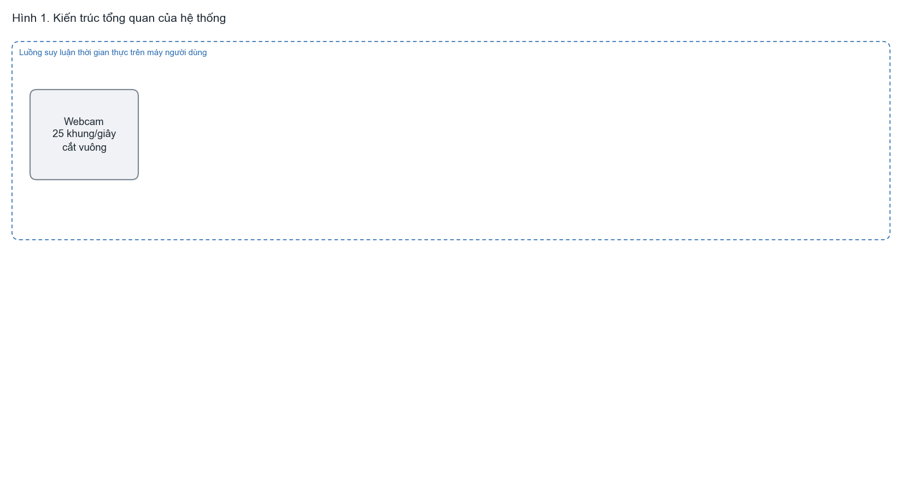

*Hình 1. Kiến trúc tổng quan. Bản in: [PDF](so-do/hinh-1-tong-quan-he-thong.pdf)*

Sản phẩm gồm sáu khối:

| Khối | Chức năng | Công nghệ |
|---|---|---|
| Thu nhận hình ảnh | Lấy khung hình từ webcam, cắt vuông để khớp định dạng 224×224 của dữ liệu huấn luyện | OpenCV |
| Trích khung xương | Ước lượng 33 điểm cơ thể [11] và 21 điểm mỗi bàn tay [10], cộng điểm cổ, tổng cộng 76 điểm | MediaPipe |
| Tách ký hiệu | Xác định thời điểm bắt đầu và kết thúc một ký hiệu, loại khung lỗi | PoseStateMLP và hàng đợi cử chỉ |
| Chuẩn hoá | Đưa clip về hệ toạ độ theo vai, nội suy về số khung cố định | NumPy |
| Phân loại | Dự đoán gloss, trả về 5 ứng viên có xác suất cao nhất | PyTorch |
| Giao diện | Hiển thị chữ, độ tin cậy, phát giọng nói và yêu cầu ký lại khi cần | Ứng dụng máy tính |

**Nguyên lý hoạt động:** ở mỗi khung hình, hệ thống trích khung xương và ước lượng xác suất người dùng đang thực hiện ký hiệu. Khi xác suất vượt ngưỡng, các khung hợp lệ được đưa vào hàng đợi. Khi người dùng trở về tư thế nghỉ, clip được đóng lại, chuẩn hoá và đưa vào mô hình phân loại. Từ nhận được hiển thị ngay trên màn hình, sau đó hệ thống chờ tư thế nghỉ mới để nhận ký hiệu tiếp theo.

Phạm vi của sản phẩm demo là **nhận diện từng từ rời rạc**. Dịch liên tục cả câu là hướng phát triển sau, không thuộc phạm vi hiện tại.

### 2. Tính mới và tính sáng tạo

| Tiêu chí | Phiên dịch viên | Từ điển, bài giảng video | Găng tay cảm biến | Nhận diện chữ cái | Ý tưởng này |
|---|---|---|---|---|---|
| Trao đổi trực tiếp | Có | Không | Có | Hạn chế, phải đánh vần | Có, theo từng từ |
| Thiết bị | Không | Máy tính, điện thoại | Phần cứng riêng | Camera | Camera thông thường |
| Chi phí mỗi lần dùng | Cao | Thấp | Trung bình, thêm chi phí thiết bị | Thấp | Thấp |
| Độ chính xác ngữ nghĩa | Cao nhất | Do người học tự tra | Khó thu biểu cảm và vị trí tay so với mặt | Giới hạn ở chữ cái | Phụ thuộc mô hình, giới hạn trong bộ từ vựng |
| Sẵn có mọi lúc | Không | Có | Có | Có | Có |

Bảng trên là đánh giá định tính của nhóm. Sản phẩm **không nhằm thay thế phiên dịch viên**: trong các tình huống quan trọng như y tế hay pháp lý, phiên dịch viên vẫn là lựa chọn đúng.

Các điểm mới của ý tưởng:

1. **Dùng cả thân và hai bàn tay ở cấp từ.** Khác với các nghiên cứu chỉ dùng điểm bàn tay cho chữ cái và chữ số [15], đồ thị 76 điểm giữ được quan hệ giữa tay, mặt và thân.
2. **Xử lý điểm thiếu một cách tường minh.** Mỗi điểm có thêm cờ hợp lệ, giúp mô hình phân biệt điểm thật nằm ở gốc toạ độ với điểm mà bộ trích xuất không nhận được.
3. **Đưa quan hệ tay với mặt vào mô hình.** Biến thể AnchorGCN mô tả trực tiếp mỗi điểm bàn tay so với tám mốc ở mặt, cổ và vai, thay vì để thông tin đi qua nhiều bước trên đồ thị.
4. **Đánh giá vượt ra ngoài một bộ dữ liệu.** Ngoài tập kiểm tra cùng nguồn, mô hình được kiểm tra trên video từ nguồn khác và với người dùng thật.
5. **Nối từ nghiên cứu đến sản phẩm.** Cùng một quy trình tiền xử lý dùng cho huấn luyện và cho webcam, kèm bộ tách ký hiệu nhẹ để chạy thời gian thực.

### 3. Tính khả thi

**Về kỹ thuật:** các thành phần chính đều đã có nền tảng vững. MediaPipe được thiết kế để chạy thời gian thực trên thiết bị [10][11]. Mô hình đồ thị như ST-GCN [7] đã được cộng đồng dùng rộng rãi, và hướng khung xương kết hợp GCN đã xếp hạng nhất ở cuộc thi nhận diện ký hiệu độc lập người ký CVPR 2021 [6].

**Về dữ liệu:** bộ VSL400 [18][19] có quy mô lớn, thu từ nhiều người ký và đã được đề tài trích keypoint. Ngoài ra có nguồn video từ dự án QIPEDC để đánh giá khác miền [17].

**Về triển khai:** mã nguồn khung cho tiền xử lý, các mô hình, huấn luyện và suy luận qua webcam đã được xây dựng trong kho mã của đề tài, nên phần việc còn lại tập trung vào thực nghiệm, cải tiến và thử nghiệm với người dùng.

**Điều kiện cần:** ý tưởng hoàn toàn thực hiện được ở điều kiện hiện nay với máy tính cá nhân và GPU đám mây. Khó khăn lớn nhất không nằm ở công nghệ mà ở độ phủ từ vựng, khả năng tổng quát và sự tham gia của cộng đồng Điếc. Các điểm này được xử lý ở mục VI.

### 4. Bản vẽ, sơ đồ và công thức

Ý tưởng có 7 sơ đồ, mỗi sơ đồ là một trang PDF để in và một ảnh GIF động hiện dần từng bước. Xem các sơ đồ theo thứ tự Hình 1, 3, 5 là có thể nắm được nguyên lý vận hành. Tài liệu có 14 công thức ở mục III.6.

| Hình | Nội dung | Số chi tiết chính | Tệp |
|---|---|---|---:|
| 1 | Kiến trúc tổng quan | 12 khối | [PDF](so-do/hinh-1-tong-quan-he-thong.pdf), [GIF](so-do/hinh-1-tong-quan-he-thong.gif) |
| 2 | Đồ thị khung xương | 76 điểm | [PDF](so-do/hinh-2-do-thi-khung-xuong.pdf), [GIF](so-do/hinh-2-do-thi-khung-xuong.gif) |
| 3 | Quy trình nghiên cứu | 5 bước | [PDF](so-do/hinh-3-quy-trinh-nghien-cuu.pdf), [GIF](so-do/hinh-3-quy-trinh-nghien-cuu.gif) |
| 4 | Kiến trúc mô hình | 7 khối chính | [PDF](so-do/hinh-4-kien-truc-mo-hinh.pdf), [GIF](so-do/hinh-4-kien-truc-mo-hinh.gif) |
| 5 | Tách ký hiệu thời gian thực | 3 trạng thái, 2 kết quả | [PDF](so-do/hinh-5-tach-ky-hieu-thoi-gian-thuc.pdf), [GIF](so-do/hinh-5-tach-ky-hieu-thoi-gian-thuc.gif) |
| 6 | Thiết kế đánh giá | 3 mức kiểm tra | [PDF](so-do/hinh-6-thiet-ke-danh-gia.pdf), [GIF](so-do/hinh-6-thiet-ke-danh-gia.gif) |
| 7 | Kế hoạch thực hiện | 8 hạng mục | [PDF](so-do/hinh-7-ke-hoach-thuc-hien.pdf), [GIF](so-do/hinh-7-ke-hoach-thuc-hien.gif) |

### 5. Tổng quan các mô hình liên quan

Mục này tổng hợp các hướng tiếp cận chính, từ đó giải thích vì sao đề tài chọn các mô hình ở mục III.6.

#### 5.1. Từ ảnh video đến khung xương

Nghiên cứu nhận diện ký hiệu cấp từ có hai hướng lớn. Hướng dựa trên ảnh học trực tiếp từ điểm ảnh, còn hướng dựa trên tư thế (pose) học từ toạ độ khớp. WLASL so sánh cả hai hướng trên một bộ dữ liệu lớn, và đề xuất Pose-TGCN để mô hình hoá phụ thuộc không gian và thời gian của quỹ đạo khớp [5]. SAM-SLR kết hợp nhiều luồng RGB, độ sâu và khung xương, trong đó SL-GCN xử lý động học khung xương, và đạt hạng nhất cuộc thi nhận diện độc lập người ký CVPR 2021 [6].

Đa phương thức có lợi về độ chính xác nhưng nặng và cần nhiều luồng dữ liệu, trong khi sản phẩm của đề tài phải chạy trên máy tính thường với một camera. Bộ ước lượng tư thế như MediaPipe lại đủ nhẹ để chạy thời gian thực trên thiết bị [10][11]. Khung xương cũng tách bớt ảnh hưởng của phông nền và không cần giữ hình ảnh người dùng. Vì vậy đề tài chọn hướng khung xương, chấp nhận mất thông tin chi tiết về biểu cảm khuôn mặt.

#### 5.2. Mô hình thời gian: MS-TCN

MS-TCN được đề xuất cho phân đoạn hành động trong video dài, gồm nhiều tầng tích chập thời gian giãn, tầng sau tinh chỉnh dự đoán của tầng trước [9]. Tích chập giãn mở rộng vùng nhìn theo thời gian mà không làm tăng nhiều số tham số. Bài gốc giải bài toán gán nhãn theo khung, nên đề tài chỉ kế thừa ý tưởng khối tích chập giãn và chuyển sang phân loại cả clip. Mô hình này không dùng cấu trúc cơ thể, do đó đóng vai trò mốc để đo xem đồ thị có thực sự mang lại lợi ích.

#### 5.3. Mô hình đồ thị

**ST-GCN** biểu diễn chuỗi khung xương thành đồ thị không gian – thời gian và học đặc trưng trực tiếp từ dữ liệu, thay vì dựa vào các quy tắc thủ công [7]. Topo đồ thị của ST-GCN được định nghĩa trước theo cơ thể người và giữ cố định khi huấn luyện lẫn kiểm tra [8]. Với ký hiệu, đây là điểm yếu đáng lưu ý: hai bàn tay hoặc bàn tay và khuôn mặt có quan hệ về nghĩa nhưng lại cách nhau rất xa trên đồ thị xương.

**2s-AGCN** giải quyết điều đó bằng cách học topo đầu cuối qua lan truyền ngược, có thể dùng chung hoặc riêng cho từng mẫu, đồng thời thêm luồng thông tin bậc hai về chiều dài và hướng xương [20]. **MS-AAGCN** phát triển tiếp với mô-đun attention theo không gian, thời gian, kênh và thêm luồng chuyển động [12]. Đổi lại, số tham số tăng và mô hình dễ học khớp hơn khi dữ liệu mỗi lớp không nhiều.

**CTR-GCN** nhận thấy topo có vai trò chi phối việc tổng hợp đặc trưng, nên học một topo dùng chung làm tri thức nền rồi tinh chỉnh theo từng kênh, với rất ít tham số bổ sung [8]. Đây là ứng viên phù hợp cho thiết bị phổ thông vì cân bằng tốt giữa độ linh hoạt và kích thước mô hình.

Các mô hình trên được phát triển cho nhận diện hành động. **SL-GCN** trong SAM-SLR [6] và **Pose-TGCN** [5] cho thấy họ GCN chuyển được sang ngôn ngữ ký hiệu, nhưng cần tập trung vào bàn tay, nơi chứa nhiều thông tin nhất.

#### 5.4. Transformer trên tư thế

SPOTER áp dụng Transformer lên toạ độ khớp 2D với chi phí tính toán thấp, hướng tới thiết bị cầm tay. Bài báo đóng góp cách chuẩn hoá xử lý bàn tay trong hệ toạ độ cục bộ riêng và cách tăng cường bằng xoay khớp tuần tự [21]. Transformer nắm được quan hệ xa theo thời gian và giữa các khớp mà không cần đồ thị, nhưng thường cần nhiều dữ liệu hơn. Vì kiểu sai của nó khác GCN, đề tài dùng Transformer chủ yếu để tổ hợp. Ý tưởng hệ toạ độ cục bộ của SPOTER cũng là cơ sở để đề tài mô tả tay theo các mốc trên cơ thể trong AnchorGCN.

#### 5.5. Mô hình đa tốc độ

SlowFast dùng một nhánh tốc độ khung thấp để nắm ngữ nghĩa và một nhánh tốc độ cao, nhẹ hơn nhờ giảm số kênh, để nắm chuyển động nhanh [22]. Ký hiệu có đặc điểm tương tự: có đoạn giữ tư thế và có đoạn chuyển động nhanh, và tốc độ ký khác nhau giữa người ký. MultiRate-Attn-STGCN của đề tài áp dụng ý tưởng này cho đồ thị: nhánh 32 khung giữ đủ độ rộng, các nhánh 64 và 96 khung giảm độ rộng, sau đó gộp bằng attention.

#### 5.6. Khả năng tổng quát và ít dữ liệu

OpenHands huấn luyện bốn mô hình dựa trên tư thế trên sáu ngôn ngữ ký hiệu, và dùng tiền huấn luyện tự giám sát trên dữ liệu chưa gán nhãn để cải thiện khi có ít dữ liệu [14]. Kết quả này gợi ý một hướng khả thi cho tiếng Việt, nơi dữ liệu gán nhãn còn hạn chế.

#### 5.7. Nghiên cứu cho ngôn ngữ ký hiệu tiếng Việt

| Công trình | Dữ liệu | Hướng tiếp cận | Hạn chế so với mục tiêu đề tài |
|---|---|---|---|
| Ha và cộng sự [15] | 33 ký tự và chữ số, tự thu | GCN đa luồng trên điểm bàn tay | Chưa ở cấp từ, không dùng thân và mặt |
| Dang và Bessmertny [13] | 4.364 video, ba miền, có sinh thêm dữ liệu | GRU-LSTM trên vector MediaPipe | Tập trung vào sinh dữ liệu, chưa so sánh GCN |
| Dinh và cộng sự [16] | 1.000 gloss, 30 người ký, đa góc nhìn | So sánh nhiều mô hình trên đa góc nhìn | Cần nhiều camera, khác với một webcam |
| Nguyen Quoc và cộng sự [18][19] | VSL400: 400 gloss, 28 người ký, ba góc nhìn | Bộ dữ liệu cấp từ có người ký Điếc | Là bài công bố dữ liệu, cần thêm nghiên cứu về triển khai |

#### 5.8. Tổng kết và khoảng trống nghiên cứu

| Họ mô hình | Điểm mạnh | Điểm yếu | Vai trò trong đề tài |
|---|---|---|---|
| Đa phương thức RGB-D [6] | Giàu thông tin | Nặng, cần nhiều đầu vào | Không dùng, vì cần chạy trên máy thường |
| TCN [9] | Nhẹ, đơn giản | Không dùng cấu trúc cơ thể | Mốc so sánh |
| ST-GCN [7] | Đơn giản, dễ diễn giải | Topo cố định | Mốc của nhóm đồ thị |
| AGCN, MS-AAGCN [12][20] | Topo thích nghi, có attention | Nhiều tham số | Kiểm tra lợi ích của attention |
| CTR-GCN [8] | Linh hoạt, ít tham số | Tính toán topo theo kênh tốn thời gian hơn | Ứng viên chính cho sản phẩm |
| Transformer [21] | Nắm quan hệ xa | Cần nhiều dữ liệu | Thành viên tổ hợp |
| Đa tốc độ [22] | Nắm nhiều nhịp chuyển động | Nhiều nhánh, tăng tính toán | Hướng cải tiến |

Từ tổng quan trên, đề tài xác định ba khoảng trống. Thứ nhất, các mô hình GCN hiện đại chưa được so sánh đầy đủ trên cùng quy trình cho tiếng Việt cấp từ. Thứ hai, các mô hình phổ biến chưa mã hoá trực tiếp vị trí tay so với mặt, trong khi đây là yếu tố phân biệt nhiều ký hiệu. Thứ ba, ít công trình đi tiếp đến bước tách ký hiệu thời gian thực và đánh giá khác miền. Ba khoảng trống này tương ứng với các câu hỏi nghiên cứu CH1 đến CH4 ở mục 6.1.

### 6. Phương pháp thực hiện

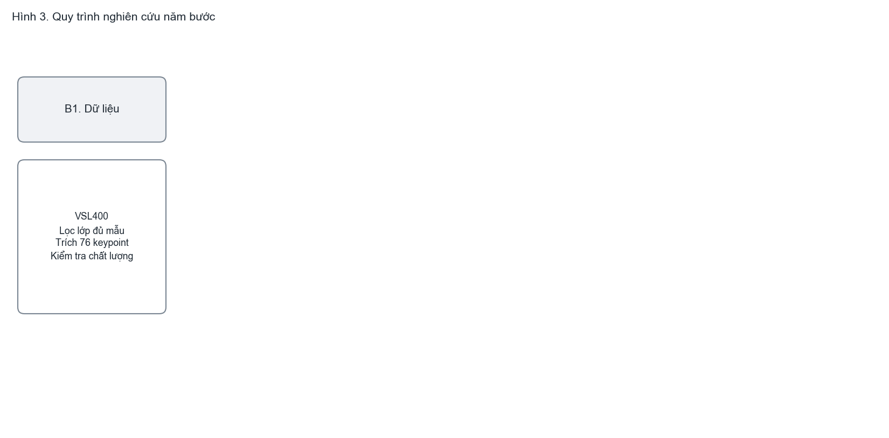

*Hình 3. Quy trình nghiên cứu. Bản in: [PDF](so-do/hinh-3-quy-trinh-nghien-cuu.pdf)*

#### 6.1. Câu hỏi nghiên cứu

- **CH1.** Với ký hiệu tiếng Việt cấp từ, mô hình đồ thị có vượt được mô hình chỉ dùng thông tin thời gian hay không, và mức độ chênh lệch có đáng so với chi phí tính toán?
- **CH2.** Các điểm chân có đóng góp gì cho việc phân loại, hay nên được bỏ để giảm nhiễu?
- **CH3.** Thông tin tay so với mặt, đa tốc độ thời gian và tổ hợp mô hình có giải quyết được các cặp ký hiệu dễ nhầm hay không?
- **CH4.** Mô hình giữ được bao nhiêu năng lực khi chuyển sang nguồn video khác và người dùng thật?

#### 6.2. Dữ liệu: bộ VSL400

Đề tài sử dụng bộ dữ liệu **VSL400** [18][19], bộ video cho nhận diện ngôn ngữ ký hiệu tiếng Việt cấp từ.

| Thuộc tính | Mô tả |
|---|---|
| Quy mô | 74.259 clip đã gán nhãn, 400 gloss riêng lẻ [19] |
| Người ký | 28 người [19], gồm cả người Điếc dùng ngôn ngữ ký hiệu bản ngữ [18] |
| Ghi hình | Ba camera RGB đồng bộ: chính diện, trái, phải [19] |
| Độ dài | Trung bình 2,61 giây mỗi clip, tổng khoảng 53,99 giờ [19] |
| Siêu dữ liệu | Nhãn gloss và thông tin người ký cho từng bản ghi [19] |
| Quyền riêng tư | Vùng mặt đã được khử nhận dạng, định danh trực tiếp đã được loại bỏ [19] |
| Điều kiện dùng | Giấy phép CC BY 4.0, cần đồng ý Thoả thuận sử dụng dữ liệu để truy cập video [19] |

**Cách sử dụng trong đề tài.** Vì sản phẩm chỉ dùng một webcam đặt trước mặt người ký, đề tài dùng góc quay chính diện. Mỗi video được chuyển về khung vuông 224×224 ở 25 khung/giây, sau đó trích thành chuỗi keypoint dạng (T, 76, 3) gồm 34 điểm thân (33 điểm Pose và điểm cổ) và 42 điểm tay.

**Quy tắc lọc.** Đề tài chỉ giữ gloss có ít nhất 20 clip huấn luyện, nhằm bảo đảm mỗi lớp đủ mẫu để học. Sau lọc còn **422 nhãn**, với 20.700 clip train và 5.163 clip test, độ dài trung vị 61 khung. Clip quá ngắn hoặc có quá ít khung hợp lệ bị loại khi chuẩn hoá.

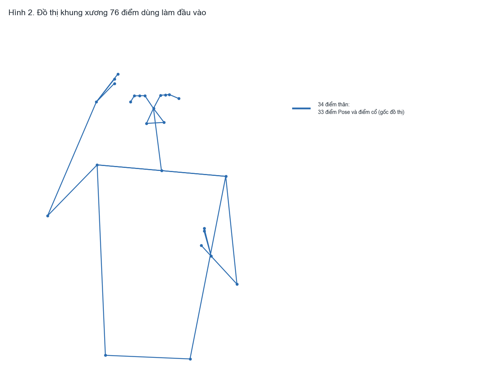

*Hình 2. Đồ thị khung xương, vẽ từ một khung thật trong VSL400. Bản in: [PDF](so-do/hinh-2-do-thi-khung-xuong.pdf)*

#### 6.3. Tiền xử lý và tăng cường

**Chuẩn hoá không gian.** Mục đích là loại bỏ khác biệt do vị trí đứng và khoảng cách đến camera. Với *ct* là trung điểm hai vai ở khung *t* và *s* là trung vị độ rộng vai trong toàn clip:

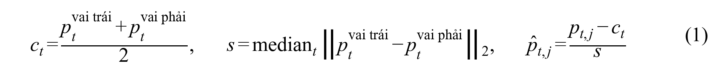

Toạ độ z của bàn tay vốn đã tương đối so với cổ tay nên chỉ chia cho *s*. Mỗi điểm được bổ sung cờ hợp lệ *vt,j ∈ {0, 1}*, tạo tensor đầu vào 4 kênh.

**Chuẩn hoá thời gian.** Clip được nội suy về *T = 64* khung. Phép nội suy không trộn một điểm qua vùng bị mất, nên toạ độ luôn xuất phát từ giá trị quan sát được.

**Tăng cường dữ liệu.** Mỗi lượt huấn luyện áp dụng cắt thời gian ngẫu nhiên 85–95% độ dài clip, co giãn, xoay trong mặt phẳng và thêm nhiễu Gauss. Đề tài **không lật trái phải**, vì tay thuận là một phần của ký hiệu và cách lật có thể làm sai dữ liệu.

#### 6.4. Mô hình phân loại

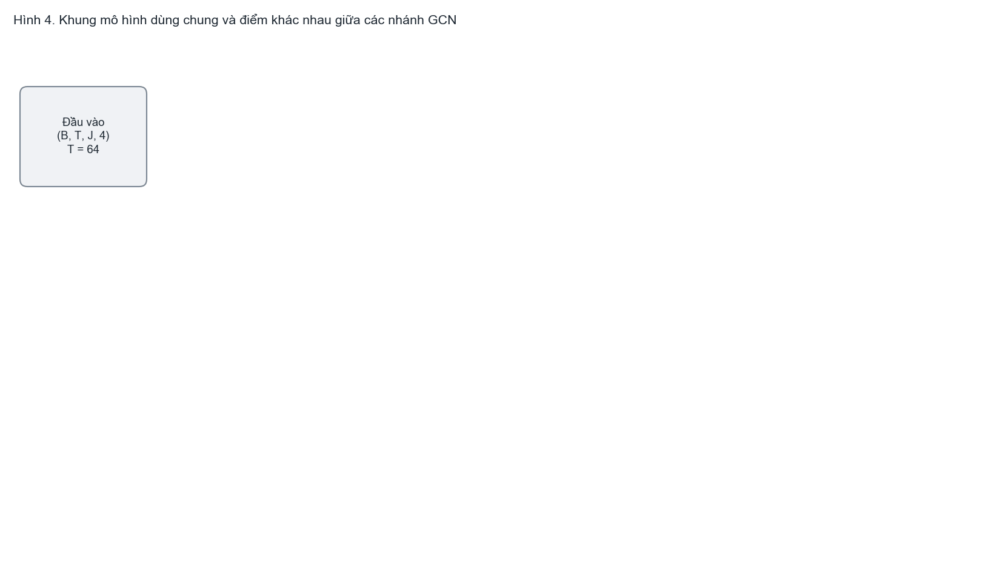

*Hình 4. Khung mô hình dùng chung. Bản in: [PDF](so-do/hinh-4-kien-truc-mo-hinh.pdf)*

Khung xương được biểu diễn bằng đồ thị không gian – thời gian, trong đó khớp là đỉnh, xương là cạnh. Tích chập đồ thị với ba phân vùng lân cận theo ST-GCN [7] có dạng:

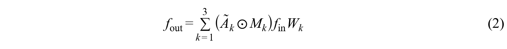

Trong đó *Ãk* là ma trận kề đã chuẩn hoá của phân vùng *k*, *Mk* là trọng số cạnh học được và *Wk* là tham số của phép chiếu.

Các nhóm mô hình được so sánh:

| Nhóm | Mô hình | Vai trò trong nghiên cứu |
|---|---|---|
| Mốc so sánh | MS-TCN [9] | Không dùng đồ thị. Mô hình đồ thị phải vượt được mốc này |
| Đồ thị | ST-GCN [7] | Đồ thị cố định theo cấu trúc cơ thể, là mốc của nhóm GCN |
| Đồ thị | CTR-GCN [8] | Học topo dùng chung và tinh chỉnh theo từng kênh, ít tham số |
| Đồ thị | AAGCN [12] | Học topo từ dữ liệu, có attention |
| Khác họ | Transformer [21] | Có kiểu sai khác với GCN, dùng cho tổ hợp |
| Cải tiến | MultiRate-Attn-STGCN [22] | Ba nhánh 32, 64, 96 khung, gộp bằng attention để giữ chi tiết chuyển động |
| Cải tiến | AnchorGCN | Mô tả điểm tay so với tám mốc ở tai, mắt, miệng, đầu, cổ, vai |

Hàm mất mát là cross-entropy với label smoothing *ε = 0,1*:

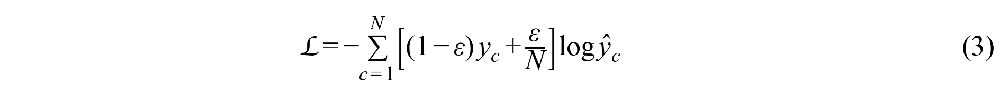

Để giảm các lỗi riêng của từng mô hình, đề tài thử tổ hợp bằng trung bình xác suất của tập mô hình *ℳ*:

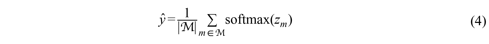

#### 6.5. Thiết lập huấn luyện

Mọi mô hình dùng chung một cấu hình, nên chênh lệch đo được phản ánh kiến trúc chứ không phải cách huấn luyện.

| Tham số | Giá trị |
|---|---|
| Số khung, số epoch | 64 khung, 70 epoch, 5 epoch warmup |
| Bộ tối ưu | SGD, lr 0,1, momentum 0,9, weight decay 4×10⁻⁴. Riêng Transformer dùng AdamW, lr 10⁻³ |
| Batch hiệu dụng | 128, trên 2 GPU T4 với DDP |
| Kỹ thuật ổn định | EMA 0,999, gradient clipping 1,0, AMP |
| Tiêu chí chọn mô hình | Macro-F1 trên tập validation |
| Thí nghiệm cắt bỏ | Mỗi mô hình chạy với J = 68 và J = 76 để trả lời CH2. Các biến thể cải tiến chỉ thay một yếu tố mỗi lần |

#### 6.6. Tách ký hiệu thời gian thực

*Hình 5. Tách ký hiệu từ luồng webcam. Bản in: [PDF](so-do/hinh-5-tach-ky-hieu-thoi-gian-thuc.pdf)*

Dữ liệu huấn luyện là các clip đã cắt sẵn, còn webcam là luồng liên tục, nên cần một bộ phát hiện ranh giới ký hiệu.

- **PoseStateMLP:** mạng MLP nhỏ nhận cửa sổ 3 khung liên tiếp của 26 điểm thân, phân biệt tư thế nghỉ và tư thế đang ký. Nhãn được sinh tự động từ vị trí khung trong clip, có đối chiếu độ cao cổ tay.
- **Hàng đợi cử chỉ:** chuyển trạng thái theo ngưỡng *P(action) = 0,3*. Khi ký hiệu kết thúc, clip được đệm 5 khung nghỉ ở mỗi đầu để giống cách quay dữ liệu huấn luyện.
- **Kiểm soát chất lượng:** khung mất cặp vai hoặc mất quá một bàn tay bị loại. Clip bị yêu cầu ký lại nếu

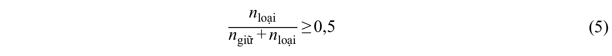

Ngưỡng 0,3 hiện là giá trị khởi đầu và sẽ được hiệu chỉnh trên dữ liệu validation.

#### 6.7. Phương pháp đánh giá

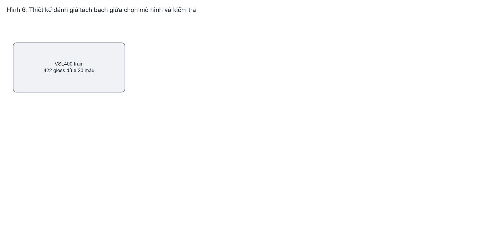

*Hình 6. Thiết kế đánh giá. Bản in: [PDF](so-do/hinh-6-thiet-ke-danh-gia.pdf)*

Tập test chỉ được dùng để kiểm tra lần cuối. Việc chọn checkpoint, siêu tham số và ngưỡng được thực hiện trên tập validation tách từ train, nhằm tránh đánh giá quá lạc quan. Do VSL400 có thông tin người ký [19], đề tài ưu tiên tách theo người ký, vì đây là cách kiểm tra sát thực tế hơn [6].

| Mức | Dữ liệu | Câu hỏi cần trả lời |
|---|---|---|
| 1. Cùng miền | VSL400 test | Mô hình phân biệt tốt đến đâu trong điều kiện giống huấn luyện? |
| 2. Khác miền | Video QIPEDC trên 147 gloss chung với VSL400, 252 clip [17] | Mô hình có tổng quát khi đổi người ký, phông nền và cách quay? |
| 3. Người dùng thật | Người Điếc dùng webcam ở điều kiện đời thường | Sản phẩm có dùng được và có ích không? |

Các chỉ số dưới đây được chia theo năm nhóm. Mỗi nhóm trả lời một câu hỏi riêng, vì một mô hình có độ chính xác cao vẫn có thể chạy chậm, đưa ra độ tin cậy sai hoặc khó dùng với người thật.

**Nhóm 1. Độ chính xác phân loại**

Gọi *M* là số clip kiểm tra, *N* là số gloss, *yi* là nhãn đúng của clip *i* và *Tk(xi)* là tập *k* gloss có xác suất cao nhất do mô hình dự đoán.

**Top-1 và Top-5** cho biết tỷ lệ clip có nhãn đúng nằm trong 1 hoặc 5 dự đoán đầu. Top-1 phản ánh trường hợp ứng dụng tự chọn một từ. Top-5 phản ánh trường hợp người dùng được chọn trong 5 từ gợi ý:

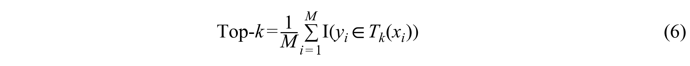

Trong đó *I(·)* bằng 1 khi điều kiện đúng và bằng 0 khi sai.

**Precision và Recall** được tính cho từng gloss *c*. Precision *Pc* trả lời: khi mô hình nói là gloss *c* thì đúng bao nhiêu phần. Recall *Rc* trả lời: trong các clip thực sự là gloss *c*, mô hình nhận ra bao nhiêu phần. Với *TPc*, *FPc*, *FNc* lần lượt là số dự đoán đúng, số dự đoán nhầm sang *c* và số clip của *c* bị bỏ sót:

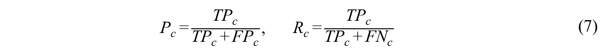

**Macro-F1** là chỉ số chính để chọn mô hình. F1 của mỗi gloss là trung bình điều hoà của *Pc* và *Rc*, sau đó lấy trung bình trên các gloss với trọng số bằng nhau. Nhờ vậy, các gloss ít mẫu ảnh hưởng ngang với gloss nhiều mẫu, trong khi Top-1 có thể bị các gloss nhiều mẫu chi phối. Chỉ số này được báo cáo kèm khoảng tin cậy 95% bằng bootstrap trên các clip kiểm tra:

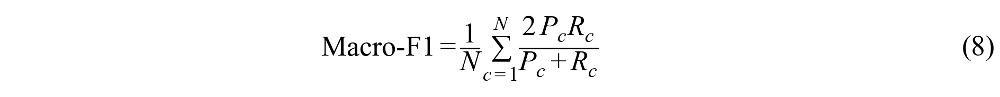

**Tỷ lệ nhầm theo cặp** lấy từ ma trận nhầm lẫn, cho biết gloss *a* bị đoán thành gloss *b* thường xuyên đến đâu. Chỉ số này trả lời CH3 và chỉ ra ký hiệu cần bổ sung thông tin tay so với mặt:

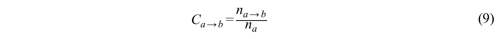

Trong đó *na→b* là số clip của *a* bị đoán thành *b*, còn *na* là tổng số clip của *a*.

**Nhóm 2. Khả năng tổng quát và độ tin cậy**

**Mức suy giảm khác miền** đo phần năng lực bị mất khi đổi nguồn video, phục vụ CH4. Để so sánh công bằng, cả hai vế được tính trên cùng 147 gloss chung, và dự đoán rơi ra ngoài tập này được tính là sai:

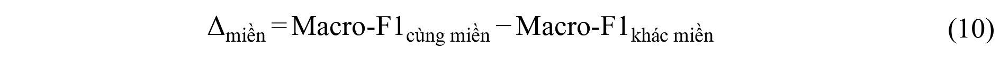

**Sai số hiệu chuẩn kỳ vọng (ECE)** kiểm tra độ tin cậy mà giao diện hiển thị có đáng tin hay không. Các dự đoán được chia thành *B* nhóm theo độ tin cậy, rồi so sánh độ chính xác thực tế với độ tin cậy trung bình của từng nhóm [23]. ECE càng nhỏ càng tốt:

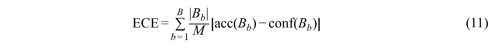

**Độ phủ và độ chính xác có chọn lọc** dùng để đặt ngưỡng từ chối *τ*. Hệ thống chỉ trả lời khi độ tin cậy *≥ τ*, còn lại sẽ đề nghị ký lại. Ngưỡng càng cao thì câu trả lời càng đáng tin nhưng số lần phải ký lại càng nhiều:

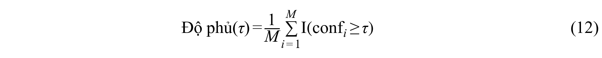

**Tỷ lệ chấp nhận nhầm từ ngoài từ vựng** là tỷ lệ clip thuộc các gloss đã bị lọc, tức mô hình chưa từng học, nhưng vẫn được trả lời với độ tin cậy *≥ τ*. Chỉ số này càng thấp càng tốt.

**Nhóm 3. Chất lượng tách ký hiệu**

Nhóm này đánh giá PoseStateMLP và hàng đợi cử chỉ trên các video ghi nhiều ký hiệu liên tiếp, với ranh giới được gán nhãn thủ công. Một đoạn dự đoán *S* được tính là đúng nếu độ chồng lấp thời gian với đoạn thật *G* đạt ít nhất 0,5:

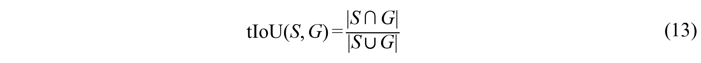

Từ đó tính Precision, Recall và F1 theo đoạn, kèm **số ký hiệu bị bỏ sót**, **số ký hiệu bị gộp hoặc tách nhầm** và **tỷ lệ yêu cầu ký lại**. Chỉ số cuối cùng cho biết toàn hệ thống: tỷ lệ ký hiệu vừa được tách đúng vừa được phân loại đúng.

**Nhóm 4. Hiệu năng triển khai**

| Chỉ số | Cách đo | Ý nghĩa |
|---|---|---|
| Số tham số, dung lượng tệp mô hình | Đếm tham số, đo kích thước checkpoint | Mức độ gọn nhẹ khi đóng gói |
| Thời gian suy luận | Mili giây mỗi clip trên CPU máy tính thường | Khả năng chạy không cần GPU |
| Độ trễ đầu cuối | Từ lúc kết thúc ký hiệu đến khi hiển thị từ, báo trung vị và phân vị 95 | Cảm nhận phản hồi của người dùng |
| Tốc độ xử lý | Số khung hình mỗi giây của toàn luồng, so với 25 khung/giây của dữ liệu huấn luyện | Khả năng theo kịp webcam |
| RAM sử dụng | Bộ nhớ lớn nhất trong khi chạy | Khả năng dùng trên máy cấu hình thấp |

**Nhóm 5. Trải nghiệm người dùng**

Ở mức thử nghiệm với người thật, đề tài ghi nhận **tỷ lệ hoàn thành kịch bản**, **thời gian hoàn thành**, **số lần phải ký lại** và ý kiến định tính qua phỏng vấn có phiên dịch. Mức độ dễ dùng được đo bằng thang SUS gồm 10 câu, mỗi câu chấm từ 1 đến 5 [24]. Câu lẻ mang nghĩa tích cực, câu chẵn mang nghĩa tiêu cực, nên điểm được quy đổi về thang 0–100:

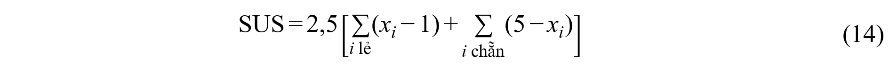

Vì chỉ có 6 người tham gia, các số ở nhóm này chỉ mang tính định tính và không dùng để kết luận cho toàn cộng đồng.

**Tổng hợp chỉ số theo mức kiểm tra**

| Nhóm chỉ số | Mức 1: Cùng miền | Mức 2: Khác miền | Mức 3: Người dùng thật |
|---|---|---|---|
| Top-1, Top-5, Macro-F1 | Có | Có | Top-1 theo từ đã ký |
| Tỷ lệ nhầm theo cặp | Có | Có | Không |
| Mức suy giảm khác miền | Không | Có | Không |
| ECE, độ phủ, chấp nhận nhầm | Có | Có | Không |
| Tách ký hiệu | Không | Không | Có |
| Hiệu năng triển khai | Có | Không | Có |
| Trải nghiệm người dùng | Không | Không | Có |

Với đánh giá khác miền, nhóm sẽ áp dụng các hướng tăng khả năng tổng quát như tiền huấn luyện tự giám sát trên dữ liệu pose, theo kinh nghiệm của OpenHands [14].

#### 6.8. Xây dựng và thử nghiệm sản phẩm

1. Phiên bản 1: ứng dụng máy tính, webcam, hiển thị từ và độ tin cậy.
2. Phiên bản 2: thêm 5 từ ứng viên để người dùng tự chọn khi mô hình không chắc, ghép nhiều từ thành chuỗi và phát giọng nói.
3. Thử nghiệm: mời người Điếc và người nghe thực hiện các kịch bản ngắn, như hỏi đường, gọi món, khai triệu chứng. Bài báo của Bragg và cộng sự nhấn mạnh công việc này cần kết hợp hiểu biết về văn hoá Điếc, không chỉ là kỹ thuật [4], nên người Điếc tham gia từ khâu chọn từ vựng đến khâu đánh giá.

#### 6.9. Kế hoạch thực hiện

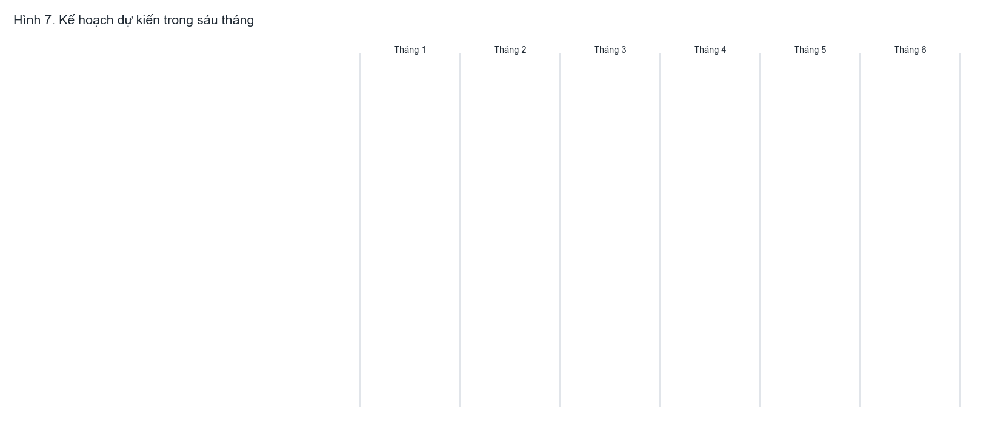

*Hình 7. Kế hoạch dự kiến. Bản in: [PDF](so-do/hinh-7-ke-hoach-thuc-hien.pdf)*

### 7. Kết quả đạt được

#### 7.1. Những gì đã thực hiện

Đến ngày 21/11/2026, nhóm đã huấn luyện **17 mô hình** thuộc 7 họ kiến trúc ở mục 6.4, gồm cả hai cấu hình J = 68 và J = 76, trên GPU đám mây 2 × T4. Checkpoint tốt nhất của từng mô hình được chấm lại trên cùng một quy trình tiền xử lý dùng khi huấn luyện, ở hai mức kiểm tra:

| Mức | Dữ liệu đã dùng | Quy mô |
|---|---|---|
| 1. Cùng miền | VSL400 test, góc chính diện | 5.163 clip, 422 gloss |
| 1. Ngoài từ vựng | Clip test thuộc các gloss bị loại ở bước lọc | 124 clip, 50 gloss |
| 2. Khác miền | Video QIPEDC [17] trên các gloss chung với VSL400 | 252 clip, 147 gloss |

**Lưu ý về mức độ lạc quan.** Thiết kế ở mục 6.7 tách validation khỏi tập test. Trong đợt thực nghiệm này, do giới hạn thời gian GPU, tập test VSL400 được dùng luôn để chọn checkpoint theo Macro-F1, nên các số ở Mức 1 là **cận trên**. Số chấm lại khớp với số lưu trong checkpoint lúc chọn, lệch không quá 0,05 điểm. Dữ liệu QIPEDC không tham gia vào việc chọn mô hình, nên Mức 2 là thước đo khách quan hơn.

Một số lần huấn luyện chưa chạy đủ 70 epoch, đánh dấu \* trong các bảng: ST-GCN J = 68 và J = 76 (dừng ở epoch 65 và 61 do hết thời gian một phiên chạy, lúc tốc độ học đã gần 0), AAGCN J = 68 (đến epoch 33), CTR-GCN J = 68 (checkpoint tốt nhất ở epoch 19), CTR-GCN-BT (đến epoch 47), AnchorGCN-A (48), AnchorGCN-AS (42), AnchorGCN-T32 (39) và hai lần chạy AnchorGCN đầy đủ (14). Kết luận về các mô hình này chỉ là tạm thời.

#### 7.2. Nhóm 1: Độ chính xác phân loại cùng miền

VSL400 test, 5.163 clip, 422 gloss. Khoảng tin cậy 95% của Macro-F1 lấy bằng bootstrap 1.000 lần trên các clip.

| Mô hình | J | Epoch | Tham số | Top-1 (%) | Top-5 (%) | Macro-F1 (%) | CI 95% | Macro-P (%) | Macro-R (%) |
|---|---:|---:|---:|---:|---:|---:|---|---:|---:|
| MS-TCN (mốc) | 68 | 67 | 0,69 M | 92,66 | 98,22 | 93,07 | 92,16–93,53 | 93,58 | 93,15 |
| MS-TCN (mốc) | 76 | 59 | 0,71 M | 92,70 | 98,39 | 93,20 | 92,27–93,62 | 93,73 | 93,21 |
| ST-GCN\* | 68 | 59 | 3,27 M | 94,09 | 98,61 | 94,45 | 93,62–94,86 | 94,85 | 94,50 |
| ST-GCN\* | 76 | 59 | 3,30 M | 94,29 | 98,61 | **94,72** | 93,92–95,10 | 95,04 | 94,76 |
| CTR-GCN\* | 68 | 19 | 1,64 M | 91,42 | 98,26 | 91,85 | 90,85–92,31 | 92,82 | 91,95 |
| CTR-GCN | 76 | 62 | 1,67 M | **94,33** | 98,53 | 94,68 | 93,87–95,05 | 95,04 | 94,73 |
| AAGCN\* | 68 | 32 | 3,92 M | 93,18 | 98,31 | 93,62 | 92,74–94,05 | 94,14 | 93,62 |
| AAGCN | 76 | 40 | 3,95 M | 93,12 | 98,33 | 93,50 | 92,59–93,88 | 93,97 | 93,56 |
| Transformer | 76 | 42 | 5,18 M | 90,78 | 98,02 | 91,33 | 90,25–91,77 | 91,86 | 91,38 |
| MultiRate-Attn-STGCN | 68 | 67 | 5,12 M | 93,76 | 98,30 | 94,12 | 93,22–94,52 | 94,40 | 94,29 |
| MultiRate-Attn-STGCN | 76 | 67 | 5,21 M | 93,49 | 98,26 | 93,78 | 92,89–94,19 | 94,17 | 93,93 |
| CTR-GCN-BT\* | 76 | 42 | 2,26 M | 93,84 | **98,62** | 94,17 | 93,31–94,56 | 94,62 | 94,23 |
| AnchorGCN-A\* | 76 | 48 | 1,68 M | 93,80 | 98,57 | 94,20 | 93,34–94,62 | 94,63 | 94,22 |
| AnchorGCN\* (lần 1) | 76 | 14 | 2,25 M | 86,77 | 96,92 | 87,31 | 85,93–87,75 | 89,09 | 87,50 |
| AnchorGCN\* (lần 2) | 76 | 14 | 2,25 M | 86,31 | 96,75 | 87,04 | 85,68–87,54 | 89,23 | 87,04 |
| AnchorGCN-AS\* | 76 | 38 | 2,51 M | 92,58 | 97,56 | 92,97 | 91,99–93,43 | 93,50 | 92,99 |
| AnchorGCN-T32\* | 76 | 39 | 3,57 M | 92,35 | 97,62 | 92,86 | 91,92–93,21 | 93,44 | 92,83 |

Tổ hợp theo công thức (4), trung bình xác suất các mô hình J = 76:

| Tổ hợp | Tham số | Top-1 (%) | Top-5 (%) | Macro-F1 (%) | CI 95% |
|---|---:|---:|---:|---:|---|
| MS-TCN + ST-GCN | 4,00 M | 94,36 | 98,68 | 94,73 | 93,91–95,08 |
| CTR-GCN + ST-GCN + Transformer | 10,15 M | 94,79 | 98,74 | 95,13 | 94,37–95,51 |
| ST-GCN + CTR-GCN + CTR-GCN-BT + MultiRate | 12,44 M | **95,08** | 98,78 | **95,44** | 94,64–95,81 |
| Cả 12 mô hình J = 76 | 34,53 M | 95,04 | **98,84** | 95,39 | 94,64–95,73 |

Tổ hợp 4 mô hình ở dòng thứ ba là tổ hợp tốt nhất khi dò mọi tổ hợp 2–4 mô hình trên tập test, nên số của nó lạc quan hơn ba dòng còn lại, vốn được định sẵn.

**Nhận xét chung.**

- Mô hình đơn tốt nhất đạt **Top-1 94,3%** (CTR-GCN) và **Macro-F1 94,7%** (ST-GCN và CTR-GCN, chênh nhau 0,04 điểm) trên 422 gloss. Top-5 đạt khoảng 98,5% ở mọi mô hình chính, tức là nếu giao diện đưa ra 5 từ gợi ý thì gần như luôn có từ đúng.
- Tổ hợp nâng Macro-F1 lên 95,4%, hơn mô hình đơn tốt nhất khoảng 0,7 điểm. Số gloss đạt F1 = 1 tăng từ 185 (CTR-GCN) lên 215.
- Phân bố F1 theo gloss của CTR-GCN J = 76: 290 gloss có F1 ≥ 0,95, 64 gloss từ 0,90 đến 0,95, 44 gloss từ 0,80 đến 0,90, 23 gloss từ 0,50 đến 0,80 và 1 gloss dưới 0,50.
- Các gloss yếu nhất của CTR-GCN J = 76 là Con heo (F1 0,48), Dơ (0,53), Thứ ba và Thứ tư (cùng 0,59) và Khóc (0,62). Các cặp nhầm nhiều nhất là Dơ ↔ Con heo (7/15 mỗi chiều), Nhẹ → Bây giờ (6/17), Chị ↔ Cô (5/16 và 4/15), Xôi → Ướt (5/15) và Không cần → Đắng (4/12).

**Trả lời CH1: mô hình đồ thị so với mốc thời gian.** ST-GCN và CTR-GCN J = 76 hơn MS-TCN khoảng 1,5 điểm Macro-F1 (94,72 và 94,68 so với 93,20), và khoảng tin cậy không chồng lấn nhau. Tính theo clip, ST-GCN đúng 4.868 clip so với 4.786 của MS-TCN. Như vậy cấu trúc đồ thị có giúp ích thật. Lợi ích này đi kèm chi phí: CTR-GCN cần gấp 2,4 lần số tham số của MS-TCN và chạy chậm hơn khoảng 20 lần trên CPU (mục 7.5), dù vẫn chỉ khoảng 30 ms mỗi clip. AAGCN chỉ hơn mốc 0,3 điểm, nằm trong sai số, nên attention bổ sung chưa đem lại lợi ích ở quy mô dữ liệu này. CTR-GCN đạt độ chính xác ngang ST-GCN với một nửa số tham số, nên vẫn là ứng viên chính cho sản phẩm.

**Trả lời CH2: vai trò của các điểm chân.**

| Mô hình | Macro-F1 VSL400, J = 68 → 76 | Macro-F1 QIPEDC, J = 68 → 76 |
|---|---|---|
| MS-TCN | 93,07 → 93,20 (+0,13) | 63,25 → 56,43 (−6,82) |
| ST-GCN | 94,45 → 94,72 (+0,27) | 66,52 → 65,03 (−1,49) |
| AAGCN | 93,62 → 93,50 (−0,12) | 67,64 → 66,55 (−1,09) |
| MultiRate-Attn-STGCN | 94,12 → 93,78 (−0,34) | 61,41 → 63,65 (+2,24) |

CTR-GCN không được so vì lần chạy J = 68 chưa xong. Trên VSL400, chênh lệch do thêm chân đều nhỏ hơn độ rộng khoảng tin cậy (khoảng ±0,6 điểm), nên **điểm chân không giúp phân loại một cách có ý nghĩa**. Trên QIPEDC, J = 68 tốt hơn ở 3/4 họ mô hình. Một cách giải thích hợp lý là chân thường bị khuất hoặc nằm ngoài khung hình ở video khác nguồn. Vì vậy, với sản phẩm dùng webcam, bỏ điểm chân là lựa chọn an toàn hơn. Số tham số gần như không đổi giữa hai cấu hình.

**Trả lời CH3: các cặp ký hiệu dễ nhầm.** Bảng dưới đếm số clip nhầm *n/N* trên 8 chiều nhầm tiêu biểu. Cột cuối là tổng của 14 chiều nhầm được theo dõi.

| Mô hình (J = 76) | Dơ → Con heo | Con heo → Dơ | Chị → Cô | Cô → Chị | Nhẹ → Bây giờ | Không cần → Đắng | Xôi → Ướt | Bánh tét → Bánh chưng | Tổng 14 chiều |
|---|---:|---:|---:|---:|---:|---:|---:|---:|---:|
| MS-TCN | 9/15 | 4/15 | 7/16 | 3/15 | 5/17 | 4/12 | 6/15 | 6/14 | 60 |
| ST-GCN | 9/15 | 7/15 | 6/16 | 2/15 | 5/17 | 4/12 | 4/15 | 1/14 | 55 |
| CTR-GCN | 7/15 | 7/15 | 5/16 | 4/15 | 6/17 | 4/12 | 5/15 | 1/14 | 55 |
| CTR-GCN-BT\* | 8/15 | 4/15 | 5/16 | 2/15 | 4/17 | 3/12 | 5/15 | 3/14 | 50 |
| AnchorGCN-A\* | 9/15 | 5/15 | 6/16 | 1/15 | 6/17 | 4/12 | 5/15 | 4/14 | 55 |
| MultiRate-Attn-STGCN | 9/15 | 2/15 | 5/16 | 2/15 | **1/17** | 4/12 | 4/15 | **0/14** | **41** |
| Tổ hợp 4 mô hình | 8/15 | 4/15 | 5/16 | 3/15 | 4/17 | 4/12 | 4/15 | 0/14 | 47 |

- **Mô hình đa tốc độ giải quyết được các cặp khác nhau về nhịp chuyển động.** MultiRate-Attn-STGCN giảm Nhẹ → Bây giờ từ 5–6/17 xuống 1/17, đưa Bánh tét → Bánh chưng về 0, và có tổng số nhầm thấp nhất (41 so với 55 của ST-GCN).
- **Thông tin tay so với mặt mới có tác dụng một phần.** AnchorGCN-A gần như xoá Cô → Chị (1/15), nhưng chiều ngược lại và cặp Dơ ↔ Con heo không đổi. Bản AnchorGCN đầy đủ mới chạy được 14/70 epoch nên chưa kết luận được.
- **Một số cặp không mô hình nào tách được.** Dơ → Con heo vẫn ở mức 7–9/15 với mọi mô hình J = 76 và mọi tổ hợp, còn Không cần → Đắng ở mức 3–4/12 với tất cả mô hình. Giả thuyết của nhóm là các cặp này khác nhau chủ yếu ở biểu cảm khuôn mặt hoặc khẩu hình, trong khi bộ 76 điểm không có điểm chi tiết trên mặt và vùng mặt trong VSL400 đã được khử nhận dạng [19]. Đây là hướng cần bổ sung thông tin ở giai đoạn sau.
- **Tổ hợp mô hình** giảm được các lỗi ngẫu nhiên, nhưng không sửa được những lỗi mà mọi thành viên cùng mắc.

#### 7.3. Nhóm 2: Khả năng tổng quát và độ tin cậy

**Kiểm tra khác miền (CH4).** Mức suy giảm được tính theo công thức (10) trên cùng 147 gloss chung. Dự đoán rơi ra ngoài 147 gloss được tính là sai.

| Mô hình | VSL400 147 gloss: Top-1 / F1 (%) | QIPEDC Top-1 (%) | QIPEDC Top-5 (%) | QIPEDC Macro-F1 (%) | Suy giảm Top-1 | Suy giảm F1 | Dự đoán ra ngoài 147 gloss |
|---|---|---:|---:|---:|---:|---:|---:|
| MS-TCN J = 68 | 93,34 / 95,69 | 59,13 | 71,43 | 63,25 | 36,7% | 33,9% | 25,0% |
| MS-TCN J = 76 | 93,29 / 95,78 | 54,37 | 71,43 | 56,43 | 41,7% | 41,1% | 25,0% |
| ST-GCN J = 68 | 94,88 / 96,74 | 60,71 | 71,03 | 66,52 | 36,0% | 31,2% | 26,2% |
| ST-GCN J = 76 | 95,16 / 96,93 | 59,52 | 71,83 | 65,03 | 37,5% | 32,9% | 24,6% |
| CTR-GCN J = 76 | 95,27 / 97,11 | 59,92 | 71,83 | 64,04 | 37,1% | 34,1% | 23,4% |
| AAGCN J = 68 | 94,28 / 96,37 | **61,11** | **74,21** | **67,64** | **35,2%** | **29,8%** | 24,6% |
| AAGCN J = 76 | 94,06 / 96,12 | 60,71 | 71,43 | 66,55 | 35,5% | 30,8% | 23,8% |
| Transformer J = 76 | 91,80 / 94,77 | 55,56 | 68,65 | 60,65 | 39,5% | 36,0% | 27,8% |
| MultiRate J = 76 | 93,95 / 96,29 | 57,14 | 71,03 | 63,65 | 39,2% | 33,9% | 29,4% |
| CTR-GCN-BT\* | 94,33 / 96,61 | 58,33 | 71,43 | 61,18 | 38,2% | 36,7% | 24,6% |
| AnchorGCN-A\* | 94,66 / 96,67 | 57,94 | 70,24 | 63,60 | 38,8% | 34,2% | 25,8% |
| AnchorGCN-T32\* | 93,12 / 95,67 | 59,92 | 72,62 | 64,49 | 35,7% | 32,6% | 25,8% |
| Tổ hợp 4 mô hình | 95,65 / 97,36 | 61,90 | 72,62 | 66,98 | 35,3% | 31,2% | 23,8% |
| Tổ hợp 12 mô hình | 95,60 / 97,35 | **62,30** | 72,62 | **68,68** | 34,8% | 29,4% | 24,6% |

- Khi đổi nguồn video, mọi mô hình đều mất khoảng **35–42% Top-1**: từ khoảng 94% xuống còn 55–62%. Đây là kết quả quan trọng nhất của đợt thực nghiệm. Độ chính xác cùng miền cao chưa bảo đảm sản phẩm dùng được với người ký mới.
- Khoảng một phần tư số clip QIPEDC bị đoán thành một gloss nằm ngoài 147 gloss chung. Mô hình nhầm sang từ khác hẳn, chứ không chỉ nhầm giữa các từ gần nhau.
- Top-5 trên QIPEDC đạt khoảng 71–74%, cao hơn Top-1 khoảng 12 điểm. Cách giao diện đưa 5 từ ứng viên ở Phiên bản 2 (mục 6.8) vì vậy có ích rõ ràng khi đổi miền.
- Thứ hạng thay đổi khi đổi miền. AAGCN, vốn đứng sau CTR-GCN trên VSL400, lại tổng quát tốt nhất trong các mô hình đơn. CTR-GCN-BT ngang CTR-GCN trên VSL400 nhưng thấp hơn gần 3 điểm Macro-F1 trên QIPEDC. Vì vậy, việc chọn mô hình cho sản phẩm cần dựa thêm vào Mức 2, không chỉ dựa vào Macro-F1 trên VSL400.
- QIPEDC chỉ có 252 clip, khoảng 1–3 clip mỗi gloss, nên khoảng tin cậy rộng (ví dụ CTR-GCN J = 76: Macro-F1 64,0%, CI 57,9–68,2%). Chênh lệch dưới 5 điểm giữa các mô hình ở mức này chưa có ý nghĩa thống kê.

**Hiệu chuẩn, ngưỡng từ chối và từ ngoài từ vựng.** ECE tính với 15 nhóm theo công thức (11). Độ phủ và độ chính xác có chọn lọc tính theo công thức (12). Cột cuối là tỷ lệ chấp nhận nhầm trên 124 clip của 50 gloss mà mô hình chưa từng học.

| Mô hình | ECE VSL400 | ECE QIPEDC | τ = 0,7: phủ / đúng VSL400 | τ = 0,7: phủ / đúng QIPEDC | τ = 0,7: chấp nhận nhầm | τ = 0,9: phủ / đúng VSL400 | τ = 0,9: phủ / đúng QIPEDC | τ = 0,9: chấp nhận nhầm |
|---|---:|---:|---|---|---:|---|---|---:|
| MS-TCN J = 76 | 4,5% | 12,3% | 88,5% / 96,8% | 40,1% / 83,2% | 8,9% | 71,1% / 98,2% | 14,7% / 83,8% | 1,6% |
| ST-GCN J = 76 | 9,3% | 11,9% | 87,6% / 97,5% | 48,4% / 85,2% | 18,5% | 56,5% / 98,4% | 27,0% / 83,8% | 4,8% |
| CTR-GCN J = 76 | 5,0% | 8,4% | 93,3% / 96,8% | 51,6% / 86,9% | 15,3% | 78,7% / 98,3% | 25,4% / 87,5% | 4,8% |
| AAGCN J = 68 | 2,1% | 12,3% | 91,6% / 97,0% | 61,9% / 80,1% | 21,0% | 81,8% / 98,1% | 45,6% / 88,7% | 8,1% |
| CTR-GCN-BT\* | **1,6%** | 17,6% | 93,8% / 96,6% | 66,3% / 79,0% | 25,0% | 85,9% / 97,8% | 53,2% / 87,3% | 8,1% |
| AnchorGCN-A\* | 3,0% | 9,8% | 92,6% / 96,9% | 57,5% / 84,1% | 17,7% | 82,1% / 98,3% | 38,5% / 90,7% | 8,1% |
| MultiRate J = 76 | 7,2% | **7,0%** | 87,8% / 97,5% | 40,1% / 90,1% | 8,9% | 65,8% / 98,7% | 10,3% / 88,5% | 3,2% |
| Tổ hợp 4 mô hình | 7,6% | 9,7% | 90,0% / **98,0%** | 50,0% / **91,3%** | **6,5%** | 70,1% / **99,0%** | 17,5% / 90,9% | **1,6%** |

- **Ngưỡng từ chối có hiệu quả.** Với CTR-GCN và τ = 0,7, hệ thống trả lời 93% số clip VSL400 với độ chính xác 96,8%. Trên QIPEDC, độ chính xác khi trả lời tăng từ 59,9% lên 86,9%, đổi lại hệ thống chỉ trả lời 51,6% số clip và đề nghị ký lại phần còn lại.
- **Hiệu chuẩn tốt trong miền chưa chắc còn tốt khi đổi miền.** CTR-GCN-BT có ECE thấp nhất trên VSL400 (1,6%) nhưng cao nhất trên QIPEDC (17,6%), tức là tự tin quá mức với video lạ. MultiRate giữ ECE ổn định ở cả hai miền (khoảng 7%).
- **Từ ngoài từ vựng** là rủi ro thực tế. Ở τ = 0,7, mô hình đơn vẫn trả lời tự tin cho 9–25% số clip thuộc gloss chưa học. Tổ hợp 4 mô hình giảm tỷ lệ này xuống 6,5% ở τ = 0,7 và 1,6% ở τ = 0,9.
- Từ các số trên, nhóm đề xuất dùng ngưỡng khởi đầu **τ = 0,7** cho sản phẩm, rồi hiệu chỉnh lại trên dữ liệu webcam thật như đã nêu ở mục 6.6.

#### 7.4. Nhóm 3: Chất lượng tách ký hiệu

PoseStateMLP đã được huấn luyện. Mô hình này cùng hàng đợi cử chỉ đã được tích hợp vào chương trình suy luận qua webcam. Tuy nhiên, nhóm **chưa có bộ video nhiều ký hiệu liên tiếp được gán ranh giới thủ công**, nên các chỉ số theo đoạn ở công thức (13) chưa được đo. Đây là hạng mục của giai đoạn thử nghiệm sản phẩm.

#### 7.5. Nhóm 4: Hiệu năng triển khai

Thời gian suy luận đo trên CPU Apple M4 với 4 luồng, PyTorch 2.14, mỗi lần một clip, lấy trung vị của 30 lần chạy. Số này chỉ tính bước phân loại, chưa gồm MediaPipe và bộ tách ký hiệu. Dung lượng là kích thước tệp checkpoint.

| Mô hình (J = 76) | Tham số | Dung lượng tệp | Thời gian suy luận CPU |
|---|---:|---:|---:|
| MS-TCN | 0,71 M | 2,7 MB | 1,4 ms |
| Transformer | 5,18 M | 19,8 MB | 2,7 ms |
| MultiRate-Attn-STGCN | 5,21 M | 20,2 MB | 17,9 ms |
| ST-GCN | 3,30 M | 12,7 MB | 20,6 ms |
| AAGCN | 3,95 M | 15,8 MB | 24,2 ms |
| CTR-GCN-BT | 2,26 M | 8,8 MB | 26,6 ms |
| CTR-GCN | 1,67 M | 6,7 MB | 31,2 ms |
| AnchorGCN-A | 1,68 M | 6,7 MB | 32,8 ms |
| AnchorGCN-AS | 2,51 M | 9,9 MB | 40,5 ms |
| AnchorGCN-T32 | 3,57 M | 14,0 MB | 49,6 ms |
| Tổ hợp 4 mô hình | 12,44 M | 48,4 MB | 96,4 ms |

Mọi mô hình đơn đều phân loại một clip trong dưới 50 ms trên CPU, không cần GPU. Ngay cả tổ hợp 4 mô hình cũng dưới 0,1 giây, nhỏ so với thời gian thực hiện một ký hiệu (trung bình 2,61 giây [19]), nên đáp ứng được yêu cầu chạy trên máy tính thường. Các mô hình đều nhỏ hơn 21 MB. Độ trễ đầu cuối, tốc độ khung hình của toàn luồng và RAM sử dụng sẽ được đo cùng đợt thử nghiệm sản phẩm.

#### 7.6. Nhóm 5: Trải nghiệm người dùng

Chưa thực hiện. Thử nghiệm với người Điếc theo kịch bản ở mục 6.8 được lên lịch sau khi chốt mô hình và ngưỡng từ chối.

#### 7.7. Tổng hợp và hướng tiếp theo

| Nhóm chỉ số | Mức 1: Cùng miền | Mức 2: Khác miền | Mức 3: Người dùng thật |
|---|---|---|---|
| Top-1, Top-5, Macro-F1 | Đã đo, 17 mô hình và 4 tổ hợp (cận trên) | Đã đo, 252 clip | Chưa |
| Tỷ lệ nhầm theo cặp | Đã đo | Đã đo | — |
| Mức suy giảm khác miền | — | Đã đo: 35–42% Top-1 | — |
| ECE, độ phủ, chấp nhận nhầm | Đã đo | Đã đo | — |
| Tách ký hiệu | — | — | Đã tích hợp, chưa đo |
| Hiệu năng triển khai | Đã đo phần phân loại | — | Chưa đo đầu cuối |
| Trải nghiệm người dùng | — | — | Chưa |

**Kết quả chính.**

1. Trên VSL400 với 422 gloss, mô hình đơn tốt nhất (CTR-GCN J = 76) đạt **Top-1 94,3%, Top-5 98,5%, Macro-F1 94,7%**, và tổ hợp đạt Macro-F1 95,4%. Các con số này là cận trên vì tập test được dùng để chọn checkpoint.
2. Mô hình đồ thị vượt mốc MS-TCN khoảng 1,5 điểm Macro-F1 với khoảng tin cậy không chồng lấn (CH1). CTR-GCN đạt mức này với 1,67 triệu tham số.
3. Điểm chân không đem lại lợi ích có ý nghĩa, và còn làm giảm khả năng tổng quát ở 3/4 họ mô hình (CH2).
4. Mô hình đa tốc độ giảm rõ các lỗi do khác nhịp chuyển động. Cặp Dơ ↔ Con heo và Không cần → Đắng vẫn chưa mô hình nào tách được (CH3).
5. Khi đổi sang video QIPEDC, Top-1 còn 55–62%, và Top-5 khoảng 72% (CH4). Ngưỡng τ = 0,7 đưa độ chính xác khi trả lời lên khoảng 87–91%, đổi lại phải đề nghị ký lại khoảng một nửa số lần.
6. Mọi mô hình đều chạy dưới 50 ms mỗi clip trên CPU, đủ cho sản phẩm thời gian thực.

**Hướng tiếp theo.**

- Tách validation theo người ký từ tập train để có số liệu cùng miền không lạc quan.
- Chạy xong các lần huấn luyện còn dở, đặc biệt là AnchorGCN đầy đủ và CTR-GCN J = 68.
- Ưu tiên giảm mức suy giảm khác miền bằng tăng cường dữ liệu mô phỏng điều kiện webcam và tiền huấn luyện tự giám sát [14].
- Bổ sung thông tin khuôn mặt cho các cặp còn nhầm.
- Đo chất lượng tách ký hiệu và trải nghiệm người dùng.

Cho Phiên bản 1 của sản phẩm, nhóm chọn **CTR-GCN J = 76** làm mô hình mặc định, vì mô hình này có độ chính xác cao, nhỏ gọn và hiệu chuẩn tốt ở cả hai miền. Khi máy đủ mạnh, sản phẩm chuyển sang **tổ hợp 4 mô hình** để giảm số lần chấp nhận nhầm.

Mã đánh giá và số liệu gốc của mục này được lưu trong kho mã tại `reports/ket-qua-2026-11-21/`.

## IV. Thị trường

**Lĩnh vực:** công nghệ hỗ trợ người khuyết tật, thuộc giao thoa của thị giác máy tính và xử lý ngôn ngữ ký hiệu.

**Đối tượng phục vụ**

| Đối tượng | Mục đích sử dụng |
|---|---|
| Người Điếc, người khiếm thính | Giao tiếp với người không biết ký hiệu trong các tình huống hằng ngày |
| Gia đình, giáo viên, người học ký hiệu | Luyện tập và kiểm tra ký hiệu |
| Bệnh viện, ngân hàng, cơ quan hành chính | Hỗ trợ tại quầy tiếp đón |
| Trường học, trung tâm giáo dục đặc biệt | Công cụ dạy và học |
| Nhà nghiên cứu | Dùng mã nguồn và mô hình làm nền tảng |

**Khả năng tiêu thụ:** ở giai đoạn này sản phẩm là bản demo nghiên cứu, chưa có kế hoạch kinh doanh nên chưa thể ước tính số lượng hay doanh thu mỗi năm. Nếu tiếp tục phát triển, mô hình phù hợp là miễn phí cho cá nhân và thu phí triển khai, tuỳ biến cho tổ chức.

**Nghiên cứu thị trường:** ý tưởng **chưa được nghiên cứu, thăm dò thị trường**. Nhóm dự kiến tự thực hiện như sau:

| Nội dung | Kế hoạch |
|---|---|
| Người thực hiện | Nhóm đề tài, phối hợp với hội người Điếc hoặc trung tâm giáo dục đặc biệt |
| Địa điểm | Bắt đầu từ các đơn vị tại địa phương của nhóm |
| Đối tượng | Người Điếc, gia đình, giáo viên, nhân viên quầy dịch vụ |
| Phạm vi | Nhu cầu giao tiếp, tình huống ưu tiên, từ vựng cần có, mức sẵn lòng sử dụng |
| Phương pháp | Phỏng vấn sâu có phiên dịch, phiếu khảo sát dạng video ký hiệu, quan sát khi dùng thử |
| Kết quả | Sẽ cập nhật sau khi khảo sát |

## V. Nguồn lực thực hiện ý tưởng

### 1. Tài chính

Tổng kinh phí được giới hạn trong **3.000.000 VNĐ** cho sáu tháng. Để gói gọn trong mức này, đề tài dùng tài nguyên miễn phí và thử nghiệm ở quy mô nhỏ. Các đơn giá dưới đây là ước tính.

| Hạng mục | Tính toán | Kinh phí (VNĐ) | Ghi chú |
|---|---|---:|---|
| GPU huấn luyện | Miễn phí | 0 | Chỉ dùng hạn mức GPU miễn phí, không thuê thêm |
| Dữ liệu | Miễn phí | 0 | Dùng VSL400 và nguồn video đã công bố, không tự thu thêm |
| Máy tính, webcam | Sẵn có | 0 | Dùng thiết bị của nhóm |
| Thù lao người tham gia thử nghiệm | 6 người × 200.000 | 1.200.000 | Thử nghiệm định tính quy mô nhỏ |
| Phiên dịch ngôn ngữ ký hiệu | 1 buổi | 1.000.000 | Gộp khảo sát nhu cầu và thử nghiệm vào cùng một buổi |
| Đi lại, in ấn phiếu khảo sát | Trọn gói | 500.000 | |
| Dự phòng | | 300.000 | |
| **Tổng** | | **3.000.000** | |

### 2. Nhân sự

| Vai trò | Số người | Yêu cầu |
|---|---:|---|
| Nghiên cứu học sâu | 1–2 | Vững PyTorch, thị giác máy tính |
| Phát triển ứng dụng | 1 | Xây dựng giao diện và đóng gói |
| Cố vấn cộng đồng Điếc | 1 (tình nguyện) | Người Điếc thành thạo ngôn ngữ ký hiệu, tư vấn và kiểm tra nhãn |
| Phiên dịch viên | 1 (thuê theo buổi) | Hỗ trợ buổi khảo sát và thử nghiệm |

### 3. Công nghệ

| Nhóm | Thành phần |
|---|---|
| Huấn luyện | GPU đám mây (2 × T4), Python, PyTorch, huấn luyện phân tán DDP |
| Trích xuất | MediaPipe Pose và Hands, OpenCV |
| Dữ liệu | VSL400, video QIPEDC |
| Thiết bị suy luận | Máy tính cá nhân có webcam, không cần cảm biến chuyên dụng |

## VI. Quản lý rủi ro

| Nhóm | Rủi ro | Biện pháp ngăn chặn, xử lý |
|---|---|---|
| Công nghệ | Mô hình giảm chất lượng khi đổi người ký, phông nền, ánh sáng | Kiểm tra khác miền từ sớm; dùng khung xương thay vì ảnh; cho phép tinh chỉnh theo người dùng |
| Công nghệ | Khác biệt ký hiệu giữa các miền [13] | Công bố rõ biến thể mô hình đã học; hiển thị Top-5 thay vì một đáp án |
| Công nghệ | Các cặp ký hiệu gần giống nhau | Phân tích ma trận nhầm; bổ sung thông tin tay so với mặt; hỏi lại người dùng khi xác suất thấp |
| Công nghệ | Từ ngoài bộ từ vựng bị đoán thành một từ quen thuộc | Thêm ngưỡng từ chối; hiển thị độ tin cậy; nói rõ giới hạn từ vựng |
| Công nghệ | Mặt đã khử nhận dạng trong dữ liệu [19] làm sai lệch điểm trên mặt | Kiểm tra chất lượng điểm mặt; tái tạo vị trí mặt theo khối cứng; so sánh với video webcam thật |
| Công nghệ | Bộ trích xuất mất điểm do che khuất, tay nhanh | Dùng cờ hợp lệ và nội suy; yêu cầu ký lại khi mất quá nhiều khung |
| Công nghệ | Độ trễ cao trên máy yếu | So sánh số tham số; chọn mô hình nhẹ; tối ưu xuất mô hình |
| Dữ liệu, pháp lý | Vi phạm Thoả thuận sử dụng dữ liệu VSL400 [19] | Đọc kỹ thoả thuận; không phân phối lại dữ liệu; chỉ công bố mô hình khi được phép |
| Dữ liệu, pháp lý | Lộ hình ảnh người tham gia | Xin đồng ý bằng văn bản; xử lý tại máy; chỉ lưu khung xương khi có thể |
| Tài chính | Hết hạn mức GPU miễn phí | Lưu checkpoint để huấn luyện tiếp; ưu tiên thí nghiệm theo câu hỏi nghiên cứu |
| Tài chính | Kinh phí 3 triệu đồng chỉ đủ thử nghiệm nhỏ | Xem kết quả thử nghiệm là định tính; tìm tình nguyện viên qua trường, hội người Điếc; không kết luận chung cho cộng đồng |
| Xã hội | Sản phẩm không sát nhu cầu, hoặc bị coi là thay thế phiên dịch viên | Có người Điếc trong nhóm từ đầu; nêu rõ đây là công cụ hỗ trợ |
| Xã hội | Hiểu sai trong tình huống quan trọng | Khuyến cáo không dùng cho y tế, pháp lý nếu không có người kiểm chứng |
| Môi trường | Không đáng kể do là phần mềm | Hạn chế huấn luyện lại không cần thiết để giảm điện năng |
| Tiến độ | Thí nghiệm kéo dài, khó tìm người thử nghiệm | Liên hệ đối tác từ tháng đầu; đặt các mốc kiểm tra theo Hình 7 |

## Tài liệu tham khảo

[1] World Health Organization. *WHO: 1 in 4 people projected to have hearing problems by 2050*. 2021. <https://www.who.int/news/item/02-03-2021-who-1-in-4-people-projected-to-have-hearing-problems-by-2050>

[2] Cục Thống kê, Bộ Tài chính. *Thông cáo báo chí về kết quả Điều tra người khuyết tật năm 2023*. 2024. <https://www.nso.gov.vn/tin-tuc-thong-ke/2024/11/thong-cao-bao-chi-ve-ket-qua-dieu-tra-nguoi-khuyet-tat-nam-2023/>

[3] World Bank. *How Vietnam Opened New Doors for Deaf Children*. 2022. <https://www.worldbank.org/en/news/feature/2022/11/17/how-vietnam-opened-new-doors-for-deaf-children>

[4] D. Bragg et al. "Sign Language Recognition, Generation, and Translation: An Interdisciplinary Perspective." *ACM SIGACCESS Conference on Computers and Accessibility (ASSETS)*, 2019. <https://arxiv.org/abs/1908.08597>

[5] D. Li, C. Rodriguez Opazo, X. Yu, H. Li. "Word-level Deep Sign Language Recognition from Video: A New Large-scale Dataset and Methods Comparison." *IEEE Winter Conference on Applications of Computer Vision (WACV)*, 2020. <https://arxiv.org/abs/1910.11006>

[6] S. Jiang, B. Sun, L. Wang, Y. Bai, K. Li, Y. Fu. "Skeleton Aware Multi-modal Sign Language Recognition." CVPR 2021 Challenge on Large Scale Signer Independent Isolated Sign Language Recognition, 2021. <https://arxiv.org/abs/2103.08833>

[7] S. Yan, Y. Xiong, D. Lin. "Spatial Temporal Graph Convolutional Networks for Skeleton-Based Action Recognition." *AAAI Conference on Artificial Intelligence*, 2018, pp. 7444–7452. <https://arxiv.org/abs/1801.07455>

[8] Y. Chen, Z. Zhang, C. Yuan, B. Li, Y. Deng, W. Hu. "Channel-Wise Topology Refinement Graph Convolution for Skeleton-Based Action Recognition." *IEEE/CVF International Conference on Computer Vision (ICCV)*, 2021, pp. 13359–13368. <https://openaccess.thecvf.com/content/ICCV2021/html/Chen_Channel-Wise_Topology_Refinement_Graph_Convolution_for_Skeleton-Based_Action_Recognition_ICCV_2021_paper.html>

[9] Y. Abu Farha, J. Gall. "MS-TCN: Multi-Stage Temporal Convolutional Network for Action Segmentation." *IEEE/CVF Conference on Computer Vision and Pattern Recognition (CVPR)*, 2019, pp. 3575–3584. <https://arxiv.org/abs/1903.01945>

[10] F. Zhang et al. "MediaPipe Hands: On-device Real-time Hand Tracking." 2020. <https://arxiv.org/abs/2006.10214>

[11] V. Bazarevsky, I. Grishchenko, K. Raveendran, T. Zhu, F. Zhang, M. Grundmann. "BlazePose: On-device Real-time Body Pose Tracking." CVPR Workshop on Computer Vision for Augmented and Virtual Reality, 2020. <https://arxiv.org/abs/2006.10204>

[12] L. Shi, Y. Zhang, J. Cheng, H. Lu. "Skeleton-Based Action Recognition with Multi-Stream Adaptive Graph Convolutional Networks." *IEEE Transactions on Image Processing*, 2020. DOI: 10.1109/TIP.2020.3028207. <https://arxiv.org/abs/1912.06971>

[13] T. Dang, I. A. Bessmertny. "ViSL One-shot: generating Vietnamese sign language data set." *Scientific and Technical Journal of Information Technologies, Mechanics and Optics*, 2024. <https://openbooks.itmo.ru/read_ntv/22753/22753.pdf>

[14] P. Selvaraj et al. "OpenHands: Making Sign Language Recognition Accessible with Pose-based Pretrained Models across Languages." *Annual Meeting of the Association for Computational Linguistics (ACL)*, 2022. <https://arxiv.org/abs/2110.05877>

[15] M.-H. Ha, D.-C. Nguyen, T.-K. Dinh, T. Tien-Tam, D. T. Thanh, O. T.-C. Chen. "Deep Learning Based Graph Convolutional Network Using Hand Skeletal Points For Vietnamese Sign Language Classification." *Iranian Journal of Electrical and Electronic Engineering*, 22(1), 2026, pp. 106–117. DOI: 10.22068/IJEEE.22.1.3717. <https://ijeee.iust.ac.ir/article-1-3717-en.html>

[16] N. S. Dinh et al. "Sign Language Recognition: A Large-Scale Multi-View Dataset and Comprehensive Evaluation." *IEEE/CVF Winter Conference on Applications of Computer Vision (WACV)*, 2025, pp. 7876–7886. <https://openaccess.thecvf.com/content/WACV2025/html/Dinh_Sign_Language_Recognition_A_Large-Scale_Multi-View_Dataset_and_Comprehensive_Evaluation_WACV_2025_paper.html>

[17] Lakeserl. *SignConnect: Vietnamese Sign Language Dataset* (video từ QIPEDC), Hugging Face. <https://huggingface.co/datasets/Lakeserl/SignConnect>

[18] T. Nguyen Quoc et al. "VSL400: A Multi-view Dataset for Vietnamese Word-Level Sign Language Recognition." Preprint, Authorea. DOI: 10.22541/au.177075292.21810740/v1. <https://www.authorea.com/doi/full/10.22541/au.177075292.21810740/v1>

[19] T. Nguyen Quoc, K. Pham Dang, V. Truong Duy, V. Truong Hoang, S. Bilik, M. Sindelar, J. Stefansky, A. Łysiak, R. Martinek, P. Bilik. *A Multi-view Dataset for Vietnamese Word-Level Sign Language Recognition* (v1) [Data set]. Zenodo, 2026. DOI: 10.5281/zenodo.17943574. <https://zenodo.org/records/17943574>

[20] L. Shi, Y. Zhang, J. Cheng, H. Lu. "Two-Stream Adaptive Graph Convolutional Networks for Skeleton-Based Action Recognition." *IEEE/CVF Conference on Computer Vision and Pattern Recognition (CVPR)*, 2019, pp. 12026–12035. <https://arxiv.org/abs/1805.07694>

[21] M. Boháček, M. Hrúz. "Sign Pose-Based Transformer for Word-Level Sign Language Recognition." *IEEE/CVF Winter Conference on Applications of Computer Vision Workshops (WACVW)*, 2022, pp. 182–191. DOI: 10.1109/WACVW54805.2022.00024. <https://openaccess.thecvf.com/content/WACV2022W/HADCV/html/Bohacek_Sign_Pose-Based_Transformer_for_Word-Level_Sign_Language_Recognition_WACVW_2022_paper.html>

[22] C. Feichtenhofer, H. Fan, J. Malik, K. He. "SlowFast Networks for Video Recognition." *IEEE/CVF International Conference on Computer Vision (ICCV)*, 2019, pp. 6202–6211. <https://arxiv.org/abs/1812.03982>

[23] C. Guo, G. Pleiss, Y. Sun, K. Q. Weinberger. "On Calibration of Modern Neural Networks." *International Conference on Machine Learning (ICML)*, PMLR 70, 2017, pp. 1321–1330. <https://proceedings.mlr.press/v70/guo17a.html>

[24] J. Brooke. "SUS: A Quick and Dirty Usability Scale." In *Usability Evaluation in Industry*, P. W. Jordan et al. (eds.), Taylor & Francis, 1996, pp. 189–194.
